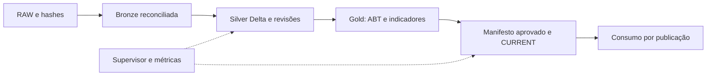

# Credit Risk Lakehouse

Laboratório de Engenharia e Análise de Dados com Python, PySpark, Delta Lake e
armazenamento S3 local. Constrói uma base analítica por caso de crédito, calcula
indicadores mensais e demonstra como corrigir, publicar e reproduzir resultados.
Destina-se a quem estuda dados e a quem quer avaliar as decisões de engenharia.

A pergunta de negócio é: como descrever população, desfecho e cobertura das
informações de crédito sem duplicar casos ao juntar tabelas históricas? A pergunta
de engenharia é: quais arquivos, regras e versões produziram cada resultado?

## Estado da entrega

**F00–F11 concluídas: 72/72 itens aceitos no escopo local.** A documentação,
a demonstração e a reprodução por comandos foram conferidas em autorrevisão. O [roteiro](docs/ROTEIRO_EXECUCAO_LAKEHOUSE.md)
controla o aceite; as evidências registram comandos, resultados e limites.
A CI está configurada e foi reproduzida localmente. Não houve job remoto,
commit/tag, push, envio de mensagens ou publicação externa nesta entrega.

## O que foi construído



A ingestão preserva valores e proveniência. Contratos verificam schema, chaves,
nulos, referências e datas. O incremento aplica revisões por chave, rejeita
conflitos e confere o resultado contra reconstrução integral. A Gold agrega o
histórico antes de juntar as fontes: uma linha da ABT corresponde a um caso.

Delta garante transações por tabela. O protocolo de publicação da aplicação
reúne três Silver e duas Gold em um manifesto aprovado; o consumidor só passa
para o conjunto novo após validação. Falhas privadas conservam a publicação
anterior. Os leitores podem consultar manifestos antigos explicitamente.

F03–F07 preservam referências em filesystem. F08 executa Delta via Hadoop S3A no
SeaweedFS; F09 acrescenta operação supervisionada. O controle de escritor vale
para um host/driver cooperante. [Arquitetura](docs/entrega/ARQUITETURA.md).

## Executar sem acesso ao Home Credit

Em Linux x86_64, com Python 3, bash e acesso de rede para baixar dependências:

```bash
bash scripts/bootstrap_environment.sh
bash scripts/bootstrap_analysis.sh
bash scripts/bootstrap_objects.sh
```

Os scripts instalam Python 3.11.14, Java 17.0.21+9, Spark 3.5.7, Delta 3.3.2 e
SeaweedFS 4.53 em diretórios locais, usando versões e hashes declarados. Não
substituem o Python do sistema. Spark usa `local[2]` e driver de 2 GiB; deixe
memória adicional para JVM, Python e serviço S3. Isso descreve a configuração,
não um mínimo de hardware validado.

Para a demonstração curta com dados inventados, use um destino ainda inexistente:

```bash
bash scripts/objects.sh scripts/demo_portfolio.py --output artifacts/minha-demo
bash scripts/analysis.sh scripts/render_demo.py --output artifacts/minha-demo
```

Consulte os CSVs, `report.json` e `correction.png` nessa pasta. A demonstração
começa em Silver tipada, publica Gold, corrige auxiliares, injeta falha após
commit privado, retoma e lê a versão inicial. O prefixo S3 de teste é removido.
[Sequência e resultados esperados](docs/entrega/DEMONSTRACAO.md).

Para executar o fluxo sintético completo desde RAW:

```bash
bash scripts/project.sh scripts/run_tests.py --suite e2e --integration-required
```

Para checks e regressão integral:

```bash
bash scripts/project.sh scripts/check_code.py
bash scripts/project.sh scripts/run_tests.py --integration-required
bash scripts/project.sh scripts/check_acceptance.py --report artifacts/tests/report.json
```

A F10 aprovou **153 testes obrigatórios, zero ignorados**, em ambiente instalado
do zero, incluindo Spark, Delta e S3 reais. A [matriz T01–T24](docs/testes/MATRIZ_ACEITACAO.md)
está aprovada. Os cenários internos dos subprocessos não são somados novamente
a esse total. [CI e isolamento](docs/testes/EXECUCAO_E_CI.md).

## Dados reais e resultados locais

A fonte usada no desenvolvimento é Home Credit. O acesso autenticado e os
arquivos selecionados foram verificados; os dados não acompanham o repositório.
As condições registradas não autorizam redistribuição geral. Consulte
[fonte e limites](docs/governance/SOURCE.md) antes de adquirir ou divulgar dados.
A demonstração e a CI usam somente dados inventados.

| Produto local aprovado | Resultado observado |
|---|---|
| Recorte determinístico | 50.000 casos e 215.390 observações históricas relacionadas |
| Gold | ABT de 50.000 linhas e 19 colunas; 22 meses de indicadores |
| Análise retrospectiva | 1.578 target=1 entre 50.000 rótulos válidos; cobertura histórica 80,152% |
| Recuperação | Reenvio, correção, atraso, falha/retomada e leitura histórica verificados |
| Ajuste F10 | Leitura tipada de sete pacotes para um; cinco tabelas iguais; 259,7→185,2 s no ensaio |

O ganho de tempo foi medido uma vez por variante; não é SLA ou benchmark
estatístico. A taxa de desfecho e a cobertura descrevem esse recorte, sem
inferência sobre uma carteira real. Unidades monetárias não foram confirmadas.
As chegadas, correções e revisões incrementais são simulações declaradas.

[Resultados e método analítico](docs/analise/RESULTADOS.md),
[dicionário ABT](docs/contratos/ABT.md), [evidência F10](docs/evidencias/F10_ACEITACAO.md).
O relatório F07 continua ligado às publicações filesystem que o originaram;
a existência do S3 não muda seu consumidor automaticamente.

A reprodução real exige acesso próprio à fonte e as etapas de
[aquisição e ambiente](docs/AMBIENTE_LOCAL.md), [recorte](docs/RECORTE_E_LOTES.md)
e [operação](docs/operacao/COMANDO_UNICO.md). O comando operacional consome
entradas locais já aprovadas; não baixa os dados por conta própria.

## Estudar e conferir

Comece pelo [guia de estudo](docs/GUIA_ESTUDO_LAKEHOUSE.md): são 12 capítulos
sobre tecnologias, ferramentas e processos, usando o código e as evidências do
projeto como exemplos. Para uma leitura rápida, siga arquitetura → contratos →
demonstração → matriz de testes.

| Assunto | Referência |
|---|---|
| Regras e modelo | [Contratos](docs/contratos/README.md), [ABT](docs/contratos/ABT.md) |
| Operação | [Comando](docs/operacao/COMANDO_UNICO.md), [erros/retry](docs/operacao/ESTADOS_E_ERROS.md), [métricas](docs/operacao/METRICAS.md) |
| Rastreio | [Lineage](docs/operacao/LINEAGE_E_INVENTARIO.md), [resumo](docs/operacao/RESUMO_OPERACIONAL.md) |
| Armazenamento | [Decisão S3 local](docs/objetos/DECISAO_E_ARQUITETURA.md), [manutenção](docs/objetos/OPERACAO.md) |
| Decisões e avanço | [Decisões](docs/DECISOES.md), [roteiro](docs/ROTEIRO_EXECUCAO_LAKEHOUSE.md) |

A ABT é retrospectiva: não comprova disponibilidade dos atributos no momento da
decisão e não é uma base de treino validada. Não há modelo preditivo, streaming,
CDC da origem, cluster distribuído, serviço de produção ou recursos AWS provisionados.
O notebook histórico conserva outputs por ser entrada vinculada por hash; o
export de código os remove na cópia. Não publique o working tree original sem
a revisão de divulgação. A licença do código não concede direitos sobre o dataset.

## Entrega F11

A [demonstração](docs/entrega/DEMONSTRACAO.md) passou e foi repetida em cópia nova:
os seis CSVs coincidiram por hash. O [pacote sintético local](artifacts/f11/credit-risk-portfolio-synthetic-final.tar.gz)
contém 194 arquivos auditados, sem dados restritos, credenciais ou outputs históricos.
[Evidência F11](docs/evidencias/F11_ENTREGA.md),
[conclusão técnica](docs/entrega/CONCLUSAO_TECNICA.md) e
[aprendizados/backlog/AWS](docs/entrega/EVOLUCAO_E_AWS.md).
O pacote é gerado localmente e não acompanha um clone Git por estar em artifacts.
