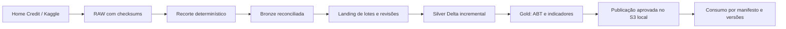

# Credit Risk Lakehouse

Pipeline local de dados de crédito com **Python, PySpark, Delta Lake e S3 local
(SeaweedFS)**. Adquire dados reais do Home Credit, preserva a origem, valida
contratos, processa revisões incrementais e publica uma base analítica por caso
(ABT) e indicadores mensais.

A reprodução detalhada abaixo corresponde ao MVP de três fontes e parte da
aquisição autenticada até tabelas Delta publicadas. A expansão executada está
resumida a seguir e tem comandos e evidências próprios. Não depende de notebook, de IDs de uma execução anterior ou de dados
incluídos no repositório.



## Documentação

Para avaliar a solução, siga [arquitetura](docs/entrega/ARQUITETURA.md),
[reprodução](docs/entrega/REPRODUCAO.md) e
[resultados e limitações](docs/analise/PUBLICO_EXPANSAO.md).
O [índice completo](docs/README.md) reúne contratos, decisões, operação e evidências.
O [percurso didático](docs/GUIA_ESTUDO_LAKEHOUSE.md) é uma leitura opcional.

## Dados e escopo executado

Fonte: competição **Home Credit — Credit Risk Model Stability**, no Kaggle.
É necessário acesso próprio à competição e autenticação da API. Os dados e
credenciais ficam locais, fora do Git. [Fonte e condições de uso](docs/governance/SOURCE.md).

A expansão utiliza **todas as 17 tabelas lógicas de treino**, em 32 Parquets e
um dicionário, sem amostragem por capacidade de hardware. Os casos são
selecionados pela data de decisão; seus históricos relacionados são preservados.

| Produto atual da expansão | Resultado executado |
|---|---|
| Bronze / Silver | 447.305 casos de janeiro–setembro/2020; 17 Silver Delta |
| ABT de desenvolvimento | 259.695 casos de janeiro–maio/2020 |
| ABT de avaliação temporal | 187.610 casos de junho–setembro/2020 |
| Atributos | 166 retrospectivos; features e labels separadas |
| Análise de público | Nove meses; cinco tabelas analíticas e gráficos |
| Publicação S3 local | 42 Delta, CURRENT nos dados originais e histórico simulado separado |

A finalidade é retrospectiva. O leitor ML permanece bloqueado
(`ml_ready=false`): disponibilidade histórica, maturação do target e identidade
global de clientes entre períodos ainda precisam de comprovação.
[Evidências da expansão](docs/README.md#expansão).

### MVP preservado e reproduzido abaixo

| Entrada lógica | Papel |
|---|---|
| `train_base` | Caso, data de decisão e rótulo `target` |
| `train_static_0` | Atributos em relação 1:1 com o caso |
| `train_applprev_1` | Histórico em relação 0:N com o caso |

A aquisição baixa seis arquivos: as três tabelas completas selecionadas, com seus
shards, e `feature_definitions.csv`. Depois, a pipeline seleciona **50 mil casos
por hash e seed fixos**, preservando todas as linhas auxiliares relacionadas.
A RAW permanece intacta. A política está em [sample_policy.yaml](configs/sample_policy.yaml).

Os dados de negócio são reais. As chegadas em lotes, duas correções auxiliares,
reenvios e um caso atrasado são **simulações declaradas** sobre esse recorte.
Não há CDC fornecido pela competição. A ABT é retrospectiva; não é uma base de
treino com disponibilidade temporal dos atributos validada.

## Requisitos

- Linux x86_64 ou WSL2, Bash, Python 3 e acesso à rede para dependências e dados.
- Conta Kaggle com acesso à competição.
- Memória e disco para RAW, recorte, estados Delta, reconstruções e objetos locais.

Os scripts instalam Python 3.11.14, Java 17.0.21+9, Spark 3.5.7, Delta 3.3.2 e
SeaweedFS 4.53 em `.venv/` e `.runtime/`, com versões e hashes declarados.
Não é necessário instalar Spark separadamente ou usar Docker.

A configuração padrão do MVP usa `local[2]`, driver de 2 GiB e quatro partições de
shuffle. A expansão tem [perfil próprio de 8 GiB](configs/spark_expansion.yaml),
com execução e capacidade medidas na E01/E07. Um ensaio anterior de replay S3 consumiu pico RSS somado de 6,08 GiB e
levou aproximadamente 18 minutos; isso é referência observada, não requisito
mínimo nem previsão para a sequência completa. [Ambiente](docs/AMBIENTE_LOCAL.md).

## Reproduzir o MVP com Home Credit real

Execute na raiz do repositório, no mesmo terminal Bash. Cada etapa deve terminar
com código zero antes da próxima. Não execute dois processos Spark em paralelo.
Os comandos guardam as respostas JSON desta reprodução em uma pasta própria;
os logs de diagnóstico continuam aparecendo no terminal.

### 1. Instalar e conferir o ambiente

```bash
bash scripts/bootstrap_environment.sh
bash scripts/bootstrap_analysis.sh
bash scripts/bootstrap_objects.sh

export JAVA_HOME="$PWD/.runtime/java/jdk-17.0.21+9-jre"
bash scripts/project.sh -m src.pipelines.check_environment
```

O check deve concluir a prova de escrita, merge e leitura histórica Delta.
Relatório: `artifacts/environment_check.json`.

Prepare a pasta da reprodução e uma função para ler campos das respostas:

```bash
set -euo pipefail
REPRO_DIR=$(mktemp -d "$PWD/artifacts/repro-home-credit-XXXXXXXX")

json_field() {
  .venv/bin/python - "$1" "$2" <<'PY'
import json
import sys
from pathlib import Path
value = json.loads(Path(sys.argv[1]).read_text())
for key in sys.argv[2].split('.'):
    value = value[key]
print(value)
PY
}
```

### 2. Autenticar e adquirir a RAW

Se as credenciais já estiverem configuradas, siga para o download. Caso contrário,
execute e cole o token Kaggle no prompt oculto do terminal:

```bash
bash scripts/project.sh scripts/configure_kaggle_token.py
```

```bash
bash scripts/project.sh -m src.pipelines.download_home_credit
```

A aquisição publica arquivos sem sobrescrever a origem e registra checksums em
`data/raw/_acquisition/`. Reexecuções verificam e reutilizam arquivos existentes.
Fonte alterada ou arquivo sem manifesto bloqueiam o processamento para investigação.

### 3. Materializar o recorte e a Bronze

```bash
bash scripts/project.sh -m src.pipelines.build_sample \
  > "$REPRO_DIR/sample.json"
SAMPLE=$(json_field "$REPRO_DIR/sample.json" selection_id)

bash scripts/project.sh -m src.pipelines.run_bronze_mvp \
  --sample "$SAMPLE" > "$REPRO_DIR/bronze.json"

cat "$REPRO_DIR/sample.json"
cat "$REPRO_DIR/bronze.json"
```

O recorte valida os contratos da origem e da seleção. A Bronze precisa retornar
`status: passed`, com qualidade e reconciliação de valores/proveniência aprovadas.
O `selection_id` é calculado a partir da fonte, configuração e implementação;
não copie um ID de outra instalação.

### 4. Preparar e validar os incrementos

```bash
bash scripts/project.sh -m src.pipelines.run_incremental_demo \
  --sample "$SAMPLE" > "$REPRO_DIR/incremental.json"
F04_REPORT=$(json_field "$REPRO_DIR/incremental.json" report)

cat "$REPRO_DIR/incremental.json"
```

Esse comando materializa a landing imutável, aplica sete pacotes em Silver local
e confere deduplicação, precedência, retry, atraso e equivalência com reconstrução.
O relatório precisa indicar `status: passed`. Ele é a entrada explícita da
operação S3; esta etapa não publica Gold.

### 5. Processar Silver e Gold no S3 local

```bash
bash scripts/objects.sh -m src.pipelines.operate_lakehouse \
  --sample "$SAMPLE" \
  --source-report "$F04_REPORT" \
  --mode rebuild \
  --max-attempts 2 --retry-delay 2 \
  > "$REPRO_DIR/operation.json"

cat "$REPRO_DIR/operation.json"
```

`rebuild` cria um estado novo para a operação e processa todos os pacotes.
O supervisor inicia o SeaweedFS, cria a sessão Spark/S3A, espelha as entradas,
executa Silver, compara com reconstrução independente e publica Gold após as
validações. O serviço iniciado pela operação é parado ao final; os objetos
persistem em `data/object-store/seaweedfs`.

Sucesso exige **`status: passed` e `exit_code: 0`**. Inspecione o relatório
operacional e o relatório do processamento referenciado por ele:

```bash
OPERATION_REPORT=$(json_field "$REPRO_DIR/operation.json" report)
cat "$OPERATION_REPORT"
```

O relatório de processamento registra `publication_id`, `registry`, contagens,
versões Delta e provas de reconstrução. A publicação contém **três tabelas Silver
e duas Gold**: `gold.abt` e `gold.monthly_metrics`. O registro fica sob
`operational-publications/<selection_id>` no prefixo S3 configurado.

### 6. Conferir as tabelas publicadas

A verificação abaixo acessa os objetos e valida arquivos, UUIDs, versões e linhas
com Spark. O serviço precisa estar ativo para essa consulta:

```bash
bash scripts/objects.sh -m src.object_store.service start
bash scripts/objects.sh -m src.pipelines.operational_status \
  --sample "$SAMPLE" --verify-tables
bash scripts/objects.sh -m src.object_store.service stop
```

A consulta deve terminar com código zero e registrar nível de verificação
`delta_tables`. Um resumo offline ou somente a existência de arquivos não
comprova a integridade da publicação.

## Reexecutar e atualizar

Para reaplicar os pacotes ao estado operacional correspondente, preservando
as regras de revisão e os recibos:

```bash
bash scripts/objects.sh -m src.pipelines.operate_lakehouse \
  --sample "$SAMPLE" --source-report "$F04_REPORT" --mode replay
```

Para acompanhar a chegada por etapas, em uma identidade de estado ainda sem
lotes posteriores aplicados:

```bash
bash scripts/objects.sh -m src.pipelines.operate_lakehouse \
  --sample "$SAMPLE" --source-report "$F04_REPORT" \
  --mode update --batch b00_w000_051
```

`update` aplica todos os pacotes até o limite informado. Não aceita regredir
um estado que já recebeu pacotes posteriores. Uma nova invocação `rebuild`
cria outra operação; mudanças em código/configuração também podem criar outra
identidade. [Modos](docs/operacao/COMANDO_UNICO.md) e [retry/erros](docs/operacao/ESTADOS_E_ERROS.md).

## Gerar o relatório analítico com gráficos

A pipeline S3 acima entrega as tabelas publicadas. O gerador HTML atual consome
um registro separado em filesystem e exige três publicações explícitas para
comparar baseline, correção e atraso. Para reproduzir também essa entrega,
continue no mesmo terminal:

```bash
bash scripts/project.sh -m src.pipelines.run_publication_demo \
  --sample "$SAMPLE" --f04-report "$F04_REPORT" \
  > "$REPRO_DIR/publication.json"
F05_REPORT=$(json_field "$REPRO_DIR/publication.json" report)

bash scripts/project.sh -m src.pipelines.run_gold_demo \
  --sample "$SAMPLE" --f05-report "$F05_REPORT" \
  > "$REPRO_DIR/gold.json"

BASELINE=$(json_field "$REPRO_DIR/gold.json" publications.baseline)
CORRECTED=$(json_field "$REPRO_DIR/gold.json" publications.corrected)
FINAL=$(json_field "$REPRO_DIR/gold.json" publications.late)

bash scripts/analysis.sh -m src.pipelines.run_analysis \
  --sample "$SAMPLE" --baseline "$BASELINE" \
  --corrected "$CORRECTED" --publication "$FINAL" \
  > "$REPRO_DIR/analysis.json"

cat "$REPRO_DIR/analysis.json"
```

As demonstrações de publicação exercitam falha controlada, retry e leitura
histórica. O relatório final informa `output`, com `report.html`, `report.md`,
seis CSVs, gráficos e `semantic.json`. Consuma apenas uma pasta com
`_SUCCESS.json` aprovado. Repetir a análise com as mesmas publicações permite
comparar resultados semânticos; horários e IDs de tentativa podem variar.
[Detalhes da reprodução analítica](docs/analise/EXECUCAO.md).

## Resultados observados do MVP e critérios de sucesso

| Critério | Resultado registrado no recorte validado |
|---|---|
| População | 50.000 casos e 215.390 observações históricas relacionadas |
| Gold | ABT com 50.000 linhas e 19 colunas; indicadores de 22 meses |
| Qualidade | Contratos e reconciliação de valores/proveniência aprovados |
| Incremental | Correções, duplicatas, revisão antiga e atraso verificados |
| Recuperação | Falha/retry e reprodução histórica aprovados |

Esses números descrevem a execução documentada. Uma reprodução deve conferir
seus próprios relatórios e manifestos. Alterar fonte, recorte, contratos ou
código pode mudar identidades e resultados. O rótulo descreve o dataset;
não representa uma taxa operacional de uma carteira real.

## Testes e alternativa sem acesso à competição

Após os três bootstraps, execute os checks e a regressão com integrações reais:

```bash
bash scripts/project.sh scripts/check_code.py
bash scripts/project.sh scripts/run_tests.py --integration-required
bash scripts/project.sh scripts/check_acceptance.py --report artifacts/tests/report.json
bash scripts/project.sh scripts/check_expansion_acceptance.py --report artifacts/tests/report.json
```

A evidência histórica F10 registra **153 testes obrigatórios, zero ignorados**, em ambiente
novo. A expansão tem uma [matriz adicional X01–X17](docs/testes/MATRIZ_EXPANSAO.md),
com e2e sintético próprio e integração à CI. A [E08](docs/evidencias/E08_ACEITACAO_EXPANSAO.md)
registra **174 testes aprovados, zero ignorados**, com Spark, Delta, S3 e os dois
e2e no ambiente local existente. A CI está declarada; a entrega registra reprodução local, sem job remoto
executado. [Execução dos testes](docs/testes/EXECUCAO_E_CI.md).

Sem credenciais Home Credit, é possível verificar o fluxo completo com fixtures
inventadas, de RAW até Gold S3:

```bash
bash scripts/project.sh scripts/run_tests.py --suite e2e --integration-required
```

Essa alternativa executa os dois fluxos: MVP e expansão. A expansão usa cinco
fontes inventadas de níveis 0/1/2 e publica 18 Delta em um prefixo temporário S3;
a entrega real usa as 17 fontes e publica 42 Delta. Nenhum acesso ao Kaggle é
necessário nesses testes. A sequência principal deste README reproduz o MVP;
os comandos da expansão estão nas evidências E02–E07.

## Decisões e limites

A expansão para todas as tabelas de treino, novas janelas de 2020 e preparação
para ML está documentada no [índice da expansão](docs/README.md#expansão).
A expansão já tem [17 Silver Delta](docs/evidencias/E03_SILVER_EXPANSAO.md) e
[duas ABTs retrospectivas](docs/evidencias/E05_ABTS_TEMPORAIS.md): 259.695 casos
para desenvolvimento e 187.610 para avaliação, com 166 atributos e labels
separadas. A [auditoria temporal](docs/evidencias/E04_ATRIBUTOS_E_TEMPO.md) mantém
o uso para ML bloqueado por falta de comprovação de disponibilidade histórica
e maturação do target. A [análise de público](docs/analise/PUBLICO_EXPANSAO.md) e a
[publicação S3 ampliada](docs/evidencias/E07_PUBLICACAO_EXPANSAO.md) estão
concluídas: 42 Delta no prefixo `lakehouse-expansion-v1`, com CURRENT nos dados
originais, recuperação e consumidor independente validados. Os comandos e resultados das seções de reprodução acima correspondem ao MVP;
os detalhes da expansão estão nas evidências vinculadas.

Delta fornece transações por tabela. O protocolo da aplicação reúne três Silver
e duas Gold em manifesto aprovado e só então ativa o ponteiro CURRENT.
Uma falha privada mantém a última publicação aprovada; uma falha após a ativação
exige consultar CURRENT antes de concluir qual publicação está vigente.

A solução foi validada em um host/driver com escritores cooperantes. Não há
cluster distribuído, streaming, modelo preditivo, agendador ou recursos AWS
provisionados. A expansão usa contratos, tratamentos e definições analíticas próprios,
documentados em [Silver e ABTs](docs/contratos/EXPANSAO_SILVER_E_ABT.md). Dados reais e derivados permanecem locais;
a entrega pública preparada utiliza dados sintéticos.

| Referência | Conteúdo |
|---|---|
| [Arquitetura](docs/entrega/ARQUITETURA.md) | Componentes e garantias |
| [Contratos](docs/contratos/README.md) / [ABT](docs/contratos/ABT.md) | Grãos, chaves, regras e colunas |
| [Operação S3](docs/objetos/OPERACAO.md) | Serviço, persistência e manutenção |
| [Lineage](docs/operacao/LINEAGE_E_INVENTARIO.md) | Origem e versões dos resultados |
| [Matriz de aceitação](docs/testes/MATRIZ_ACEITACAO.md) / [expansão](docs/testes/MATRIZ_EXPANSAO.md) | Cenários T01–T24 e X01–X17 |
| [Evidências da entrega](docs/README.md#evidências-do-mvp) | 72 itens aceitos no escopo local |
| [Guia de estudo](docs/GUIA_ESTUDO_LAKEHOUSE.md) | Leitura guiada da implementação |
