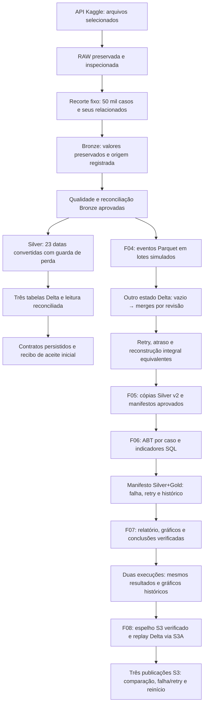

# Curso aplicado — Engenharia e Análise de Dados com Credit Risk Lakehouse

Este guia ensina as tecnologias, ferramentas e processos usados no projeto,
usando sua implementação como estudo de caso. Ao concluir o percurso, você deve
conseguir explicar o que foi construído, acompanhar o código e justificar as
decisões que levam às entregas finais.

A sequência começa pelo problema e avança até operação e análise. Os termos
novos são apresentados antes dos trechos de código que dependem deles. Cada
capítulo contém explicação, exemplo, leitura guiada da implementação, evidência
e uma atividade com resultado esperado.

## O que você vai aprender

Você vai relacionar seis perguntas em cada assunto:

1. **Qual problema precisamos resolver?** A necessidade que motivou a etapa.
2. **Qual conceito explica a solução?** O conhecimento de engenharia ou análise.
3. **Qual ferramenta executa esse papel?** Python, Spark, Parquet, Delta e outras.
4. **Como implementamos aqui?** Funções, configuração e fluxo dos dados reais.
5. **Como sabemos que funcionou?** Contratos, testes, métricas e reconciliação.
6. **O que isso permite entregar?** A ligação com as próximas etapas e o produto.

Por exemplo, estudar Delta envolve entender tabelas e versões, observar como
`materialize_initial` grava e verifica as três tabelas Silver, e explicar por
que um commit Delta ainda precisa de validação antes do aceite operacional.

## Percurso de estudo

Os capítulos seguem uma ordem de aprendizagem. Os códigos F00–F11 identificam
fases de implementação no roteiro; não são números de aulas.

| Ordem | Capítulo | Conhecimento principal | Relação com a execução |
|---|---|---|---|
| 1 | [Produto e arquitetura](estudo/01_PRODUTO_E_ARQUITETURA.md) | Produto de dados, pipeline, DW, Lake e Lakehouse | Objetivo F00; visão até F11 |
| 2 | [Dados, relacionamentos e SQL](estudo/02_DADOS_E_SQL.md) | Grão, chave, nulos, cardinalidade, joins e agregações | Fonte/contratos F00; ABT F06 |
| 3 | [Python, ambiente e Git](estudo/03_PYTHON_AMBIENTE_E_GIT.md) | Módulos, configuração, dependências, Java e reprodução | Ambiente F01; todas as pipelines |
| 4 | [Spark e arquivos Parquet](estudo/04_SPARK_E_PARQUET.md) | DataFrames, ações, execução preguiçosa, partições e formatos | Processamento F01–F03 |
| 5 | [Aquisição, recorte e Bronze](estudo/05_INGESTAO_E_BRONZE.md) | API, ingestão, seleção determinística, staging e retry | RAW/recorte/Bronze F00–F02 |
| 6 | [Contratos, qualidade e reconciliação](estudo/06_QUALIDADE_E_GOVERNANCA.md) | Schema, profiling, regras, proveniência e igualdade dos dados | Aceites F02/F03 |
| 7 | [Transformação e Silver](estudo/07_TRANSFORMACOES_SILVER.md) | Tipos, datas, nulos e controle de perdas | Regras e tratamentos F03.1–F03.3 |
| 8 | [Delta e execução Silver](estudo/08_DELTA_E_EXECUCAO.md) | Log transacional, versões, imutabilidade, locks e evolução | F03.4–F03.6; migração F05 |
| 9 | [Incremento e correções](estudo/09_INCREMENTO_E_CORRECOES.md) | Eventos, revisões, deduplicação, merge e idempotência | Protocolo F02.4 e incremento F04 validados |
| 10 | [Gold, indicadores e análise](estudo/10_GOLD_E_ANALISE.md) | ABT, denominadores, cobertura, tempo e interpretação | Gold F06; análise e reprodução F07 |
| 11 | [Operação e armazenamento](estudo/11_OPERACAO_E_STORAGE.md) | Orquestração, observabilidade, publicação, recuperação e objetos | Publicação F05/F06; objetos F08; comando F09.1; estados F09.2; métricas F09.3; lineage F09.4; resumo F09.5 e matriz F09.6 validados |
| 12 | [Testes, CI e entrega](estudo/12_TESTES_E_ENTREGA.md) | Fixtures, oráculos, integração, automação e evidências | CI e aceitação F10; entrega F11 |

Leia os capítulos em sequência na primeira passagem. Cada um aponta para o
próximo. As leituras de aprofundamento são opcionais e ficam no final de cada
capítulo, para que você não precise alternar entre muitos documentos durante
uma explicação.

## Continuação: expansão Home Credit

O percurso original acima explica o MVP. O [capítulo 13](estudo/13_EXPANSAO_E_VALIDACAO_TEMPORAL.md)
acompanha as 17 fontes, os recortes de 2020, as ABTs retrospectivas e as provas
E00–E08. Ele distingue integração completa de fontes, reprodução do software e
aprovação temporal para ML; são verificações diferentes.

## Como estudar um capítulo

Primeiro, leia a explicação e acompanhe o exemplo pequeno. Em seguida, siga a
seção de leitura guiada: ela informa qual função abrir e o que observar. Depois,
consulte a evidência indicada para relacionar o comportamento do código com o
resultado medido. Termine pela atividade e compare com a conferência.

Uma anotação útil reúne: conceito, papel da ferramenta, decisão neste projeto,
arquivo que demonstra a decisão e resultado esperado. Dúvidas devem apontar o
elo que ainda falta entender: a regra, a sintaxe, a execução ou a interpretação.

Exemplo de anotação após o capítulo 7:

> Uma conversão pode produzir um nulo novo. Aqui, `transform_table` mede essa
> perda antes de aceitar a Silver. O recorte teve 23 colunas de datas convertidas
> sem perdas. A regra preserva a possibilidade de investigar a origem.

Os trechos de código didáticos são identificados como tal. Snippets que usam
`spark`, DataFrames ou views pressupõem uma sessão preparada e os dados
mencionados no capítulo. Comandos completos informam seu ambiente e efeito.
Exemplos inventados não representam resultados da Home Credit.

## Como reconstruir mentalmente o que já foi executado

Depois dos capítulos 1–11, acompanhe este caminho. Cada saída torna-se entrada
ou evidência da etapa seguinte:

Estado após F11: **72/72 itens**, F00–F11 aceitas no escopo local.
A demo inventada foi reproduzida em cópia nova e o pacote sintético auditado.
A base F10 inclui 153 testes em ambiente novo e matriz T01–T24.
SeaweedFS, S3A e Delta executaram o replay e as publicações com comparação
integral ao filesystem, recuperação e persistência após reinício.
A Silver incremental contém **50.000 casos**, **50.000 registros estáticos** e
**215.390 observações históricas**, com duas correções auxiliares declaradas.
A Gold reúne **50.000 linhas ABT e 22 meses de indicadores**, em publicações
coerentes que fixam três Silver e duas Gold. Datas e identificadores estão
nas evidências; estes números descrevem o recorte atual. A análise F07 apresenta
1.578 target=1 entre 50 mil rótulos válidos e cobertura histórica de 80,152%,
com denominadores e limites explícitos, sem inferência sobre uma carteira real.

A carga Silver F03 usou o snapshot completo para provar persistência e contratos.
A F04 preservou esse pacote e começou outro estado vazio, recebendo somente o
primeiro lote na carga inicial. Novos casos, correções, duplicatas, revisão
antiga e atraso foram processados e reconciliados com reconstrução independente.
Essa aplicação real amplia a prova sintética inicial de merge do ambiente.

Para conferir as execuções, leia as evidências:

| Etapa | Resultado e papel didático |
|---|---|
| [F04](evidencias/F04_INCREMENTAL.md) | Replay de eventos e merge; 18 min 59 s, pico RSS somado 5,06 GiB |
| [F05](evidencias/F05_PUBLICACAO.md) | Migração de schema, CURRENT, falha/retry, rollback e retenção; 3 min 44 s |
| [F06](evidencias/F06_GOLD.md) | Agregação por caso, correções auxiliares e SQL mensal; 3 min 13 s, pico RSS somado 2,95 GiB |
| [F07](evidencias/F07_ANALISE.md) | Consumo por publicações, gráficos e interpretação; 49,844 s, pico RSS somado 2,29 GiB; reprodução byte a byte |
| [F08](evidencias/F08_OBJETOS.md) | SeaweedFS/S3A, replay e publicações reconciliadas com filesystem; 18 min 8 s, pico RSS somado 6,08 GiB incluindo servidor |

Essas durações incluem várias validações, cópias e provas, além dos merges.
F05 preserva três snapshots Silver; F06 deriva três publicações analíticas.
Em ambas, uma falha privada mantém a publicação aprovada anterior. Consultar
baseline por manifesto reproduz o resultado antigo; restaurar late seleciona
novamente o resultado atual. A reprodução é demonstrada, sem apagar história.

A linha de base F08 aprovou **129 verificações, sem ignorados**, incluindo
cinco suítes Delta (15/9/9/8/10 cenários, com S3A) e uma suíte analítica Spark (seis).
Os seis verificadores de subprocesso já fazem parte do total do runner.
As duas execuções reais reproduziram 19 arquivos de resultados. A F09 acrescentou
testes direcionados e a [matriz operacional](evidencias/F09_MATRIZ_OPERACIONAL.md)
com cinco cenários reais. A [F10](evidencias/F10_ACEITACAO.md) consolidou
153 testes obrigatórios sem ignorados em instalação nova e um e2e totalmente
sintético. A CI está configurada, sem execução remota nesta sessão.

## Entrega concluída e evolução opcional

Os capítulos 9–12 explicam contratos, consumo, operação e entrega. A
[demonstração](entrega/DEMONSTRACAO.md) e a [nota técnica](entrega/CONCLUSAO_TECNICA.md)
fecham o escopo. Trabalhos futuros ficam no [backlog](entrega/EVOLUCAO_E_AWS.md).

As entregas devem permitir responder tanto a uma pergunta analítica quanto à
pergunta de engenharia: “Quais entradas, regras e versões produziram esse número?”
Modelo preditivo, feature store, retreinamento e AWS ficam para evolução posterior.

## Papel dos documentos

| Documento | Quando usar |
|---|---|
| Este guia e seus 12 capítulos | Aprender e conectar conceitos, ferramentas e implementação |
| [Roteiro de execução](ROTEIRO_EXECUCAO_LAKEHOUSE.md) | Conferir tarefas, dependências e estado atual |
| [Decisões](DECISOES.md) | Consultar por que uma alternativa foi escolhida |
| [Objetos F08](evidencias/F08_OBJETOS.md), [análise F07](evidencias/F07_ANALISE.md), [Gold](evidencias/F06_GOLD.md) e [publicação](evidencias/F05_PUBLICACAO.md) | Conferir comandos e resultados medidos; cada capítulo indica a sua |
| [Referência detalhada](REFERENCIA_ESTUDO_LAKEHOUSE.md) | Aprofundar um assunto nas aulas técnicas preservadas |

As aulas da referência foram escritas em momentos diferentes do desenvolvimento.
Para o estado atual, use este percurso, o roteiro e a evidência da entrega.
Os capítulos recebem explicação e leitura guiada conforme novas etapas forem
implementadas; o material de aprendizagem precisa acompanhar o projeto.

**Comece pelo [capítulo 1 — Produto e arquitetura](estudo/01_PRODUTO_E_ARQUITETURA.md).**
