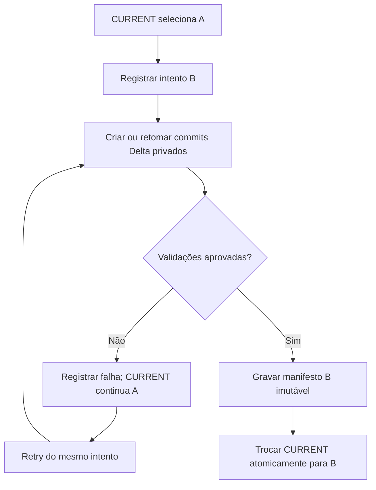

# Publicação, recuperação e retenção locais — F05

Implementação: [protocol.py](../src/publication/protocol.py),
[evolution.py](../src/publication/evolution.py),
[retention.py](../src/publication/retention.py).

## O que é publicado

Um manifesto imutável reúne paths, UUIDs, versões Delta, schemas, chaves,
contagens, checksums, validações, entradas e proveniência. O arquivo
`_CURRENT.json` aponta para um manifesto aprovado, com seu hash. Cada registry
tem seu próprio CURRENT: Silver em F05, e a publicação analítica completa em F06.

Dados de uma tentativa ficam privados enquanto são gravados e validados.
Somente o manifesto e o ponteiro autorizam consumo. Não há descoberta de tabela
por pasta ou uso implícito da maior versão Delta.

| Artefato | Local |
|---|---|
| Registry Silver | `artifacts/publications/<selection_id>/silver/` |
| Intentos e tentativas | `intents/`, `owners/` e `runs/` dentro do registry |
| Manifestos aprovados | `manifests/<publication_id>.json` |
| Ponteiro e ativações | `_CURRENT.json` e `activations/` |
| Código/configuração arquivados | `blobs/<sha256>` |
| Tabelas Silver | `data/silver/samples/<selection_id>/published/<publication_id>/` |

`publication_id` deriva da identidade de entrada/implementação. UUID Delta
identifica uma tabela; versão Delta identifica seu estado; versão de contrato
identifica regras; `batch_id` e revisão pertencem à origem; `run_id` identifica
uma tentativa. Retry usa novo run_id e o mesmo intento quando a entrada é igual.

## Visibilidade e um escritor

O lock exclusivo do registry é local, cooperativo e não bloqueante. O consumidor
mantém o contexto `open_publication` durante suas ações Spark. Sem CURRENT,
a leitura inicial falha explicitamente com `NoPublicationError`.

O manifesto só é criado após as validações. Em seguida, um arquivo temporário
completo substitui CURRENT com `os.replace` no mesmo filesystem; o ponteiro e
o diretório são sincronizados. Não há transação Delta entre as três tabelas:
a publicação seleciona um conjunto coerente de commits já concluídos.

Essas garantias se referem ao filesystem POSIX do laboratório e às falhas de
processo exercitadas. Não demonstram equivalência em objetos ou garantia de
hardware após perda de energia. A adaptação do destino permanece em F08.

Exemplo do caminho de uma publicação nova B quando A já foi aprovada:



Se a falha ocorrer após gravar o manifesto e antes de trocar CURRENT, o
manifesto existe, mas A continua selecionada. O retry verifica B antes de
ativá-la. Após a troca de CURRENT, B já foi publicada.

## Retomar sem apagar resultado válido

O intento registra um token antes das escritas; os commits Delta são marcados
com esse token, tabela e etapa. Depois de falhar, a retomada inspeciona o log
e o conteúdo: uma cópia ou migração já concluída não é executada outra vez.

Diretório existente sem vínculo é recusado. Apenas arquivos não commitados de
um diretório privado pertencente ao intento podem ser descartados no retry;
qualquer log de commit existente impede essa limpeza. Publicações aprovadas
nunca são sobrescritas nem limpas por essa recuperação.

Falha antes/depois de um commit, entre tabelas ou após qualidade reprovada
mantém CURRENT anterior. Falha depois do manifesto e antes do ponteiro deixa
um manifesto íntegro ainda não ativo; retry o verifica e ativa. Se o ponteiro
já foi trocado antes da falha do registro final, a publicação nova já está
aprovada: retry reconhece o commit e não pressupõe rollback automático.

## Ler versões anteriores e recuperar publicação

`open_publication(repo, registry, spark, publication_id)` seleciona explicitamente
um manifesto histórico. Sem o ID, usa CURRENT. A leitura confere integridade e
usa `versionAsOf` para cada tabela. Não devolva planos para executar fora do contexto.

`activate_publication` verifica um manifesto já aprovado e troca CURRENT para
ele. Retornar a uma publicação anterior não regrava tabelas nem altera sua
história. Uma nova ativação é registrada, e a restauração ao estado posterior
usa o mesmo procedimento. Isso não implementa SCD tipo 2.

## Proveniência e reprodução

Os snapshots de entrada fixam o relatório F04, lote, hashes de pacote/recibo,
UUIDs e versões de origem, além da coorte e da edição RAW. Código, configurações
e contratos são copiados para blobs por hash. Consultar uma publicação anterior
não exige que os arquivos atuais de código continuem na mesma revisão.

Para reconstruir, preserve também RAW, recorte, landing, relatórios de entrada,
blobs e dependências. A restauração de um ambiente antigo a partir desses
artefatos é uma operação explícita; a leitura histórica não executa código antigo.

## Retenção e manutenção

A política fixa 30 dias para retenção Delta de log e arquivos removidos. Todas
as versões de publicações aprovadas ficam adicionalmente **fixadas por tempo
indeterminado**, até uma retirada explícita que considere seus consumidores.
Isso inclui os arquivos/logs e manifestos de entrada necessários ao replay.

O protocolo não oferece VACUUM de dados reais. `audit_retention` verifica todas
as publicações, arquivos e versões iniciais preservadas. Como as tabelas
publicadas são imutáveis, não recebem novos commits que disparem manutenção.

A prova destrutiva `retention_fixture(spark)` cria sua própria tabela temporária;
não recebe path do usuário. VACUUM com 720 horas preserva a versão inicial
recente. Somente nessa fixture a proteção é desabilitada para VACUUM 0, provando
que remover arquivos históricos torna a versão antiga ilegível. A configuração
da sessão é restaurada e a versão atual continua correta. Não simulamos o
transcurso real de 30 dias nem alegamos uma janela histórica já decorrida.

Antes de qualquer manutenção futura, auditar os pins e suas referências. Uma
política de descarte real exige uma nova decisão; não apagar blobs, manifestos,
arquivos Delta, RAW ou landing para liberar espaço durante este laboratório.

## Executar

```bash
bash scripts/project.sh -m src.pipelines.run_publication_demo \
  --sample 7d58bbdaa00cbabfbce54d26 \
  --f04-report artifacts/f04/runs/20261113T020347Z_1609747b.json
```

O comando publica baseline, correção e atraso, demonstra falha/retry e rollback,
audita retenção e executa a limpeza somente na fixture interna. Os snapshots
fixados são 3/3/3, 3/4/4 e 4/5/5 na origem F04; a cópia gerenciada migra para v2.
Relatórios operacionais ficam em `artifacts/f05/runs/`.
