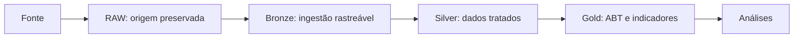

# Referência detalhada — Credit Risk Lakehouse

Este documento preserva o guia extenso e as aulas acumuladas durante a
implementação. O percurso atual está no
[curso aplicado de Engenharia e Análise de Dados](GUIA_ESTUDO_LAKEHOUSE.md),
com 12 capítulos que conectam conceitos, ferramentas, código e evidências.
Consulte esta referência por assunto; a numeração original e as aulas históricas
abaixo descrevem a organização e o estado de cada entrega na época.

Guia de estudo aplicado ao projeto de Frederico Costa. Iniciado em 12/11/2026.

Este material explica a construção do projeto; o
[roteiro de execução](ROTEIRO_EXECUCAO_LAKEHOUSE.md) controla tarefas e conclusão.
O objetivo é conseguir implementar, testar e explicar cada escolha, além de
executar comandos. O guia cobre o escopo deste laboratório e serve de base para
aprofundamento; ele não presume experiência de produção com essas ferramentas.

## Como estudar e acompanhar

Para cada módulo: leia o conceito, abra o arquivo indicado, faça o exercício,
compare com o resultado esperado e registre a explicação com suas palavras.
Não é preciso aprender toda a stack antes de começar. Estude o assunto da fase
atual e use o resultado da fase como exercício prático.

Código existente é indicado por links. Nomes de tabelas e arquivos ainda não
implementados aparecem como **propostos**. Exemplos de dados neste guia são
**sintéticos**, não resultados da Home Credit. Exemplos SQL dependem de registrar
as tabelas/views na sessão Spark; não são comandos de uma interface já entregue.
Os snippets de Delta exigem a preparação do ambiente prevista em F01.

| Módulo | Assunto | Aplicação no roteiro |
|---|---|---|
| 1 | Produto de dados e problema de negócio | F00 |
| 2 | DW, Lake e Lakehouse | F00 |
| 3 | Fonte, grão, chaves, contratos e profiling | F00/F02 |
| 4 | Python, configuração, ambiente e Git | F01 |
| 5 | Spark, DataFrames e execução | F01/F03 |
| 6 | RAW, Bronze, Parquet e ingestão | F02 |
| 7 | Silver, SQL, joins e qualidade | F03 |
| 8 | Delta, incremento, esquema e histórico | F04/F05 |
| 9 | Gold, ABT e indicadores | F06 |
| 10 | Análise e comunicação dos resultados | F07 |
| 11 | Orquestração, observabilidade e recuperação | F05/F09 |
| 12 | Armazenamento de objetos e recursos locais | F08 |
| 13 | Testes, reconciliação e CI | Todas/F10 |
| 14 | Documentação, demonstração e entrega | F11 |

## 1. Começar pelo produto de dados

### O conceito

Um pipeline move e transforma dados. Um produto de dados oferece uma saída útil,
com significado, regras de uso e confiança suficientes para uma pessoa tomar
uma decisão ou investigar um problema. A existência de um pipeline não prova
que sua saída responde a uma pergunta relevante.

Neste projeto, o público é uma equipe de análise de risco. A necessidade é
consultar uma base consistente por caso de crédito e entender indicadores ao
longo do tempo, inclusive quando um dado é corrigido. A engenharia sustenta a
confiabilidade; a análise dá significado ao resultado.

| Elemento | Exemplo neste projeto |
|---|---|
| Público | Analista de risco |
| Pergunta | Como variou a proporção de casos com `target=1`? |
| Saída | Indicador temporal com numerador, denominador e publicação usada |
| Garantia | Mesma publicação produz o mesmo resultado |
| Limitação | Amostra da competição, com semântica temporal a validar |

O enunciado deve evitar prometer redução de inadimplência ou melhoria de receita.
Nosso laboratório não mede esses impactos. Também não temos, por enquanto, uma
decisão automatizada de concessão de crédito.

### Exercício e verificação

Escreva um parágrafo com público, necessidade, saída e limite. Depois escolha
três perguntas e liste os campos necessários. Se uma pergunta exigir um campo
que não foi encontrado, registre a dependência ou retire a pergunta do MVP.

Você entendeu quando consegue explicar por que a ABT e cada indicador existem,
sem começar a apresentação pelos nomes das ferramentas.

## 2. Entender DW, Lake e Lakehouse

### O conceito

Data Warehouse organiza dados integrados para consumo analítico, frequentemente
com modelagem dimensional. Data Lake preserva e disponibiliza dados em diferentes
formatos, com tratamento e governança definidos pela solução. Lakehouse combina
armazenamento típico de lake com mecanismos de tabela e gestão que permitem
processamento e consumo analítico confiáveis.

Essas categorias admitem arquiteturas variadas. Um DW também pode ter carga
incremental e histórico; um Lake pode ter dados tratados e catálogo. O diferencial
deste projeto deve ser demonstrado nas garantias implementadas, não em uma lista
de características supostamente exclusivas.

| Componente | Papel neste laboratório |
|---|---|
| Python | Organizar código, parâmetros, validações e execução |
| Spark/PySpark | Ler, transformar, unir e agregar os dados |
| SQL | Expressar e conferir transformações e indicadores |
| Parquet | Formato colunar de arquivos de dados |
| Delta Lake | Protocolo/formato de tabela sobre arquivos, com transações e versões |
| Armazenamento de objetos local | Persistir objetos usados pelo laboratório |
| Git e CI | Rastrear código e verificar alterações |

RAW/Bronze/Silver/Gold são uma convenção de responsabilidades. Não existe obrigação
de usar esses nomes para construir um Lakehouse. Aqui eles ajudam a separar
preservação, rastreabilidade, tratamento e consumo.



### Exercício e verificação

Abra o [build Bronze](../src/bronze/build_bronze.py) e encontre onde ele escreve
Parquet. Explique por que isso, mesmo com staging e manifesto local, ainda não
demonstra uma tabela Delta com merge e leitura por versão. A resposta deve
distinguir formato de arquivo, formato de tabela, motor e armazenamento.

## 3. Conhecer a fonte antes de modelar

### Origem e condições de uso

Os dados usados atualmente vêm da competição **Home Credit — Credit Risk Model
Stability**, identificada em [ingest_raw.py](../src/pipelines/ingest_raw.py).
Não confundir com outra competição da Home Credit. A avaliação está em
[SOURCE.md](governance/SOURCE.md): o usuário informou inscrição e confirmou
o desenvolvimento com a fonte real. O alcance da divulgação externa será
revisado antes de publicar. Licença do código não licencia dados de terceiros.

Documente quem publicou, como acessar, quais arquivos foram usados, o período,
as regras aplicáveis e as limitações. A data de download também importa: um nome
de arquivo igual não prova conteúdo igual.

### Grão, chaves e cardinalidade

**Grão** responde: o que uma linha representa? Na base principal, a hipótese a
validar é um caso de crédito por `case_id`. Nas auxiliares, um caso pode ter vários
registros. Um identificador do caso não deve ser chamado de identificador de
cliente sem evidência.

**Chave** identifica uma linha no grão definido. Ela pode ser simples ou composta.
Em uma auxiliar, `case_id` repetido pode estar correto; a chave candidata pode
incluir `num_group1` e `num_group2`, conforme a profundidade e o contrato validado.

**Cardinalidade** descreve relações entre conjuntos de linhas: 1:1, 1:N ou N:N.
Ela determina o risco de multiplicação em joins. Shards são pedaços físicos do
mesmo conjunto lógico; testar cada shard separadamente pode deixar passar uma
chave duplicada entre arquivos.

### Profiling e contrato

Profiling é investigação: tipos, valores, distribuição, nulos, duplicatas e datas.
Contrato transforma o conhecimento validado em regras explícitas e verificáveis.

| Regra candidata | Evidência exigida | Ação em caso de violação |
|---|---|---|
| `case_id` único na base principal | Contagem exata de duplicatas | Bloquear publicação |
| `target` no domínio permitido | Valores distintos e definição da fonte | Bloquear ou rejeitar conforme contrato |
| Data convertível | Contagem antes/depois do cast | Registrar falhas; aplicar política |
| Referência para a base | Anti-join de chaves auxiliares | Investigar origem ou recorte |

As ações acima são exemplos de desenho. A política definitiva será registrada
por tabela. Um nulo em uma variável opcional pode ser legítimo; nulo na chave
pode invalidar o registro. Não aplicar uma regra única a todas as colunas.

Confira o [dicionário histórico de train_base](data_dictionary/tables/parquet_files__train__train_base.md).
O campo `approx_nunique` é estimado e não serve para certificar unicidade.

### Exercício e verificação

Monte um contrato de cinco campos da base principal: significado, tipo, pode
ser nulo, domínio e regra de falha. Separe o que já foi confirmado do que é
hipótese. Execute contagens exatas quando os dados estiverem disponíveis e
compare com os artefatos históricos sem assumir que precisam coincidir.

## 4. Usar Python, ambiente e Git para reproduzir o trabalho

### Organizar código por responsabilidade

Uma função de transformação recebe dados e parâmetros e devolve um resultado.
Uma função de I/O lê ou grava. Uma função de orquestração chama etapas e decide
o que fazer em caso de erro. Separar essas responsabilidades facilita testes e
reduz dependência de estado escondido.

Em [run_bronze_mvp.py](../src/pipelines/run_bronze_mvp.py), localize criação da
sessão Spark, chamada de transformação, checks e encerramento. Em
[RunContext](../src/utils/run_context.py), observe `dataclass`, `Path`, timestamps
UTC e geração de `run_id`. O contexto agrupa metadados de execução; ele não deve
se tornar um lugar para regras de negócio sem relação entre si.

Conceitos Python usados no repositório:

| Recurso | Por que aparece |
|---|---|
| `Path` | Manipular caminhos de filesystem sem concatenar strings manualmente |
| `dict` e JSON/YAML | Representar contratos, configuração e relatórios |
| Exceções | Comunicar falhas e impedir continuidade indevida |
| `try/finally` | Liberar recursos mesmo quando ocorre erro |
| Context manager | Delimitar aquisição e liberação de lock |
| Type hints | Explicitar interfaces; não substituem validação em execução |
| Módulos e `python3 -m` | Executar usando a estrutura de pacotes do projeto |

### Ambiente e configuração

Código Python depende de bibliotecas; PySpark também depende do runtime Java e
Delta precisa ser compatível com Spark. Uma instalação que funciona por acaso
na máquina atual não é um ambiente reproduzível.

Um manifesto deve declarar versões testadas e instruções de instalação. Variáveis
de ambiente guardam parâmetros externos e segredos quando apropriado; não eliminam
a necessidade de documentar quais valores existem. YAML centraliza parâmetros
somente se o código realmente o lê.

Um container pode empacotar dependências, mas ainda precisa de versões, volumes,
limites e instruções. A decisão entre instalação local e container será feita
após verificar o ambiente. Não é preciso manter os dois como requisitos do MVP.

### Git como registro de decisões executáveis

Diff mostra o que mudou. Commit identifica uma versão do código. Um commit não
identifica automaticamente os arquivos de dados usados na execução: precisamos
de manifestos e checksums separados. Credenciais, grandes datasets e estados
temporários não devem compor o histórico do projeto.

Comandos de inspeção disponíveis agora, na raiz:

```bash
git status --short
git diff -- src/bronze/build_bronze.py
python3 --version
```

### Exercício e verificação

Compare [configs/spark.yaml](../configs/spark.yaml) com a criação da sessão no
entrypoint Bronze. Identifique quais valores são usados de fato. A entrega de
F01 deve permitir mudar um parâmetro central e observar sua aplicação na execução.

## 5. Entender como Spark executa

### O conceito

Spark é um motor de processamento. PySpark é sua interface Python. Rodar em modo
local permite aprender seu modelo de execução sem operar um cluster distribuído.
O laboratório não deve ser apresentado como experiência operacional com cluster.

Um DataFrame descreve dados tabulares com esquema. Ao encadear seleções, filtros
e joins, construímos um plano. Muitas transformações são avaliadas de forma
preguiçosa: o processamento ocorre quando uma ação precisa do resultado.

```python
# Exemplo didático: df é um DataFrame já disponível na sessão.
selecionado = df.select("case_id", "target").filter("target = 1")
selecionado.explain()
quantidade = selecionado.count()
```

`select` e `filter` descrevem a transformação; `count` exige o resultado.
`explain` ajuda a inspecionar o plano. Consultas SQL e DataFrames são duas formas
de expressar processamento sobre dados estruturados no Spark.
[Referência: Spark SQL](https://spark.apache.org/docs/latest/sql-programming-guide.html).

### Recursos e custo

**Partição de execução** é uma divisão do trabalho. **Particionamento físico por
coluna** organiza arquivos por valores, como mês. **Shard de origem** é um pedaço
do dataset publicado. Os três conceitos não são sinônimos.

Operações como agregações e alguns joins podem redistribuir dados entre tarefas,
o chamado shuffle. Mesmo em modo local, isso pode usar memória e disco. Mais
paralelismo pode aumentar o consumo sem resolver o gargalo.

`collect()` traz todos os resultados para o driver; `toPandas()` também exige
cuidado com tamanho. `coalesce(1)` reduz arquivos, mas pode concentrar trabalho.
Cache só deve entrar quando há reutilização e benefício medido; removê-lo quando
não for mais necessário evita ocupar memória. Medir precede ajustar.
[Referência: desempenho no Spark](https://spark.apache.org/docs/latest/sql-performance-tuning.html).

### Exercício e verificação

No recorte, compare a execução de uma transformação e de três ações repetidas
sobre ela. Registre plano, tempo e recursos. Explique o que é driver, o que é
ação e onde poderia ocorrer recomputação. Não conclua que cache é melhor apenas
porque foi adicionado: compare resultados e consumo.

## 6. Construir RAW e Bronze rastreáveis

### Por que preservar origem

RAW guarda os arquivos selecionados como foram obtidos. Isso permite investigar
um erro de transformação e reconstruir resultados. Preservar não exige guardar
indefinidamente toda cópia de transporte: a retenção deve declarar quais originais,
versões, formatos e metadados são necessários.

O downloader atual remove ZIPs após extrair e descarta partes do download.
Essa seleção precisa ser deliberada e documentada. Baixar tudo e depois apagar
também afeta o pico de disco.

Bronze acrescenta rastreabilidade sem impor todas as regras analíticas. Nosso
código adiciona `_run_id`, `_ingest_date` e `_source_file`. Essas colunas explicam
a ingestão; não são variáveis de negócio e não devem entrar inadvertidamente em
um modelo futuro.

### Parquet, manifesto e checksum

Parquet organiza dados em formato colunar, útil para consultas que leem um
subconjunto de campos. Isso não torna cada pasta uma tabela transacional.
Manifesto registra quais fontes e lotes foram processados; checksum permite
comparar conteúdo. SHA-256 não valida significado ou qualidade do dado.

Leia [BRONZE_INGESTION.md](governance/BRONZE_INGESTION.md) junto do código. A unidade
de publicação atual é um arquivo de origem. A escrita ocorre em staging e o
rename local publica dados e manifesto; um lock impede builds locais simultâneos.
Uma execução pode falhar após já publicar alguns arquivos. Portanto, atomicidade
por arquivo não é atomicidade da execução inteira.

**Idempotência** significa que repetir a operação com a mesma entrada preserva
o efeito de negócio esperado. Não exige timestamps ou IDs de execução idênticos.
A identidade estável do lote ajuda a não ingerir novamente o mesmo arquivo.

### Exercício e verificação

Siga no código um arquivo da RAW até `_ingestion.json`. Explique o que ocorre
se a gravação falhar, se o processo parar após o rename ou se a origem mudar.
Os testes existentes exercitam parte desses cenários com doubles; F02 repete a
verificação com arquivos e Spark reais.

## 7. Construir Silver com SQL e qualidade

### Transformação com responsabilidade

Silver reúne dados tratados no grão apropriado, com tipos e regras verificáveis.
Limpar não significa preencher todo nulo, eliminar todo valor extremo ou remover
toda repetição. Cada decisão precisa de significado e efeito conhecidos.

No [notebook Silver](../notebooks/analise_silver.ipynb), há hipóteses sobre casts,
sentinelas e união de shards. Elas são matéria-prima para regras, não prova de
que qualquer transformação já está implementada na pipeline.

Um cast inválido pode gerar nulo ou erro conforme operação/configuração.
Contabilize entradas não nulas que deixam de ser válidas, em vez de conferir
apenas se o código terminou. **Quarentena** preserva registros rejeitados com
origem e motivo; precisa de política de revisão e reprocessamento.

### SQL: raciocinar sobre conjuntos

`WHERE` filtra linhas; `GROUP BY` define grupos; agregações resumem grupos;
`HAVING` filtra resultados agregados. SQL usa lógica com nulos: comparar com
`= NULL` não substitui `IS NULL`.

Exemplo didático sobre uma view **proposta** `silver_casos`:

```sql
-- Resultado esperado: zero linhas quando o contrato de unicidade é atendido.
SELECT case_id, COUNT(*) AS quantidade
FROM silver_casos
GROUP BY case_id
HAVING COUNT(*) > 1;
```

`COUNT(*)` conta linhas; `COUNT(coluna)` conta valores não nulos. Essa diferença
é essencial ao calcular cobertura e proporções. Para detectar órfãos, um anti-join
procura chaves de uma fonte sem correspondente na outra.

### Joins e multiplicação: exemplo sintético

Base de casos:

| case_id | target |
|---|---:|
| 101 | 1 |
| 102 | 0 |

Histórico:

| case_id | registro |
|---|---|
| 101 | A |
| 101 | B |

Um `LEFT JOIN` direto gera três linhas: o caso 101 aparece duas vezes e o 102
uma vez. Se calcular a proporção de `target=1` nessas linhas, obterá 2/3 em vez
de 1/2. A consulta executa sem erro, mas responde sobre o grão errado.

Agregue o histórico por caso antes do join. Assim obtemos uma coluna como
`qtd_registros_historico` e preservamos uma linha por caso. Uma contagem ausente
pode virar zero se ausência significar nenhum registro no recorte; isso não
justifica converter a média monetária ausente em zero.

### Qualidade como contrato executável

Leia [engine.py](../src/quality/engine.py) e
[quality_rules_bronze.yaml](../configs/quality_rules_bronze.yaml). Identifique
leitura de regras, avaliação e relatório. Separe erro nos dados de erro na regra
ou na execução: uma configuração inválida não deve produzir aprovação silenciosa.

### Exercício e verificação

Reproduza as duas tabelas sintéticas com Spark ou SQL e calcule a proporção antes
e depois de agregar o histórico. Depois crie um órfão e uma data inválida. A
verificação deve detectar cada problema e indicar a ação esperada no contrato.

## 8. Acrescentar comportamento Lakehouse com Delta

### Transação, tabela e versão

Delta usa arquivos de dados e um log transacional para descrever estados da
tabela. Um consumidor deve usar o leitor Delta, que interpreta esse estado.
Ler todos os Parquets diretamente pode incluir arquivos que não fazem parte
do snapshot desejado.

As propriedades ACID ajudam a entender o objetivo: atomicidade da operação,
consistência segundo as garantias implementadas, isolamento entre operações e
durabilidade dos commits nas condições do armazenamento. Isso não substitui
nossas regras de negócio: precisamos testar chave única e semântica dos dados.
Conflitos de escrita também exigem tratamento.
[Referência: concorrência Delta](https://docs.delta.io/concurrency-control/).

### Incremento e precedência

Carga completa reconstrói um conjunto; carga incremental aplica mudanças.
`MERGE` combina inserção/atualização conforme condições. A chave do merge deve
corresponder ao grão. É necessário deduplicar a entrada e definir qual revisão
vence antes de aplicar a mudança.
[Referência: merge e deduplicação](https://docs.delta.io/delta-update/).

Exemplo **sintético** de uma coluna técnica `source_revision`:

| Chegada | Caso | Revisão | Valor ilustrativo | Efeito esperado |
|---|---|---:|---:|---|
| Lote A | 101 | 1 | 10 | Inserir |
| Lote B | 101 | 2 | 12 | Atualizar |
| Reenvio A | 101 | 1 | 10 | Ignorar revisão antiga |
| Reenvio B | 101 | 2 | 12 | Preservar estado |
| Lote C | 101 | 2 | 99 | Detectar conflito de mesma revisão |

A coluna acima não é presumida na Home Credit. Ela fará parte do desenho de
simulação. Usar apenas horário de ingestão pode fazer uma revisão antiga vencer
porque chegou depois. Também não podemos excluir linhas ausentes de um lote
parcial como se o lote fosse um snapshot completo.

### Três tempos e quatro identificadores

| Conceito | Pergunta respondida |
|---|---|
| Data do negócio | Quando ocorreu o fato/decisão descrito? |
| Data de chegada | Quando o laboratório recebeu/processou a entrada? |
| Disponibilidade do atributo | Quando essa informação poderia ser conhecida? |
| `run_id` | Qual tentativa de execução fez o trabalho? |
| `batch_id` | Qual entrada/lote está sendo processado? |
| Revisão de origem | Qual alteração do registro deve prevalecer? |
| Versão Delta | Qual estado técnico de uma tabela foi gravado? |

Confundir esses conceitos provoca replay incorreto e vazamento de informação.
O rótulo final da competição é apropriado à análise retrospectiva; não deve ser
tratado como conhecido na decisão original de crédito.

### Evolução de esquema e time travel

Evoluir esquema permite mudanças planejadas, como acrescentar uma coluna.
Não significa aceitar automaticamente qualquer mudança. Contratos devem decidir
o que pode mudar e como consumidores serão afetados.

Time travel lê um snapshot anterior, por exemplo com `versionAsOf`. Uma leitura
fixada ajuda a repetir uma análise, desde que os arquivos necessários ainda
existam. Registre também código, configuração e versões das demais entradas.
[Referência: versões e esquema Delta](https://docs.delta.io/delta-batch/).

```python
# Exemplo didático: ambiente Delta preparado e tabela existente.
# caminho_delta e versao devem vir de uma publicação registrada.
anterior = (
    spark.read.format("delta")
    .option("versionAsOf", versao)
    .load(caminho_delta)
)
```

Histórico de transações não equivale a modelagem SCD tipo 2. SCD2 representa
versões de negócio com intervalos de validade; não será necessário implementá-lo
para alegar apenas leitura de snapshots técnicos.

Remover arquivos antigos pode impedir leituras históricas. Retenção, histórico e
`VACUUM` precisam de uma política consistente com a janela de reprodução. Nosso
teste de limpeza usará dados descartáveis, sem encurtar a janela da demonstração.
[Referência: utilitários e retenção](https://docs.delta.io/delta-utility/).

### Exercício e verificação

Implemente em fixture as cinco chegadas da tabela sintética. Embaralhe as linhas
dentro de um lote e repita a execução. A resposta final deve continuar a mesma;
o conflito precisa aparecer de forma explícita. Leia a versão anterior e explique
por que `run_id`, revisão e versão Delta podem ter valores diferentes.

## 9. Entregar Gold, ABT e indicadores

### ABT como contrato de consumo

ABT significa Analytical Base Table: uma tabela organizada para uma finalidade
analítica. Aqui sua finalidade inicial é análise de risco retrospectiva, com
uma linha por caso de crédito. Ela pode apoiar um modelo futuro, mas não exige
treinamento de modelo para existir.

O desenho **proposto**, sujeito à inspeção dos campos, tem quatro grupos:

| Grupo | Exemplos de conteúdo |
|---|---|
| Identificação e tempo | `case_id`, data da decisão, período |
| Atributos estáticos | Campos validados de `train_static_0` |
| Histórico agregado | Contagens e resumos validados da auxiliar 1:N |
| Desfecho e rastreabilidade | `target`, publicação e versões de origem |

Cada coluna terá definição, transformação, fonte, tipo e política de nulos.
Valores monetários exigem validação de unidade, escala e precisão; o sufixo de
um nome de coluna não basta para assumir moeda ou converter tipos.

### ABT, indicadores e análise são entregas distintas

A ABT mantém detalhe por caso. Indicadores resumem esse detalhe em um grão como
mês. A análise interpreta os resultados. Gold entrega ABT e indicadores; notebook
ou relatório consome essa publicação para apresentar a análise.

Contrato inicial de indicadores:

| Indicador | Numerador | Denominador | Cuidados |
|---|---|---|---|
| Volume | Casos únicos no período | Não se aplica | Grão e recorte |
| Proporção de `target=1` | Casos com rótulo 1 | Casos com rótulo válido 0/1 | Rótulos ausentes e maturação |
| Cobertura de auxiliar | Casos com ao menos um registro auxiliar | Casos da base no período | Recorte e ausência legítima |

Exemplo SQL **didático** para a ABT **proposta** `gold_abt_casos`:

```sql
SELECT
    MONTH AS periodo,
    COUNT(*) AS casos,
    SUM(CASE WHEN target = 1 THEN 1 ELSE 0 END) AS casos_target_1,
    SUM(CASE WHEN target IN (0, 1) THEN 1 ELSE 0 END) AS casos_rotulados,
    CASE
        WHEN SUM(CASE WHEN target IN (0, 1) THEN 1 ELSE 0 END) = 0
            THEN NULL
        ELSE 1.0 * SUM(CASE WHEN target = 1 THEN 1 ELSE 0 END)
            / SUM(CASE WHEN target IN (0, 1) THEN 1 ELSE 0 END)
    END AS proporcao_target_1
FROM gold_abt_casos
GROUP BY MONTH;
```

O uso de `COUNT(*)` para casos pressupõe unicidade previamente verificada. Um
grupo sem rótulos válidos recebe proporção nula, não zero. A fórmula inclui
numerador e denominador para que o percentual seja auditável.

### Atualizar a Gold corretamente

Uma correção na auxiliar de um caso existente pode mudar a ABT mesmo quando a
base principal não mudou. O conjunto de casos afetados precisa considerar todas
as fontes usadas. Se um indicador por mês depender desses casos, aquele período
precisa ser atualizado, ainda que seja antigo.

Para o recorte pequeno, recomputar Gold a partir de versões Silver fixadas é uma
referência simples para reconciliação. A estratégia incremental deve produzir
o mesmo conteúdo de negócio. O roteiro exige demonstrar essa equivalência e
registrar o custo, antes de otimizar.

### Exercício e verificação

Crie três casos sintéticos: um com dois históricos, outro sem histórico e outro
com rótulo ausente. Defina manualmente a ABT e os indicadores esperados. Corrija
apenas a auxiliar do primeiro caso e confirme que a Gold muda no lugar correto,
sem alterar o número de casos.

## 10. Analisar sem extrapolar o que os dados dizem

### Descrição, hipótese e causalidade

Descrição relata o que aparece no conjunto. Hipótese sugere explicações a
investigar. Causalidade exige desenho e evidência adicionais. Um segmento com
maior proporção de `target=1` não prova que pertencer ao segmento causou o desfecho.

A base da competição não representa automaticamente toda a carteira de uma
instituição nem a população de candidatos a crédito. O recorte de desenvolvimento
também pode mudar a composição. Um limite de 50 mil casos controla recursos;
sozinho, não é um desenho de amostragem representativa.

### Tempo, composição e tamanho dos grupos

Comparações temporais precisam de períodos comparáveis e definição de rótulo.
Alterações na composição dos grupos podem alterar o indicador global mesmo
quando o comportamento de cada grupo permanece parecido. Compare volumes,
composição, cobertura e proporções antes de sugerir explicações.

Exemplo **sintético**: um grupo tem 1 caso positivo em 2; outro tem 100 em 1.000.
As proporções são 50% e 10%, mas o primeiro resultado é muito sensível a uma
única observação. Mostrar apenas percentuais esconde essa diferença. Métodos de
incerteza podem ser aprofundados depois; o mínimo é exibir tamanhos e limites.

### Escolher gráficos para a pergunta

| Pergunta | Visualização inicial | Informação a exibir |
|---|---|---|
| Volume ao longo do tempo | Linha ou barras por período | Número de casos e período |
| Desfecho ao longo do tempo | Linha de proporção e painel de contagens | Rótulos válidos e limites |
| Cobertura das auxiliares | Barras por fonte/período | Numerador, denominador e ausências |
| Efeito de uma correção | Comparação antes/depois no mesmo recorte | Publicações e lote simulado |

Não é necessário introduzir uma ferramenta de BI antes de entregar a análise.
O relatório pode ser um notebook reproduzível com gráficos exportados. Se houver
dashboard futuro, ele também deverá identificar a publicação consultada.

### Exercício e verificação

Para um gráfico, escreva quatro frases: pergunta, resultado observado, hipótese
e limitação. Confira cada número com uma consulta separada. Uma conclusão como
“o grupo X causa mais risco” deve ser revisada se só há associação descritiva.

## 11. Operar, observar e recuperar

### Orquestração

Orquestrar é coordenar dependências, estados e falhas. Um comando Python pode
atender ao laboratório se controlar as etapas com clareza. Agendamento e interface
visual não são necessários para demonstrar dependências e recuperação.

Retry é uma nova tentativa. Se a operação não for idempotente, o retry pode
duplicar efeitos. Erro de conexão pode justificar retry limitado; contrato inválido
exige corrigir entrada ou regra. Repetir indefinidamente um dado inválido não
aumenta confiabilidade.

### Logs, métricas, lineage e inventário

| Artefato | Pergunta |
|---|---|
| Log | O que aconteceu nesta execução/etapa? |
| Métrica | Quanto foi processado, quanto demorou e o que falhou? |
| Relatório de qualidade | Quais regras passaram ou falharam? |
| Lineage | De quais entradas e transformações veio esta saída? |
| Inventário | Que datasets existem e quais são suas características? |

Leia [metrics_bronze.py](../src/observability/metrics_bronze.py) e identifique
o intervalo medido por `duration_seconds`. O tempo de produzir o relatório não
é o tempo de ingerir e tratar todos os dados. Uma métrica precisa ter escopo e
unidade definidos antes de ser usada em uma apresentação.

### Publicação consistente entre tabelas

Suponha que a Silver tenha avançado e a Gold falhe. Consumir cada tabela na versão
“mais recente” pode misturar estados. A proposta é registrar uma **publicação
aprovada**, que aponta as versões compatíveis e só é disponibilizada após checks.

Exemplo **sintético** de manifesto de publicação, não arquivo atual:

```json
{
  "publication_id": "demo-002",
  "run_id": "execucao-demo-002",
  "code_commit": "commit-a-registrar",
  "tables": {
    "silver_casos": {"version": 3},
    "gold_abt_casos": {"version": 2},
    "gold_indicadores": {"version": 2}
  },
  "quality_status": "passed"
}
```

Versões diferentes entre tabelas são normais; cada tabela tem sua sequência.
O manifesto deverá conter também identidades/localizações, entradas e parâmetros
necessários à reprodução. No MVP haverá um escritor de pipeline por vez e um
procedimento de atualização segura do apontamento da publicação. As garantias
precisam ser verificadas no filesystem e no armazenamento de objetos.

Esse manifesto é uma convenção do projeto; não é o mesmo que o recurso de
manifestos de integração oferecido por algumas ferramentas.

### Exercício e verificação

Interrompa a execução após atualizar Silver e antes de concluir Gold. Consulte
como consumidor, usando a última publicação aprovada. O resultado deve continuar
consistente. Depois retome e demonstre que a nova publicação aparece somente
após passar por todas as verificações.

## 12. Usar armazenamento de objetos e respeitar recursos

### Filesystem e objetos

No filesystem, arquivos ficam em diretórios e o código usa operações como rename
e locks locais. No armazenamento de objetos, trabalhamos com buckets, chaves e
APIs. Prefixos que parecem pastas não garantem as mesmas operações e propriedades
de um diretório POSIX.

Um serviço local com API compatível com S3 permite testar conectores, configuração
e persistência. Isso não equivale à operação completa de S3 na AWS. Fornecedor,
versões, protocolo de commit e alcance de rede serão escolhidos e verificados
em F08. Por isso, o build Bronze atual não pode ser simplesmente apontado para
uma URL de objetos e considerado migrado.

### Configuração e persistência

Precisaremos registrar endpoint, bucket, credenciais de laboratório, versões do
conector e localização física dos dados. Segredos ficam fora do Git e dos prints.
Se houver container, o volume persistente precisa sobreviver ao encerramento do
processo; remover o volume pode remover a base.

### Orçamento de recursos

Espaço necessário inclui download, extração, RAW, Bronze, Silver, Gold, versões
antigas, shuffle e imagens de containers. Arquivos comprimidos pequenos podem
exigir memória muito maior durante processamento. Meça pico, não apenas tamanho
final.

Particionar fisicamente por um identificador de alta cardinalidade pode criar
muitos diretórios/arquivos pequenos. O recorte pode funcionar melhor sem partições
físicas. A decisão deve considerar tamanho, filtros e medições, sem transformar
`case_id` em partição por padrão.
[Referência: organização de tabelas Delta](https://docs.delta.io/best-practices/).

### Exercício e verificação

Meça disco antes, durante e depois da mesma execução e reinicie o serviço de
objetos. Confirme persistência e equivalência dos dados de negócio. Explique
quais garantias do lock/rename local precisaram de outro desenho.

## 13. Testar o comportamento, não apenas executar o código

### Tipos de teste

| Tipo | O que verifica | Exemplo no projeto |
|---|---|---|
| Unidade | Regra isolada | Precedência de revisão e validação de configuração |
| Integração | Componentes reais funcionando juntos | Spark lendo/escrevendo Delta com o conector |
| Ponta a ponta | Fluxo e contrato de consumo | Entrada até publicação Gold e relatório |
| Reconciliação | Equivalência entre representações/processamentos | Incremental versus reconstrução integral |

Um mock/double substitui um componente para isolar comportamento. É útil para
simular falhas, mas não comprova que Java, Spark ou Delta funcionam juntos.
Uma fixture é a preparação de dados/ambiente do teste. Um oráculo é a referência
usada para decidir se a resposta está correta. Copiar a mesma lógica produtiva
para gerar o esperado pode reproduzir o mesmo erro dos dois lados.
[Referência: unittest](https://docs.python.org/3/library/unittest.html).

### O que já existe

Leia [test_pipeline_reliability.py](../tests/test_pipeline_reliability.py) e
[test_quality_spark.py](../tests/test_quality_spark.py). A primeira suíte usa
substitutos para Spark; a segunda depende da instalação real. A execução histórica
da análise inicial teve 16 aprovações e 3 integrações ignoradas, não 19 integrações
bem-sucedidas.

Comando atual, na raiz:

```bash
python3 -m unittest discover -s tests -v
```

Ao preparar Spark real, verificar também o isolamento da importação dos stubs.
Um teste não deve deixar módulo falso em cache e afetar a execução de outro.

### Reconciliação forte

Mesma contagem não garante mesmo conteúdo: dois registros podem trocar valores.
Confira chaves e valores em ambos os sentidos, normalizando apenas diferenças
legítimas, como metadados de execução. Para decimais, datas e nulos, defina a
comparação conforme contrato; tolerância numérica precisa de justificativa.

Se a origem foi repartida em aceitos e rejeitados, uma verificação inicial é:

```text
entradas = aceitos + rejeitados
```

Mas isso não é uma regra universal para qualquer etapa: deduplicação, agregações
e merges mudam cardinalidade. Defina uma equação por operação e confira identidades
ou chaves para não compensar perda com duplicação.

### CI como verificação contínua

CI executa verificações automaticamente em mudanças de código. Nosso desenho
usará fixtures sintéticas pequenas e ambiente compatível, sem depender de login
Kaggle. Integração obrigatória deve falhar quando falta dependência, em vez de
gerar sucesso com todos os testes relevantes ignorados. A validação com recorte
real continua necessária e será registrada localmente.

### Exercício e verificação

Escreva o resultado esperado de uma correção com três registros à mão. Execute
o teste, depois introduza uma alteração que impeça a atualização da Gold quando
somente a auxiliar muda. O teste deve falhar. Reverta a alteração de demonstração.
Isso verifica que o teste protege uma regra de negócio relevante.

## 14. Entregar e explicar o projeto

### README como porta de entrada

Um leitor precisa entender problema, fonte, arquitetura, execução e resultado
sem reconstruir a história do chat. O README deve oferecer um caminho curto de
reprodução e links para detalhes. Mostrar o estágio real é parte da qualidade.

A apresentação deve responder:

1. Para quem esta base foi construída e qual pergunta responde?
2. O que uma linha da ABT representa?
3. Como são evitadas multiplicações em joins e duplicação em reexecuções?
4. Como uma correção é aplicada e chega ao indicador?
5. O que acontece quando a execução falha no meio?
6. Como reproduzir o resultado anterior?
7. O que foi medido e quais limites permanecem?

### Evidências e demonstração

Preparar uma demonstração com dados e saídas reais do laboratório: executar lote,
consultar Gold, aplicar correção simulada, mostrar diferença, provocar falha,
retomar e consultar publicação anterior. A simulação deve aparecer identificada
na fala, no relatório e nos artefatos.

Capturas de tela ajudam a comunicar, mas não substituem comandos, versões e
testes. Não chamar a execução local de produção nem experiência com Spark local
de experiência completa com Databricks.

### Exercício e verificação

Faça uma explicação de cinco minutos sem instalar nada ao vivo. Em seguida,
siga apenas o README em ambiente limpo. Anote o primeiro ponto em que precisou
usar conhecimento que não estava documentado e corrija a instrução.

## Aula aplicada — primeira entrega F00

Esta seção conecta os conceitos ao trabalho efetivamente documentado em
12/11/2026. Não registra novos resultados da base nem afirma que os exercícios
foram realizados pelo usuário.

### Do objetivo à especificação verificável

O pedido “construir um Lakehouse de risco” é amplo. Em
[ESCOPO_PRODUTO.md](ESCOPO_PRODUTO.md), ele foi traduzido em público, problema,
grão, perguntas, entregas e limites. Isso é análise de requisitos de dados:
transformar uma intenção em algo que conseguimos implementar e conferir.

Exemplo: “analisar desfechos” virou uma pergunta com identificador, rótulo,
população e denominador necessários. O resultado não é um percentual calculado,
mas uma definição de como esse percentual poderá ser calculado corretamente.
Separar especificação de resultado evita preencher o planejamento com números
que não foram medidos.

### Evidência histórica e verificação atual

Os dicionários locais mostram que campos necessários existiam em execuções
anteriores. Isso sustenta a viabilidade inicial das perguntas, mas não comprova
o conteúdo do próximo download, nem a unicidade das chaves ou a qualidade atual.
Por isso F00.1 foi aceita documentalmente e F00.3 permanece aberta.

O mesmo raciocínio vale para o ambiente: a inspeção encontrou Python, mas não
Spark/Delta nem Java no PATH. Esse resultado descreve a sessão examinada, sem
comprovar o estado de outros ambientes do computador ou a compatibilidade da
stack que ainda será preparada. A
[evidência da sessão](evidencias/F00_ABERTURA.md) separa esses fatos.

### Fonte adequada faz parte do desenho do produto

A decisão inicial e sua atualização após esclarecer a inscrição estão em
[DECISOES.md](DECISOES.md). A Home Credit foi mantida para o desenvolvimento;
revisar divulgação externa continua antes de publicar. O rascunho em
[SOLICITACAO_AUTORIZACAO.md](governance/SOLICITACAO_AUTORIZACAO.md) está preservado,
sem envio, e não é condição geral de preparação do ambiente.

Uma dependência externa não impede todo o aprendizado. Podemos testar merge,
precedência, falhas e publicação com fixtures sintéticas. Essas fixtures validam
comportamento técnico; elas não permitem concluir algo sobre a população real.

### Exercício desta entrega

Leia as perguntas P01–P06 do escopo e escolha uma de negócio e uma de engenharia.
Para cada uma, explique qual entrada é necessária, o que seria uma resposta
correta e o que ainda impede sua validação. Depois explique por que “definido”,
“implementado” e “validado” precisam aparecer como estados diferentes no roteiro.

## Aula aplicada — F01, ambiente e primeiro teste transacional

Implementação e medições detalhadas em [AMBIENTE_LOCAL.md](AMBIENTE_LOCAL.md) e
[evidência F01](evidencias/F01_AMBIENTE.md). A sequência abaixo foi executada no
ambiente da sessão; não afirma que o usuário já realizou os exercícios.

### Por que o projeto tem um Python próprio

O sistema oferece Python 3.14.4; o projeto usa Python 3.11.14 em um ambiente
isolado. Isso separa as necessidades do sistema operacional das versões que
decidimos testar com Spark. `.venv` isola pacotes; `.runtime` guarda ferramentas
como o interpretador e Java. Nenhum deles é camada de dados.

`requirements.in` registra dependências diretas escolhidas. `requirements.lock`
fixa também transitivas e hashes. O primeiro descreve a intenção; o segundo
permite repetir a resolução validada. Instalar a versão mais recente de cada
pacote separadamente não equivale a instalar um conjunto compatível.

### Por que Spark precisa de Java e Kaggle precisa de autenticação

PySpark fornece a interface Python, mas o processamento envolve a JVM Java.
Uma importação Python bem-sucedida não prova que a JVM inicia, nem que os JARs
Delta estão acessíveis. A prova de ambiente criou, corrigiu e leu uma tabela
Delta anterior para exercitar essa combinação.

O cliente Kaggle é outra fronteira: instalar o pacote não conecta a conta do
usuário. Estar inscrito pelo navegador também não configura automaticamente a
API no terminal. O procedimento de login e aquisição seletiva está no documento
de ambiente. Tokens ficam no diretório local ignorado, nunca como argumento
literal dentro de scripts versionados.

### O que configuração central resolve

Antes, a sessão RAW usava `local[*]` e Bronze tinha configurações próprias no
código. Agora ambas usam [spark.py](../src/utils/spark.py) e `configs/spark.yaml`.
Isso permite discutir o perfil de recursos sem editar várias pipelines.

O [carregador de paths](../src/utils/paths.py) alimenta `RunContext`. Um teste
real grava RAW em `inputs`, Bronze em `outputs/bronze` e o relatório em `reports`,
mostrando que a configuração chega aos consumidores. Criar um YAML sem esse
vínculo teria apenas aparência de parametrização.

### O que aprendemos com testes e métricas

A suíte passou com 31 testes e nenhuma integração ignorada. Foi corrigido um
risco de isolamento: um módulo carregado com funções falsas poderia permanecer
no cache de imports e depois ser usado por um teste real. A cópia privada do
módulo evita contaminar o namespace produtivo.

A prova pequena teve pico amostrado de RSS da árvore em aproximadamente 1,38 GiB.
Uma medição somente do driver mostrava cerca de 36 MB, omitindo a JVM. A lição é
definir o escopo da métrica: o número pode estar tecnicamente correto e ainda
responder à pergunta errada. Esses resultados não dimensionam o conjunto Home Credit.

### Exercício desta entrega

Execute a prova e identifique no JSON as versões e configurações observadas.
Compare com os arquivos de configuração. Depois rode o runner obrigatório e
explique por que testes ignorados impedem aprovação de integração.

Quando a API estiver autenticada, use `download_home_credit --plan` antes do
download. Explique por que baixar seis arquivos reais ainda não equivale a
selecionar o recorte de 50 mil casos, e por que checksum não comprova qualidade
dos campos. O próximo estudo prático será a inspeção desses arquivos reais.

## Aula aplicada — autenticação, aquisição e inspeção dos dados reais

Esta entrega usa **Home Credit real**. A evidência completa está em
[F00_F02_FONTE_REAL.md](evidencias/F00_F02_FONTE_REAL.md); a inspeção executável
está em [inspect_home_credit.py](../src/profiling/inspect_home_credit.py).

### Autenticar não é o mesmo que estar inscrito

A inscrição vincula a conta à competição. A autenticação da API permite que o
cliente no terminal opere com essa conta. No WSL, a abertura automática do navegador
falhou; a configuração local de token permitiu listar e baixar arquivos. O token
ficou fora do código e do Git. Não foi necessário configurar um servidor MCP
para que a pipeline utilizasse o cliente oficial.

Antes de baixar, a API listou 138 arquivos. Escolhemos seis: cinco Parquets de
treino e o dicionário de variáveis. Isso é seleção de fontes/tabelas, não amostragem
de casos. Os arquivos selecionados têm aproximadamente 358 MiB; o recorte de
até 50 mil casos ainda será construído a partir deles.

### Como comprovar uma aquisição

Um download terminar sem erro é somente a primeira verificação. Conferimos nomes
e tamanhos contra o inventário remoto, calculamos SHA-256 e repetimos a execução.
A segunda execução conferiu os arquivos locais e não baixou novamente.

O checksum responde se o conteúdo local continua igual ao registrado. Ele não
responde se uma coluna contém uma data inválida nem se o dado remoto mudou depois.
Por isso aquisição e qualidade são verificações complementares.

### Descobrir o grão usando os arquivos atuais

| Tabela lógica | Linhas observadas | Casos distintos | Chave sem duplicatas neste snapshot |
|---|---:|---:|---|
| Base | 1.526.659 | 1.526.659 | `case_id` |
| Estática | 1.526.659 | 1.526.659 | `case_id` |
| Aplicações anteriores | 6.525.979 | 1.221.522 | `case_id`, `num_group1` |

No histórico, repetir `case_id` é esperado. O erro seria tratar essas repetições
como duplicatas sem considerar o grão composto. Os shards foram unidos antes da
verificação, porque uma chave pode repetir em arquivos diferentes mesmo que cada
arquivo isolado pareça correto.

O dicionário antigo exibia contagem aproximada de distintos maior que a quantidade
de linhas da base. A inspeção atual contou exatamente 1.526.659 chaves distintas
e zero grupos duplicados. A estimativa não era prova de duplicação nem falha do
dataset. Escolher o tipo de medida certo faz parte da validação.

### Referência válida não implica cobertura completa

Nenhum caso da auxiliar ficou sem referência na base. Ainda assim, 305.137 casos
da base não apareceram no histórico selecionado. Esses dois resultados podem
ser verdadeiros ao mesmo tempo:

```text
Integridade: todo caso presente na auxiliar pertence à base.
Cobertura: nem todo caso da base precisa aparecer na auxiliar.
```

A cobertura do histórico foi aproximadamente 80,01%. O anti-join identifica
ausências; ele não explica o motivo delas. O contrato deverá definir como a ABT
representará ausência de histórico, distinguindo contagem zero de uma medida
desconhecida.

### Por que agregar antes do join da ABT

Com as cardinalidades observadas, um left join direto com o histórico geraria
6.831.116 linhas: as 6.525.979 linhas relacionadas e uma linha para cada um dos
305.137 casos sem correspondência. Esse cálculo é derivado das contagens, sem
materializar o join.

A ABT precisa continuar com uma linha por caso. Portanto, primeiro produziremos
uma tabela de agregados por `case_id` e só depois a uniremos à base. Essa é uma
decisão de modelagem analítica que previne erro silencioso de indicadores.

### Profiling descreve; contrato determina o que aceitamos

Foram encontradas 121 colunas com algum nulo na estática e 32 no histórico. Nenhuma
coluna selecionada ficou inteiramente nula e não foram encontrados NaN. Isso não
significa que toda ausência deva ser preenchida ou rejeitada.

O relatório descreve a observação. O contrato escolherá quais campos são
obrigatórios, quais ausências são legítimas, como converter tipos e quando falhar.
Também não basta encontrar o nome de uma feature no dicionário para considerá-la
conhecida na data da decisão; disponibilidade temporal continua a validar.

### Tempo de negócio e tempo de aquisição

A base cobre 2019-01-01 a 2020-10-05, embora o download tenha sido feito em 2026.
`date_decision` é tempo do negócio; o manifesto registra tempo de aquisição.
Outubro de 2020 é parcial. Comparar sua contagem diretamente com a de um mês
completo produziria uma interpretação frágil.

O rótulo 1 aparece em 47.994 de 1.526.659 casos, aproximadamente 3,14%. É uma
proporção retrospectiva desse conjunto, sem extrapolação para a carteira atual
ou para a probabilidade de um cliente específico.

### Exercício desta entrega

Reproduza a inspeção pelo comando em [AMBIENTE_LOCAL.md](AMBIENTE_LOCAL.md).
Localize no JSON uma coluna com nulos e uma chave sem nulos. Explique por que
o campo `nullable_in_schema` pode ser verdadeiro nos dois casos.

Depois explique, com os números observados, a diferença entre duplicidade de
chave, referência órfã e ausência de cobertura. Escreva quais verificações devem
ser repetidas quando um novo lote entrar. Esse raciocínio será usado para os
contratos e a carga incremental.

## Aula aplicada — contratos, coorte e lotes

Definições em [contratos](contratos/README.md) e [recorte/lotes](RECORTE_E_LOTES.md).
Resultados reais em [evidência desta entrega](evidencias/F00_CONTRATOS_RECORTE.md).

### Transformar observações em regras

O profiling anterior descreveu o snapshot. Agora escolhemos regras com base no
produto: chave única por caso, data/período/rótulo obrigatórios na base e ausência
de referência órfã. A estática precisa cobrir os casos desta publicação; o histórico
pode estar ausente. Cada regra tem contexto e efeito definidos.

O fato de uma feature não ter nulos não foi suficiente para torná-la obrigatória.
A exigência precisa vir do contrato de consumo ou de uma regra da fonte. Esse
cuidado evita transformar características acidentais de uma edição em regras
universais e rejeitar uma atualização legítima no futuro.

O [YAML do contrato](../configs/contracts/home_credit_v1.yaml) define todos os
campos e tipos. [contracts.py](../src/quality/contracts.py) verifica schema,
chaves e referências. Um arquivo novo sem fingerprint é rejeitado na configuração:
todo input precisa fazer parte da identidade da execução, além de existir no disco.

### Separar snapshot de evento

Um snapshot descreve um estado. Nele, repetir a chave principal é uma violação.
Em um histórico de eventos, várias revisões da mesma chave podem ser esperadas.
Por isso o contrato atual declara `raw_snapshot_and_sample`; ele não será aplicado
indiscriminadamente ao acúmulo de revisões da Bronze.

F02.4 definirá a identidade do evento, o lote e a precedência de revisões. A
garantia atual é sobre a edição estática e sua cópia filtrada, sem alegar CDC.

### Por que usar hash em vez de primeiras linhas

As primeiras linhas dependem da organização do arquivo, e uma amostragem por
fração não fixa necessariamente a quantidade desejada. Nossa regra ordena o
SHA-256 de `seed:case_id` e escolhe os primeiros 50 mil casos. O desempate por
ID explicita uma ordem total mesmo se houver empate de hash.

Exemplo didático de uma chave, sem ler dados reais:

```python
from hashlib import sha256

chave_de_ordenacao = sha256('credit-risk-mvp-v1:101'.encode('utf-8')).hexdigest()
```

O Spark implementa a mesma regra sobre a base validada. O teste usa `hashlib`
como referência independente, embaralha partições/linhas e muda o rótulo. Os IDs
selecionados continuam os mesmos. O hash não anonimiza a tabela nem demonstra
que a amostra representa uma população externa.

### Selecionar entidades e preservar seus relacionamentos

A seleção produziu 50.000 casos na base e na estática. Um semi-join com suas
chaves trouxe 215.390 linhas históricas de 40.076 casos. Os outros 9.924 não têm
correspondência no histórico selecionado e continuam presentes na base.

Um limite independente de 50 mil linhas no histórico responderia outra pergunta:
traria algumas observações, possivelmente truncando os casos. Definir a entidade
primeiro e preservar todos os relacionados mantém o grão e a integridade necessários
às futuras agregações da ABT.

### Comprovar que a gravação preservou conteúdo

Contagens iguais poderiam esconder a troca de um valor. O construtor compara o
multiconjunto de linhas nos dois sentidos com `exceptAll`. A operação verifica
valores e quantidade de repetições; depois o contrato é aplicado ao que foi
realmente lido da saída gravada.

A escrita ocorre em staging. O diretório completo é publicado com manifesto
após as verificações. O arquivo de manifesto relaciona os dados à fonte, ao
contrato, à política e ao código. Na reexecução, checksums e digest dos casos
verificam a possibilidade de reutilizar essa saída sem regravá-la.

São garantias do filesystem local deste laboratório. Objetos locais e publicação
entre várias tabelas Delta exigirão os testes e adaptações previstos nas próximas
fases; o rename atual não resolve sozinho esses outros cenários.

### Entender a coorte e os lotes

Os 50 mil casos são a coorte fixa do experimento. Suas partes serão entregues
em três lotes: 35.046, 10.022 e 4.932 casos, definidos por intervalos de `WEEK_NUM`.
O histórico acompanha o lote do caso, preservando as relações.

Esse calendário é simulado. Semana de decisão não é data real de chegada da
fonte. O arquivo `case_batches` registra a atribuição, mas ainda não executa
carga incremental. Novos casos dos incrementos virão das partes restantes da
coorte, e as correções futuras não devem provocar uma nova seleção global.

Trocar a coorte durante uma correção poderia mudar um indicador por mudança da
população, confundindo o que queremos demonstrar. Manter os casos fixos permite
comparar antes/depois sobre o mesmo conjunto.

### Exercício desta entrega

Execute `bash scripts/project.sh -m src.pipelines.build_sample` e confira o
resultado de reutilização. Abra `_selection.json` no caminho retornado e localize:
identidade da fonte, seed, limite, digest dos casos, contagens e lotes.

Leia os testes em [test_sample_contracts.py](../tests/test_sample_contracts.py).
Antes de executá-los, explique por que histórico vazio pode ser válido, por que
uma referência órfã deve falhar e por que mudar `target` não muda a seleção.
Use fixtures temporárias para explorar violações de contrato.

Por fim, explique por que uma pasta de recorte com três tabelas ainda não é uma
ABT e por que o processamento incremental continua pendente, apesar de os lotes
já estarem definidos.

## Aula aplicada — entrada explícita, commits e recuperação Bronze

Execução em [BRONZE_DO_RECORTE.md](BRONZE_DO_RECORTE.md), resultados em
[evidência F02.3](evidencias/F02_BRONZE_RECORTE.md). Esta entrega usa o recorte
real; os cenários de falha usam fixtures pequenas com Spark real.

### Tornar a entrada parte da interface

Um caminho global chamado RAW pode significar origem original ou cópia filtrada.
O entrypoint agora exige `--sample` com identificador ou `--raw`, e cada modo
tem namespace separado. Isso torna a origem e o destino parte da chamada.

`RunContext` continua imutável. O vínculo usa `dataclasses.replace` para criar
outro contexto: `raw_dir` preserva a referência original, `ingestion_dir` aponta
ao recorte e `bronze_dir` identifica a saída isolada. Relatórios separados evitam
que o último processamento de outra coorte pareça ser o nosso.

### Distinguir as identidades

| Identificador | O que representa nesta fase |
|---|---|
| `case_id` | Caso de crédito, chave de negócio |
| `selection_id` | Artefato/coorte de desenvolvimento |
| `ingest_batch` | Unidade técnica derivada do arquivo de entrada |
| `run_id` | Tentativa de execução |

Os lotes por semana são outra informação: o calendário simulado de F04.
Nesta fase foram ingeridos os 50 mil casos do snapshot inteiro. Um commit de
arquivo não representa uma semana de negócio nem uma revisão de um caso.

### Entender quando a escrita fica visível

Spark termina de escrever em staging antes de o builder publicar o diretório.
Manifesto e Parquets já estão juntos quando ocorre o rename. Na falha de teste
após a escrita Spark, os arquivos ainda não estavam no destino consumível.
Na interrupção após rename, o commit já existia, embora a execução tivesse falhado.

Por isso o retry consulta o estado persistido. O manifesto identifica origem e
checksums de saída; arquivos confirmados e íntegros são preservados enquanto a
execução retoma os pendentes. O código de saída do processo, sozinho, não revela
tudo que foi persistido.

### Separar commit de arquivo e aprovação da execução

Publicar um arquivo não prova que todas as tabelas e regras passaram.
`_READY.json` é o gate local: aparece depois das verificações e referencia a
execução que aprovou o namespace. Durante uma tentativa iniciada ou após falha,
fica ausente, mesmo que haja commits disponíveis para retomada.

F03 integrará esse protocolo ao consumo Silver. O mecanismo atual ainda não
oferece uma transação entre várias tabelas Delta; essa publicação virá em F05.

### Interpretar metadados no retry

O primeiro processamento real gravou três datasets. O segundo gravou zero e
confirmou 50 mil linhas na base, 50 mil na estática e 215.390 no histórico.
`_run_id` das linhas permaneceu o da primeira carga; o relatório e `_READY`
identificam a tentativa mais recente que verificou o resultado.

`_source_file` aponta ao Parquet imediato do recorte. O manifesto da seleção
leva aos arquivos RAW originais. `_ingest_date` indica chegada ao laboratório,
separada de `date_decision`, que descreve o período de negócio.

### Testar as janelas de falha

Os testes novos exercitam escrita Spark que falha antes do rename, interrupção
após rename, regra de qualidade de fixture incorreta e processo separado mantendo
o lock. A retomada preserva commits válidos e exige nova aprovação antes do consumo.

A fixture de qualidade restaura a regra original depois de introduzir uma
exigência incorreta. Em um incidente, investigar se a causa está no dado, na
regra ou na execução é parte da correção. Mudar o contrato exige justificativa.

Outro teste corrompe somente um Parquet sintético confirmado. O retry detecta
a diferença e preserva a evidência, sem sobrescrevê-la. Esse caso precisa de
investigação/restauração; repetir o comando não deve mascarar alterações.

As interrupções são controladas por exceções. A morte de processo foi testada
para o detentor do lock, sem matar uma JVM escrevendo. Essa distinção limita
corretamente as garantias que podemos afirmar.

### Exercício desta entrega

Reexecute a Bronze e compare `run_id` do relatório, `verified_by_run_id` do marcador
e `run_id` dos manifestos de arquivo. Explique por que podem diferir sem duplicação.

Leia [test_bronze_ingestion.py](../tests/test_bronze_ingestion.py) e desenhe staging
→ manifesto → rename → qualidade → `_READY`. Marque cada falha e o que o retry
deverá encontrar. Use as fixtures para explorar esses estados.

Explique também por que contagens iguais e checksums de saída não provam,
sozinhos, igualdade dos valores de negócio com a origem. Essa comparação completa
é o trabalho previsto em F02.6.

## Aula aplicada — eventos, revisões e precedência

Implementação F02.4: [contrato de eventos](contratos/EVENTOS_REVISOES.md),
[validador](../src/quality/event_contracts.py) e
[landing de referência](../src/bronze/event_batches.py). A fonte continua sendo
o recorte real Home Credit. Simulamos as chegadas e uma alteração declarada,
porque o snapshot da competição não fornece um log de mudanças.

### Por que uma chave de negócio não basta

Imagine este exemplo **sintético**, calculável à mão:

| Chegada | Caso | Revisão | Anuidade | Consequência no estado |
|---|---|---|---|---|
| A | 10 | 1 | 100 | Inserir 100 |
| B | 10 | 2 | 101 | Atualizar para 101 |
| C | 10 | 1 | 100 | Preservar entrega antiga; continuar em 101 |
| D | 10 | 2 | 101 | Preservar repetição; continuar em 101 |
| E | 10 | 2 | 999 | Rejeitar o lote por conflito |

As cinco chegadas têm a mesma chave de negócio. Existem duas versões válidas e
várias entregas. Exigir `case_id` único em toda a Bronze acumulada apagaria essa
distinção ou bloquearia qualquer correção. Na Silver de estado atual, a chave
deverá voltar a ser única depois de aplicar a precedência. Esse merge ainda
será implementado em F04.

O histórico auxiliar tem chave composta: um caso pode ter várias observações
identificadas por `num_group1`. Uma revisão corrige uma dessas observações. Usar
somente `case_id` para decidir qual versão vence misturaria observações distintas.

### Três perguntas que exigem três identidades

“Qual entidade?” é respondido pela chave de negócio. “Qual versão dessa entidade?”
é respondido pelo `_event_id`. “Qual ocorrência recebida?” é respondido pelo
`_delivery_id`. Um `run_id` responde outra pergunta: qual tentativa técnica
executou o trabalho? Repetir uma tentativa não deve inventar outra revisão.

O hash do evento inclui chave e revisão, mas exclui o valor corrigível. Se duas
linhas discordam sobre a mesma revisão, seus eventos terão o mesmo ID e hashes
de conteúdo diferentes. Isso permite reconhecer o conflito. Se incluíssemos
o conteúdo na identidade do evento, a contradição poderia parecer dois eventos
independentes. Já o hash da entrega inclui lote e posição, para guardar repetições
intencionais sem multiplicar o efeito de negócio.

### Separar tempo e precedência

`date_decision` descreve o negócio. O horário no recibo registra a chegada ao
laboratório. `_source_revision` é uma sequência que o simulador declara. A
versão Delta, quando houver merge, descreverá um estado técnico da tabela.
Esses quatro valores não são intercambiáveis.

Uma revisão antiga pode chegar depois de uma nova. Por isso, “última linha lida”
não é uma regra válida de consolidação. `revision_action` só atualiza quando a
revisão recebida é maior. Os testes percorrem todas as ordens de três revisões
e exigem o mesmo estado final. Antes disso, `check_revision_history` verifica
conflitos em todas as revisões: até uma revisão antiga contraditória é um erro,
mesmo que já não seja candidata ao estado atual.

### O que significa reexecutar sem duplicar

A landing publica um pacote com dois arquivos: linhas JSONL e manifesto. Ambos
são preparados numa pasta temporária; o rename torna o pacote visível no destino
local. O lock impede dois escritores de disputar o stream neste protocolo.
Uma interrupção anterior ao commit permite tentar novamente. Se o commit já
existir, o retry verifica checksum e conteúdo e retorna `reused=true`.

Reenviar o mesmo evento em **outro lote** é diferente de repetir a execução do
mesmo lote: a primeira situação cria uma nova entrega histórica; a segunda
reconhece o pacote já publicado. Nenhuma das duas precisa alterar duas vezes
o estado atual. São as regras do pipeline que produzem esse efeito; JSONL ou
Delta, isoladamente, não definem a identidade de negócio.

### Por que definir a codificação do hash

Um hash compara bytes. JSON com campos em ordens diferentes pode descrever o
mesmo objeto e gerar bytes diferentes. A referência ordena nomes de campos,
usa separadores definidos e normaliza tipos antes de calcular SHA-256. Para um
campo double, `1` vira `1.0`; para bigint, `True` não pode virar `1`. NaN e
Infinity são rejeitados neste envelope. Não se deve presumir que outro
serializador produza os mesmos bytes sem uma prova de compatibilidade.

### Ler o experimento e reconhecer seus limites

Execute o comando do contrato e leia `artifacts/event_contract/<run_id>.json`.
A demonstração extrai uma linha de cada tabela do mesmo caso real, do primeiro
lote atribuído. Publica as três linhas iniciais e depois uma correção simulada
na anuidade da estática, uma chegada antiga e duas entregas repetidas. O
classificador espera **3 inserções, 1 atualização, 1 revisão antiga ignorada e
2 repetições sem efeito**. O lote conflitante deve permanecer ausente.

Essas ações são calculadas pela referência Python. Não foram aplicadas à Silver
ou à Gold. A leitura integral do histórico em memória atende aos pequenos
pacotes do exercício; o gerador completo e o processamento distribuído são
trabalho de F04. A simulação não transforma o snapshot em CDC real nem comprova
disponibilidade dos atributos no momento da decisão de crédito.

### Exercício desta entrega

1. Identifique no `make_event` os componentes dos três hashes e explique cada um.
2. Sem executar código, calcule o estado final das chegadas A–D da tabela acima.
3. Explique por que E precisa falhar, em vez de usar o horário como desempate.
4. Leia o teste de conflito em revisão antiga. Explique por que olhar apenas o
   estado atual não detectaria a contradição.
5. Reexecute a demonstração e confira `reused=true` nos quatro lotes, mantendo
   os índices de recebimento e o recibo da primeira execução.
6. Diferencie uma entrega repetida de uma nova tentativa de execução e explique
   onde cada uma fica registrada.

Resultado esperado: conseguir justificar a chave da Silver e o contrato de
entrada antes de escrever o merge, sem confundir chegada com revisão.

## Aula aplicada — qualidade depende do contrato e do grão

Entrega F02.5: [regras e operação](QUALIDADE_BRONZE.md),
[engine](../src/quality/engine.py) e
[adaptador do contrato](../src/quality/bronze_contract.py).

### Ausência de observações não é ausência de dataset

Um caso sem aplicações anteriores pode ser legítimo. Portanto, o histórico
auxiliar admite zero linhas. Isso não autoriza omitir a tabela: precisamos do
dataset com schema válido para distinguir “não há observações” de “a carga não
chegou”. Base e estática continuam obrigatórias e não vazias. Essa diferença
levou à remoção de `non_empty` da regra global; o contrato já define o mínimo
de cada tabela.

Da mesma forma, nulo em atributo opcional não significa falha de ingestão. O
contrato determina quais campos são obrigatórios. Imputar todos os nulos apenas
para deixar um relatório verde alteraria o dado e esconderia informação útil.

### Usar um schema completo e uma fonte de definição

Conferir somente `case_id` e target não detecta uma coluna auxiliar removida ou
um valor numérico que virou string. O adaptador lê os schemas congelados e gera
`exact_schema`, nulabilidade, chave, volume e referências. A Bronze acrescenta
metadados técnicos permitidos; nenhum outro campo extra passa silenciosamente.

Abra `METADATA` no adaptador: `ingest_batch` é uma coluna de partição descoberta
pelo Spark ao ler as pastas da Bronze. Uma coluna pode aparecer no DataFrame
mesmo sem estar gravada dentro de cada arquivo Parquet. Isso explica por que
validamos o schema lido pelo consumidor, incluindo a organização física atual.

### Integridade referencial e cobertura respondem perguntas diferentes

“Todo auxiliar pertence a um caso da base?” é a checagem de órfãos, feita com
anti-join do filho contra o pai. “Todo caso da base tem uma linha estática?” é
cobertura, feita com o anti-join na direção oposta. O histórico exige a primeira
regra; a estática exige as duas. Usar apenas foreign key não detectaria a perda
de metade da estática quando todas as linhas restantes ainda fossem válidas.

Unicidade também depende do conjunto lido. Dois arquivos podem ser únicos
isoladamente e repetir uma chave entre si. A engine lê a raiz do dataset e
avalia a chave globalmente. Isso é apropriado para o snapshot; para eventos,
o mesmo caso pode aparecer em revisões e entregas diferentes.

### Separar configuração inválida de dado inválido

`columns: case_id` parece legível, mas declara uma string onde se espera uma
lista. Uma engine permissiva poderia iterar letras ou deixar o check sem efeito.
`load_rules` agora valida estruturas, nomes e parâmetros antes de executar.
Uma regra incorreta não pode virar aprovação nem um aviso que o pipeline ignore.

Um Parquet ilegível é outro tipo de falha: a configuração pode estar correta,
mas o conteúdo não pode ser avaliado. A engine registra `readable=false` e
reprova a publicação. O orquestrador mantém o gate ausente até a recuperação.
Os testes escrevem um arquivo inválido em pasta temporária para comprovar isso;
não corrompem dados reais.

### Qualidade aprovada ainda não é reconciliação

Se trocarmos uma anuidade de 100 para 101 preservando tipo, chave e referências,
as regras podem continuar passando. Os dados são plausíveis, mas já não são os
mesmos da origem. Por isso, F02.6 comparará os valores de negócio nos dois
sentidos. Não inferir fidelidade apenas por contagens ou checks de qualidade.

### Exercício desta entrega

1. Leia `test_empty_optional_history_and_optional_null_pass` e explique por que
   o resultado esperado é aprovação.
2. Desenhe as duas direções do anti-join para base `{1,2}` e estática `{1}`.
3. Localize como o schema do contrato é acrescido dos metadados Bronze e como
   uma coluna extra é relatada.
4. Diferencie o relatório de erro de configuração do relatório de erro de dados.
5. Explique por que a Bronze de eventos não deve exigir `case_id` único em todo
   o histórico. Compare com o contrato da tabela consolidada.
6. Dê um exemplo de alteração que passe na qualidade e falhe na reconciliação.

## Aula aplicada — provar que a Bronze preserva a origem

Entrega F02.6: [protocolo de reconciliação](RECONCILIACAO_BRONZE.md) e
[implementação](../src/quality/reconcile_bronze.py).

### Qualidade e fidelidade são perguntas diferentes

Considere uma linha sintética com anuidade 100. Se a Bronze contiver 101, o tipo
double continua correto, a chave permanece única e a contagem não muda. Isso
pode passar na qualidade e ainda representar um erro de cópia. A reconciliação
responde se os valores são os mesmos, sem depender apenas de plausibilidade.

Nosso teste altera o valor e recalcula o checksum no manifesto de saída. Assim,
a prova não depende de detectar apenas um arquivo fisicamente alterado: mesmo
com o arquivo consistente com seu manifesto, a comparação contra a origem deve
identificar a mudança e impedir a publicação.

### Por que usar multiconjuntos nos dois sentidos

Um conjunto elimina repetições. Um multiconjunto preserva quantas vezes cada
linha aparece. No exemplo sintético, origem `[A,A,B]` e Bronze `[A,B,B]` têm a
mesma contagem e o mesmo conjunto distinto `{A,B}`. Ainda assim, uma ocorrência
de A foi trocada por B. `exceptAll` detecta a falta de A e o excesso de B.

A comparação é posicional: selecionar `case_id,value` de um lado e `value,case_id`
do outro produziria uma comparação errada. `compare_rows` projeta explicitamente
a ordem comum e rejeita tipos incompatíveis antes da operação. Não faz casts
que poderiam esconder a divergência. A ordem das linhas e o número de partições
não influenciam o resultado esperado.

Nulos opcionais continuam sendo dados legítimos. Nas operações de conjuntos do
Spark, linhas correspondentes com nulos podem se cancelar. Isso difere de um
join comum por `=`, em que nulo não compara como um valor ordinário. O teste
com nulos e ordem invertida confirma que não tratamos ausência legítima como erro.

### Conferir todos os elos da proveniência

`_source_file` informa o arquivo imediato de onde veio cada linha. Na Bronze
do recorte, ele aponta para o recorte; o manifesto da seleção referencia a RAW.
Por isso, auditamos dois elos: recorte → Bronze e RAW filtrada pela coorte →
Bronze. O semi-join aplica a mesma lista de casos a todas as tabelas, sem reduzir
o histórico a apenas uma observação por caso.

O batch é derivado do caminho da origem. O manifesto vincula caminho, checksum,
primeiro run_id e arquivos produzidos. Reconciliar cada arquivo contra o batch
esperado evita aceitar linhas corretas armazenadas no batch errado. Comparar
também `_source_file` evita aceitar valores corretos com atribuição errada de
origem. Lineage e checksums registram o encadeamento para auditoria.

### Identificar o verdadeiro ponto de aprovação

Uma execução pode emitir lineage e depois reprovar na reconciliação. Portanto,
um arquivo de relatório ou evento `COMPLETE` não equivale ao aceite da carga.
`_READY.json` é escrito ao final das verificações e inclui o hash do relatório
de reconciliação. Uma falha mantém os dados para investigação e remove o gate.
O leitor Silver precisará respeitar esse protocolo na próxima fase.

Não houve descarte de linhas. Quando uma tabela diverge, a publicação inteira
é bloqueada. As diferenças nos dois sentidos são evidências para diagnóstico,
não uma lista de registros autorizados a desaparecer da origem.

### Exercício desta entrega

1. Calcule manualmente as diferenças de `[A,A,B]` e `[A,B,B]` nos dois sentidos.
2. Explique por que uma alteração de valor pode gerar uma falta e um excesso.
3. Leia `test_value_change_with_resigned_manifest_blocks_gate_and_reports` e
   identifique o que o checksum detecta e o que a reconciliação detecta.
4. Explique por que `_run_id` deve continuar apontando para a primeira escrita
   no retry, enquanto o relatório usa a execução atual.
5. Diferencie origem imediata, origem original e lineage usando os paths reais.
6. Localize o hash do relatório no gate e explique por que o futuro leitor Silver
   deve conferi-lo antes de consumir dados.

## Aula aplicada — transformar exploração em decisões Silver

Entrega F03.1: [catálogo de regras](silver/CATALOGO_REGRAS_SILVER.md),
[inventário por célula/campo](silver/INVENTARIO_NOTEBOOK.json) e
[política planejada](../configs/silver_policy_v1.yaml). O notebook original foi
preservado; a Silver ainda não foi materializada.

### Observar um padrão não comprova uma regra de negócio

O notebook encontra números como 99 e 999 e sugere substituí-los por null.
Um número recorrente pode ser um valor válido, arredondamento, limite ou código
de ausência. Frequência e aparência não distinguem essas possibilidades. Antes
de apagar informação, precisamos de evidência do significado naquele campo.

O mesmo vale para negativos: `avgdbddpdlast24m_3658932P` é descrito no dicionário
local como dias antes/depois do vencimento. Remover -1 apenas porque atraso não
poderia ser negativo desconsidera o “antes”. Não precisamos afirmar o significado
de cada linha para reconhecer que a justificativa do tratamento é insuficiente.

Preservar o valor mantém a decisão reversível. Tratar ausência confirmada é
válido, mas exige mapeamento documentado, contagem dos afetados e testes. Nesta
revisão, nenhum mapa genérico de sentinelas recebeu aceite para implementação.

### Uma categoria ofuscada continua sendo uma categoria

Um token hexadecimal ou iniciado por Q pode parecer estranho. Isso descreve
seu formato, sem comprovar que seja inválido. O perfil encontrou 212.967 linhas
com a55475b1 em `profession_152M` no recorte. Converter tudo para null afetaria
quase toda a coluna com uma hipótese ainda não demonstrada.

Regex ajuda a medir padrões; seu papel como validador depende de contrato de
domínio. Contar os valores distintos fora de um padrão também não equivale a
contar linhas afetadas. O notebook usa as duas unidades em contextos diferentes;
o catálogo registra essa distinção para evitar decisões com denominador errado.

### Entender por que uma “constante” pode carregar informação

No exemplo sintético `[false, null, false]`, há apenas um valor distinto não
nulo. Entretanto, preenchimento e ausência variam. A ocorrência de false não
autoriza interpretar null como false. No recorte real, `isdebitcard_729L` tem
6.350 false e 43.650 nulos; removê-la da Silver apagaria essa distinção.

`countDistinct` ignora nulos e `approx_count_distinct` é uma estimativa. Nenhum
dos dois, isoladamente, prova que um campo é inútil para todo consumidor e para
futuras cargas. A Silver inicial preservará as dez candidatas a drop. Uma
seleção de atributos para uma finalidade analítica é decisão posterior.

### Converter tipos sem inventar informação

Converter data ISO de string para date explicita uma representação que já
conseguimos validar. Foram inspecionadas 23 colunas de data, sem perdas no
recorte. A implementação futura ainda deverá contar valores preenchidos que
viram null e bloquear a publicação quando houver perda. Não basta o perfil
de hoje passar para remover a guarda das próximas cargas.

Já um cast de double para int pode truncar frações; um estreitamento de bigint
para int pode exceder o limite de 32 bits. A inspeção mediu frações/ranges dos
candidatos, mas não há requisito para essa redução na Silver inicial. Manter
os tipos evita uma migração sem benefício demonstrado. Também não converteremos
automaticamente toda coluna monetária para decimal: escolher escala e precisão
requer um contrato e não recupera precisão já perdida na origem.

### Distinguir catálogo, política e implementação

O inventário responde “onde está a proposta?”. O catálogo explica “qual decisão
foi tomada e por quê?”. O YAML registra a política planejada de forma estruturada.
O transformador, os contratos de saída e as tabelas Delta ainda serão entregues.
Uma etapa documental não deve ser confundida com um pipeline já executado.

Nove células markdown contêm exemplos sintaticamente incompletos. Isso mostra
por que copiar snippets não é suficiente: precisamos remover dependências de
estado da sessão, explicitar parâmetros e escrever testes de perda e preservação.
As outras 14 tabelas do notebook foram catalogadas, mas continuam fora do MVP.

### Exercício desta entrega

1. Localize sua coluna de interesse no inventário e compare proposta e decisão.
2. Explique o que faltaria para autorizar 999 → null numa coluna de anuidade.
3. Calcule a cardinalidade preenchida e os nulos de `[false,null,false]`.
4. Diferencie uma data válida de um atributo disponível na data da decisão.
5. Explique por que validar schema antes de unir tabelas evita fabricar nulos.
6. Leia as listas de datas no YAML e indique quais testes devem acompanhar o
   cast antes de uma futura tabela Silver ser aprovada.

## Aula aplicada — ler uma publicação aprovada com Spark

Entrega F03.2: [leitor lógico](../src/silver/read_bronze.py) e
[manual de consumo](silver/LEITURA_BRONZE.md). A operação lê Bronze; a Silver
ainda não foi tratada ou materializada.

### Uma pasta com Parquet não comprova publicação completa

Um processo pode gravar arquivos e falhar antes de concluir validações. Se o
consumidor apenas usar `spark.read.parquet`, conseguirá ler dados sem conhecer
essa falha. Nosso leitor exige o gate e confere os artefatos que justificaram
o aceite: seleção, contagens, qualidade, reconciliação, configuração e lineage.

Ele também compara o inventário completo de arquivos com o aprovado. Conferir
somente os arquivos listados no gate deixaria um arquivo extra passar despercebido.
Esse arquivo poderia duplicar linhas na próxima leitura da pasta. Por isso,
“todos os checksums listados conferem” e “o conjunto de arquivos é exatamente
o aprovado” são verificações distintas, e ambas são necessárias.

### União de fragmentos é diferente de join

`unionByName` empilha linhas do mesmo dataset lógico. Um join combina atributos
ou relaciona registros de tabelas diferentes usando chaves. Nesta entrega, o
leitor une fragmentos de cada tabela; mantém base, estática e histórico separados.
Assim, não altera o grão do histórico nem multiplica as linhas da base.

Antes de unir, confere cada fragmento. Suponha um exemplo sintético: o primeiro
arquivo tem `case_id,amount`, e o segundo só `case_id`. Com
`allowMissingColumns=True`, o Spark poderia produzir null em amount para o
segundo. Isso esconderia uma quebra de contrato. A união estrita falha em vez
de confundir coluna ausente com valor legitimamente nulo.

Depois da união, confere a chave globalmente. Dois arquivos com uma linha de
`case_id=101` cada são únicos isoladamente, mas duplicados em conjunto. O teste
de fragmentos duplicados demonstra por que validar cada arquivo não basta.

### Reconhecer metadados guardados nas pastas

O layout `ingest_batch=<hash>/part-....parquet` usa convenção de particionamento
por diretórios. `basePath` informa a raiz da tabela para o Spark recuperar essa
coluna ao ler um arquivo individual. `_source_file`, por sua vez, já está gravada
nas linhas e referencia o arquivo de entrada da ingestão; o leitor não deve
substituí-la pelo caminho do Parquet Bronze que acabou de abrir.

O manifesto relaciona o caminho de entrada, seu checksum, o batch, o primeiro
run_id e as saídas. Esse vínculo permite ler fragmentos explicitamente, sem
depender de um glob como `train_static_0*`, que poderia incluir um dataset novo
com nome semelhante. São namespaces e contratos que determinam o conjunto lido.

### Por que o lock acompanha as ações

No Spark, `select` e `unionByName` normalmente constroem planos de execução.
`count`, `collect` e uma escrita disparam ações. Soltar o lock depois de construir
um DataFrame permitiria ao produtor alterar arquivos antes da ação do consumidor.

`open_bronze_snapshot` usa um gerenciador de contexto: mantém o lock durante
o bloco `with`, incluindo as ações. Na saída normal, confere novamente a
publicação. Só depois o CLI grava um relatório de sucesso. O teste de mudança
de gate durante o consumo comprova que uma entrada inicialmente aprovada pode
ser reprovada na conferência final.

Esse protocolo exige cooperação dos consumidores e escritores locais. Python
não impede guardar uma referência ao DataFrame e executar depois do bloco, mas
isso viola a API. Um futuro job Silver deve executar suas ações dentro do mesmo
contexto. Não confundir esse lock local com isolamento transacional distribuído.

### Exercício desta entrega

1. Localize em `verify_approval` a comparação do inventário exato de arquivos.
2. Explique por que a configuração de qualidade mudada exige novo aceite.
3. Compare união estrita e união com preenchimento automático de colunas ausentes.
4. Desenhe dois shards individualmente únicos que gerem duplicata global.
5. Diferencie `_source_file`, caminho físico do shard e `ingest_batch`.
6. Localize o teste de lock e identifique em que momento outro escritor volta
   a poder entrar. Explique por que não executar ações depois do `with`.

## Aula aplicada — converter datas sem esconder perdas

Entrega F03.3: [tratamentos e métricas](silver/TRATAMENTOS.md),
[transformador](../src/silver/transforms.py) e
[comando de conferência](../src/pipelines/check_silver_transforms.py).
As funções já executam os tratamentos; a gravação de tabelas Delta é posterior.

### Nulo original e nulo produzido por erro são coisas diferentes

Considere este exemplo sintético: `["2020-02-29", null, "2019-02-29"]`.
A primeira data existe; a segunda célula já era ausência; a terceira representa
uma data impossível. Um cast tolerante pode produzir `[date, null, null]` sem
encerrar a consulta. O comando executou, mas perdeu um valor preenchido.

Nossa guarda conta essas situações separadamente. Preserva o nulo original e
bloqueia a transformação que criaria um novo nulo. Não preenche a data inválida
com uma data padrão, não descarta a linha e não aprova o restante como se nada
tivesse acontecido. A Bronze conserva a entrada para investigação.

### Um parser tolerante não substitui um contrato

`try_to_timestamp` evita que certas falhas de interpretação encerrem a expressão,
retornando null. Esse retorno ainda precisa ser avaliado. Exigimos também o
formato completo `yyyy-MM-dd`, sem espaços, timestamp ou componentes abreviados.
Se uma string preenchida não atende à regra, não a tratamos como um null legítimo.

Também formatamos a data interpretada de volta para o mesmo padrão e exigimos
igualdade com a string original. Esse teste de ida e volta impede aceitar
normalizações permissivas para outro dia. Os testes exercitam configurações de
ANSI e parser diferentes; a sessão operacional permanece em UTC.

Não confundimos formato com significado: uma data pode ser válida e ainda não
estar disponível no instante da decisão de crédito. A validação desta entrega
não autoriza um modelo preditivo nem resolve a disponibilidade temporal.

### Medir células e linhas com denominadores corretos

Se uma linha tem duas datas inválidas, `invalid_date_cells=2` e
`invalid_rows=1`. Se uma data opcional já é nula, aumenta `input_nulls`, sem
aumentar `new_nulls`. Em uma execução aprovada, os nulos de saída devem coincidir
com os originais e os preenchidos devem ser convertidos sem perdas.

Na falha, as métricas de saída descrevem um candidato rejeitado. Elas não
significam que aquelas linhas foram gravadas na Silver. O snapshot inteiro fica
bloqueado e nenhuma linha é removida. Uma tabela boa avaliada antes de outra
ruim não transforma uma execução parcial em publicação aceita.

### Preservar também o que não estamos tratando

O transformador converte apenas as 23 datas explicitadas na política. Mantém
todos os números, códigos, booleanos, nulos, chaves e metadados. Não usa a
oportunidade para estreitar tipos, eliminar constantes ou substituir 999 por null.
Essas decisões foram examinadas no catálogo e exigiriam outra justificativa.

Para comprovar a preservação, o verificador restaura somente a representação
string das datas e compara todas as colunas com a Bronze nos dois sentidos,
incluindo multiplicidades. Essa restauração é uma prova de equivalência; o
DataFrame tratado continua com tipos date. Não estamos convertendo sua saída
permanentemente de volta para string.

O teste altera deliberadamente um número, remove uma linha ou preenche um
booleano nulo com false e exige reprovação. Assim, a prova não se limita a
conferir que a própria função de cast foi chamada.

### Separar função, ação e materialização

`transform_table` mede perdas e constrói um DataFrame tratado.
`transform_snapshot` coordena tabelas e executa provas. O CLI mantém essas ações
dentro do contexto do leitor aprovado, verifica a entrada novamente ao sair e
então grava um relatório de sucesso. Ainda não há escrita de tabelas Silver.

Uma futura gravação precisa respeitar a mesma disciplina: ações dentro do lock,
erros registrados e publicação aprovada somente depois de todas as guardas.
DataFrames validados nesta conferência não devem ser guardados para execução
fora do contexto, quando os arquivos de origem podem ter mudado.

### Exercício desta entrega

1. Calcule as métricas do exemplo com uma data válida, um null e uma data inválida.
2. Explique a diferença entre função `try_` e garantia de ausência de perda.
3. Mostre por que duas datas inválidas em uma linha não são dois casos de crédito.
4. Localize no teste a prova de que 999, -1, códigos ofuscados e null booleano
   permanecem como vieram da origem.
5. Explique por que restaurar a representação da data permite comparar valores,
   sem apagar a mudança de tipo aprovada na saída.
6. Diferencie o relatório desta conferência de uma tabela Delta materializada
   e identifique o que continua pendente nas próximas fases.

## Aula aplicada — persistir e ler tabelas Delta

Entrega F03.4: [materialização inicial](silver/DELTA_INICIAL.md) e
[implementação](../src/silver/initial_delta.py). Os tratamentos deixam de existir
apenas como DataFrames candidatos: passam a ter arquivos e logs transacionais.
Isso ainda não conclui os contratos ou a operação completa da Silver.

### O que o Delta acrescenta ao Parquet

Parquet armazena os dados em formato colunar. O Delta usa arquivos de dados e
um log que registra quais pertencem a cada estado da tabela. A pasta
`_delta_log` não é um relatório opcional: ela participa da definição do conteúdo
lógico. A versão Delta identifica um desses estados, dentro daquela tabela.

Criamos `credit_cases`, `credit_static` e `previous_applications`, preservando
seus grãos. Cada uma começa na versão 0 e tem um UUID próprio. O manifesto
registra nomes, paths, UUIDs, schemas, chaves, contagens e versões. Os caminhos
são usados diretamente; não precisamos de um metastore para esta prova local.

### Por que não ler os Parquets isoladamente

Imagine uma tabela sintética com casos 1 e 2. Depois de um delete Delta do
caso 1, o arquivo antigo pode continuar no disco, embora seu conteúdo tenha
sido removido logicamente. O leitor Delta consulta o log e retorna o estado
atual. Um leitor Parquet pode juntar o arquivo antigo com os novos e retornar
linhas a mais. O teste desta entrega comprova essa diferença.

Por isso, o consumidor usa `format('delta')` e `versionAsOf` com a versão
registrada. Encontrar um Parquet válido não basta para reconstruir um estado
Delta. Não fizemos deletes nos dados reais; esse cenário existe só nas fixtures.

### Separar as identidades

`selection_id` identifica os casos do recorte. O gate identifica a publicação
Bronze aprovada. `materialization_id` identifica entrada, política, configuração,
código e runtime usados para criar o pacote inicial. O UUID identifica uma
tabela Delta. A versão 0 identifica seu primeiro estado. O `run_id` identifica
uma tentativa técnica de executar o comando.

Uma reexecução pode ter outro run_id e continuar consumindo a mesma seleção,
o mesmo pacote e a mesma versão de cada tabela. Se cada retry sobrescrevesse
o destino, poderíamos mudar UUIDs, produzir commits adicionais ou perder a
correspondência com as evidências anteriores. Nesta etapa, o pacote inicial é
imutável e o retry verifica antes de reutilizar.

### Persistir não encerra a prova

O escritor recebe DataFrames já tratados e reconciliados. Mesmo assim, lê o
resultado pelo Delta e compara schema e valores nos dois sentidos. Essa prova
confirma o elo DataFrame tratado → tabela armazenada. Com a prova anterior
Bronze → DataFrame tratado, temos os dois elos registrados.

Depois, move o pacote do staging para o path final no mesmo filesystem e lê
novamente pelos paths finais. Essa leitura confere que os arquivos referenciados
pelo log continuam acessíveis após o rename. O manifesto e os checksums permitem
detectar remoções, alterações ou commits inesperados no pacote imutável.

### Entender o limite da publicação local

Cada tabela Delta tem sua própria transação. Três tabelas na versão 0 não
representam uma única transação Delta que abrange as três. O protocolo local
prepara o pacote completo e só o move ao destino depois das verificações.
Isso controla a visibilidade no laboratório, sem criar uma garantia equivalente
em armazenamento de objetos ou uma transação global entre tabelas.

O manifesto usa `materialized_pending_silver_acceptance`. Isso significa que
as tabelas foram persistidas e reconciliadas, mas não autoriza começar a Gold.
As próximas fases fecharão contratos do estado Silver e sua publicação aprovada.
Uma falha depois de gravar não deve ser interpretada como rollback automático.

### Ler o comportamento em uma reexecução

O comando calcula a identidade e encontra seu destino. Se ele já existir,
confere arquivos, logs, schema, UUID, versão e igualdade dos dados. Em sucesso,
retorna `reused=true`, mantém o primeiro recibo e não cria versão 1. Se houver
conteúdo diferente ou diretório sem manifesto, falha sem overwrite.

Mudar a política ou código gera outro pacote, preservando o anterior. Isso
não escolhe automaticamente qual pacote um consumidor deve usar: a publicação
aprovada será uma decisão explícita nas etapas seguintes. Evitar um overwrite
acidental também exige que o consumidor saiba qual estado pretende consumir.

### Exercício desta entrega

1. Localize no manifesto os três UUIDs e suas versões. Explique por que a
   versão 0 de uma tabela não é a mesma identidade da versão 0 de outra.
2. Execute o comando novamente e confira `reused=true` e primeiro run_id preservado.
3. Leia o teste de delete sintético e explique por que a contagem Parquet pode
   divergir da contagem Delta sem os arquivos estarem corrompidos.
4. Diferencie idempotência do comando e capacidade de aplicar correções por merge.
5. Identifique os dois elos da prova de preservação até a tabela armazenada.
6. Explique por que um manifesto de materialização ainda não representa aceite
   completo da Silver nem uma transação global entre tabelas.

## Aula aplicada — validar o estado Silver persistido

Entrega F03.5: [contrato Silver](contratos/SILVER_INICIAL.md) e
[validador](../src/quality/silver_contracts.py). O comando lê as tabelas Delta
já materializadas; não modifica arquivos, logs ou versões.

### Não deixar o resultado definir sozinho sua própria regra

O manifesto do writer descreve o schema que foi gravado. Se o writer gravasse
um campo com tipo errado e registrasse esse mesmo tipo, comparar a tabela apenas
com seu manifesto poderia confirmar o erro. O contrato Silver é definido a
partir do snapshot e da política revisados, com seus hashes fixados, e confere
o estado persistido contra essa expectativa independente.

Não copiamos os 214 campos de negócio para outro YAML. O compilador aplica as
23 mudanças de tipo e acrescenta os metadados. Assim, a definição continua
rastreável, sem manter listas de campos divergentes manualmente. O relatório
guarda o contrato compilado para que a expectativa aplicada possa ser inspecionada.

### Integridade referencial não é cobertura completa

Considere um exemplo sintético com três casos na base e histórico apenas para
os casos 1 e 2. O caso 1 tem duas observações; o caso 2, uma. Não há órfãos,
mas há um caso sem histórico. Isso é permitido. Exigir cobertura completa
eliminaria ou reprovaria casos sem aplicações anteriores sem justificativa.

Na estática, a exigência é diferente: cada caso deve ter exatamente uma linha.
Conferimos a direção filho → pai para encontrar órfãos e pai → filho para
encontrar cobertura ausente. Conferimos também a chave e a cardinalidade,
porque uma referência válida não impede duas linhas estáticas do mesmo caso.

### Medir cardinalidade antes de combinar dados

No exemplo acima, um left join da base com o histórico produz quatro linhas:
duas para o caso 1, uma para o caso 2 e uma para o caso 3 sem correspondência.
Não é erro no histórico, mas seria erro interpretar esse resultado como uma
ABT de três casos. A validação mede essa expansão e não a confunde com duplicata
na chave composta `(case_id,num_group1)`.

Já um join das observações com a base não deve multiplicar as três linhas do
histórico, pois cada observação referencia um único caso. Esses dois lados do
relacionamento respondem perguntas diferentes. Os joins são diagnósticos
temporários; nenhuma tabela foi enriquecida ou regravada nessa validação.

### Domínio é uma regra explícita; perfil é uma observação

Target 0/1 e MONTH correspondente à data são domínios definidos. Um índice de
grupo deve ser não negativo, mas observar índices até 19 não prova que 20 seja
inválido numa carga futura. Por isso, validamos o piso estrutural sem impor o
teto da amostra. Contagens e intervalos observados ficam no relatório.

O mesmo cuidado vale para valores monetários, negativos e códigos ofuscados:
o contrato não transforma aparência em regra de rejeição. Campos opcionais
podem ser nulos; metadados obrigatórios precisam ser preenchidos e não vazios.

### Distinguir data válida, perda de cast e disponibilidade temporal

Uma coluna date nativa não contém a string "2020-02-30". Porém, se um cast
anterior a transformou em null numa coluna opcional, o schema sozinho não revela
a perda. Essa é a razão para manter a prova de preservação da etapa de tratamento
e da materialização, além dos contratos do estado atual.

Também contamos datas auxiliares posteriores a date_decision. Esse diagnóstico
não significa que todas sejam erro ou que as demais estivessem disponíveis
na decisão de crédito. O significado depende do atributo e do processo de origem.
Não filtramos esses registros automaticamente, e a entrega continua retrospectiva.

### Construir um oráculo independente

Os testes usam três casos, três linhas estáticas e três observações históricas,
com resultados calculáveis à mão: um caso sem histórico, no máximo duas
observações por caso e expansão de três para quatro linhas no join direto.
Isso é diferente de calcular o resultado esperado pela mesma função que está
sendo testada. Há também uma fixture persistida em Delta, lida por versão.

Falhas introduzidas de propósito — órfão, duplicata, data como string, target
inválido, metadado vazio e cobertura ausente — precisam reprovar a validação
inteira. Não basta testar apenas os dados que já sabemos que passam.

### Exercício desta entrega

1. Abra o contrato compilado no relatório e compare seus tipos com os do manifesto.
2. Calcule as duas direções dos anti-joins para base `{1,2,3}` e histórico `{1,2}`.
3. Explique por que três observações históricas podem gerar quatro linhas no
   left join da base sem violar a chave composta do histórico.
4. Diferencie o mínimo estrutural de num_group1 e o máximo observado na amostra.
5. Dê um exemplo de null que o contrato permite e que a prova de preservação
   ainda precisaria investigar se tivesse sido produzido por um cast.
6. Localize o teste sobre tabelas Delta persistidas e identifique as expectativas
   declaradas separadamente do schema do writer.

## Aula aplicada — executar e aceitar a Silver inicial

Referências: [execução inicial](silver/EXECUCAO_INICIAL.md),
[entrypoint](../src/pipelines/run_silver_initial.py) e
[recibo de aceite](../src/silver/acceptance.py).

Uma transformação correta e uma tabela Delta válida são partes da entrega.
A execução operacional também precisa dizer qual entrada usou, quais regras
aplicou, qual estado persistiu e se todas as validações terminaram. Nesta etapa,
o comando executa essas responsabilidades em sequência e gera evidência própria.
O notebook revisado fica como proveniência por hash; suas células não executam.

### Repetir sem sobrescrever

`run_id` identifica uma tentativa. `materialization_id` identifica a composição
de entrada, política, writer e runtime. Duas tentativas podem reutilizar o mesmo
pacote, mas cada tentativa aceita tem seu próprio relatório e recibo. Os
metadados das linhas continuam identificando a Bronze que as produziu.

O padrão `--existing reuse` revalida os valores tratados e os contratos do
estado persistido. Não há novo commit Delta. `--existing error` torna explícita
a intenção de criar um pacote novo e falha se o destino calculado já existe.
Alterar o writer muda a identidade técnica e cria outra geração, preservando
a anterior. Isso é diferente de sobrescrever ou aplicar uma revisão incremental.

### Aceitar depois das verificações

O manifesto técnico é imutável. Editá-lo para marcar aprovação misturaria a
identidade do que foi materializado com o resultado de uma nova execução.
O recibo separado aponta para o manifesto, versões, UUIDs e relatório aprovado.

O protocolo grava primeiro o relatório e depois o recibo. Se o processo parar
entre os dois, existe evidência de execução, mas não aceite novo. Uma falha
posterior a materialização pode deixar pacote técnico reutilizável sem aceite.
No retry, o comando confere o conteúdo e repete os contratos antes de aceitar.

Os leitores mantêm locks durante as ações Spark e revalidam artefatos ao sair.
O lock operacional Silver evita duas execuções simultâneas da mesma seleção.
Esses locks e a publicação por hard link são mecanismos do filesystem local.
As garantias para objetos e a publicação histórica entre camadas continuam nas
fases próprias; três versões Delta zero não viram uma transação global.

### Exercício desta entrega

1. Execute o comando e identifique seleção, tentativa, materialização e versões.
2. Repita com `reuse` e compare manifesto, UUIDs e versões com a primeira saída.
3. Execute `--existing error` e confira o relatório falho e os aceites preservados.
4. Localize o teste que falha ao gravar o recibo e explique por que o relatório
   da tentativa não pode ser usado como aceite sozinho.
5. Diferencie o recibo inicial de F03.6 da futura publicação de F05 e da ABT F06.

## Glossário de consulta

| Termo | Significado no projeto |
|---|---|
| ABT | Tabela preparada para finalidade analítica em grão definido |
| Backfill | Processamento de um intervalo histórico que precisa ser preenchido/recalculado |
| Batch/lote | Conjunto identificado de entradas processadas |
| CDC | Captura de mudanças da origem; não é o que o replay da competição fornece |
| Contrato | Regras verificáveis de esquema, significado e comportamento |
| Deduplicação | Tratamento de repetições segundo chave e precedência explícitas |
| Delta version | Identificador de um estado técnico de uma tabela Delta |
| Grão | O que uma linha representa |
| Idempotência | Repetição sem multiplicar o efeito de negócio |
| Incremental | Processamento das novas entradas e alterações relevantes |
| Lineage | Relação de origem e transformação das saídas |
| Manifesto | Registro explícito de entradas, lotes ou versões publicadas |
| Merge/upsert | Combinação de inserções e atualizações por condições |
| Oráculo | Resultado de referência que permite avaliar um teste |
| Profiling | Exploração das características e anomalias dos dados |
| Quarentena | Preservação rastreável de registros rejeitados para investigação |
| Replay | Reprodução controlada das entradas segundo ordem e regras registradas |
| Shard | Fragmento físico de um conjunto lógico de dados |
| Snapshot | Estado dos dados em uma versão/ponto definido |
| Time travel | Leitura de um estado técnico anterior da tabela |
| Vazamento de informação | Uso indevido de informação indisponível no momento que se pretende simular |

## Registro pessoal de aprendizagem

Preencher durante a execução. Entender o exemplo não substitui implementá-lo e
testá-lo no projeto.

| Data / fase | Conceito aprendido | Arquivo ou experimento | Erro encontrado e solução | Explicação com minhas palavras | Dúvida restante |
|---|---|---|---|---|---|
| A preencher | — | — | — | — | — |

Ao concluir uma fase, acrescente ao guia detalhes da implementação real:
versões escolhidas, comandos validados, caminhos dos novos módulos, evidências
e trade-offs observados. Remova a indicação de “proposto” apenas onde houver
implementação correspondente. Esta documentação deve acompanhar o código.

## Leituras oficiais por momento

Os links de documentação `latest` podem mudar. Em F01, registrar a versão usada
e preferir o conteúdo correspondente a ela. As consultas abaixo foram feitas em
12/11/2026; não definem versões instaladas no projeto.

| Momento | Leitura |
|---|---|
| Conhecer a fonte | [Dados Home Credit](https://www.kaggle.com/competitions/home-credit-credit-risk-model-stability/data) e [regras](https://www.kaggle.com/c/home-credit-credit-risk-model-stability/rules); avaliação e pendência atual em SOURCE |
| Primeiras transformações | [Spark SQL e DataFrames](https://spark.apache.org/docs/latest/sql-programming-guide.html) |
| Investigar recursos | [Desempenho Spark](https://spark.apache.org/docs/latest/sql-performance-tuning.html) |
| Incremento | [Atualizações e merges Delta](https://docs.delta.io/delta-update/) |
| Esquema e versões | [Leitura e escrita Delta](https://docs.delta.io/delta-batch/) |
| Recuperação e concorrência | [Controle de concorrência](https://docs.delta.io/concurrency-control/) |
| Retenção e manutenção | [Utilitários Delta](https://docs.delta.io/delta-utility/) |
| Organização física | [Boas práticas Delta](https://docs.delta.io/best-practices/) |
| Testes Python | [unittest](https://docs.python.org/3/library/unittest.html) |
