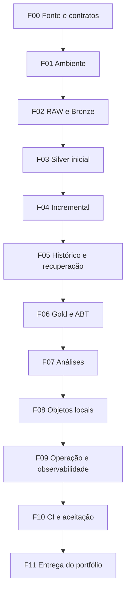

# Roteiro de execução — Credit Risk Lakehouse

Atualizado em 13/11/2026. Responsável: Frederico Costa.

Este é o controle da execução. O [curso aplicado](GUIA_ESTUDO_LAKEHOUSE.md)
ensina conceitos, ferramentas e processos em 12 capítulos, com leitura guiada
da implementação e das evidências. As indicações de capítulos abaixo seguem
essa organização; o [diagnóstico inicial](PLANO_PORTFOLIO_LAKEHOUSE.md)
preserva o levantamento e as decisões de arquitetura.

## 1. Resultado que define a conclusão

Entregar um laboratório local reproduzível com Spark e Delta Lake, armazenamento
de objetos local, ingestão rastreável, Silver incremental, Gold com ABT por caso
de crédito e indicadores, análises documentadas e evidências de recuperação e
reprodução histórica. O projeto deve explicar um problema de negócio e permitir
que outra pessoa confira seus resultados.

O conjunto inicial de dados será limitado e determinístico. Adotar Home Credit
depende de validar suas condições de uso. Modelo preditivo, feature store,
retreinamento, Databricks, Kafka e migração AWS ficam fora desta entrega.
Dashboard interativo é opcional: relatório reproduzível com gráficos atende ao
escopo analítico. Expandir para todas as tabelas também é uma evolução opcional.

## 2. Como controlar o andamento

Há **72 itens de execução**, distribuídos em 12 fases. F00–F11 foram
aceitas no escopo local. Fonte real, contratos, recorte, ingestão Bronze,
qualidade, revisões e reconciliação de valores/proveniência estão validados.
F03 também reúne regras, leitura, tratamentos, materialização Delta, contratos
persistidos e execução repetível com recibo de aceite inicial. F04 acrescentou
lotes reais simulados, precedência, deduplicação, merge, atraso/retry e
reconstrução equivalente. F05 validou evolução, publicação, recuperação e
retenção locais. F06 publicou ABT por caso e indicadores SQL, com correções
auxiliares, atraso, falha/retomada e histórico reconciliados. F07 entregou
relatório, gráficos e conclusões verificadas, com reprodução em processos novos.
F08 validou armazenamento de objetos local, replay nativo S3A, publicações
reconciliadas e persistência após reinício.
F09 consolidou comando, supervisão, métricas, lineage e resumo, com matriz real
de falhas e recuperação em destinos privados.
F10 consolidou 153 testes obrigatórios em ambiente instalado do zero, matriz
T01–T24, e2e sintético, CI declarada e revisão de acesso/preservação.
F11 concluiu documentação, demo S3 com falha/retomada e histórico, reprodução
por comandos e pacote sintético auditado. A revisão foi feita pelo executor.

| Medida atual | Valor |
|---|---|
| Itens aceitos deste roteiro | 72/72 |
| Fases aceitas | 12/12 — F00–F11 no escopo local |
| Próxima entrega | Escopo local encerrado; evoluções no backlog |
| Dependência externa conhecida | Publicação remota e divulgação de dados reais continuam ações separadas; entrega local usa pacote sintético |
| Base de testes atual | F10: 153 testes obrigatórios, zero ignorados, ambiente novo; matriz T01–T24 aprovada; CI configurada, sem execução remota nesta sessão |
| Execução atual com dados reais | Replay e três publicações S3 equivalentes a F04/F06; 50 mil casos/22 meses; falha/retry, rollback, consumidor independente e reinício aprovados; filesystem preservado |

Marcar `[x]` somente com o critério atendido e uma evidência registrada. Para
trabalho iniciado ou impedido, usar o diário abaixo, mantendo `[ ]`. Teste
ignorado não conta como teste de integração aprovado. Atualizar o quadro a cada
entrega; a contagem mede cobertura do roteiro, não horas restantes, pois os itens
têm esforços diferentes. Reestimar prazo após F01 e F04, com dados de execução.

Cada sessão deve escolher um item ou pequeno conjunto relacionado, estudar o
capítulo correspondente, implementar, validar, registrar evidência e atualizar o
controle. Evitar implementar várias fases sem fechar os critérios anteriores.

| Data | IDs | Estado | Resultado / impedimento | Evidência | Próxima ação |
|---|---|---|---|---|---|
| 12/11/2026 | Planejamento | Documentado | Direção aprovada; roteiro e guia criados | Estes documentos | Iniciar F00 |
| 12/11/2026 | F00.1 | Aceito documentalmente | Produto, público, perguntas, entregas e limites definidos | [Escopo](ESCOPO_PRODUTO.md) e [evidência](evidencias/F00_ABERTURA.md) | Confirmar dados após resolver fonte |
| 12/11/2026 | F00.2 | Em andamento | Condições examinadas; usuário escolheu manter Home Credit dependente de autorização | [Fonte](governance/SOURCE.md) e [solicitação não enviada](governance/SOLICITACAO_AUTORIZACAO.md) | Usuário revisar e encaminhar solicitação |
| 12/11/2026 | F00.6 | Aceito documentalmente | Decisões e pendências técnicas registradas | [Registro de decisões](DECISOES.md) | Validar versões, campos e serviço nas fases correspondentes |
| 12/11/2026 | F01.1 | Parcial | Ambiente da sessão inventariado; máquina final ainda a confirmar | [Evidência](evidencias/F00_ABERTURA.md) | Preparar ambiente/fixtures sem dados da competição |
| 12/11/2026 | Fonte — atualização | Direção confirmada | Usuário informou inscrição e confirmou uso real Home Credit; revisão externa não bloqueia desenvolvimento | [Fonte atualizada](governance/SOURCE.md) | Autenticar API |
| 12/11/2026 | F01.1–F01.6 | Aceitos no ambiente da sessão | Runtime isolado, configuração central, Delta e integração validados; recursos amostrados | [Evidência F01](evidencias/F01_AMBIENTE.md) | Validar recorte real após autenticação |
| 12/11/2026 | F02.1 | Em andamento | Aquisição seletiva recuperável implementada e testada; download real ainda não validado | [Execução e API](AMBIENTE_LOCAL.md) | Conferir acesso e arquivos na API |
| 12/11/2026 | F00.2/F00.3/F02.1 | Aceitos no escopo local | API autenticada, seis arquivos preservados, repetição verificada e inspeção exata aprovada | [Evidência da fonte real](evidencias/F00_F02_FONTE_REAL.md) | Definir contratos e recorte |
| 12/11/2026 | F00.4/F00.5/F02.2 | Aceitos; F00 concluída | Contratos v1 validados na origem/recorte, coorte de 50 mil casos, histórico completo relacionado e três lotes atribuídos; reexecução reutilizou saída | [Evidência de contratos e recorte](evidencias/F00_CONTRATOS_RECORTE.md) | Adaptar entrada explícita da Bronze |
| 12/11/2026 | F02.3 | Aceito no filesystem local | Entrada e saídas explícitas por seleção; qualidade/contagens reais aprovadas; retry sem gravações; falhas e locks testados com Spark real | [Evidência Bronze](evidencias/F02_BRONZE_RECORTE.md) | Definir contrato de eventos/revisões |
| 12/11/2026 | F02.4 | Aceito no escopo de referência local | Eventos/revisões e entregas separados; landing imutável; conflito rejeitado e retry comprovado com payloads reais; 66 testes aprovados | [Evidência de eventos](evidencias/F02_EVENTOS_REVISOES.md) | Alinhar qualidade Bronze em F02.5 |
| 12/11/2026 | F02.5 | Aceito no snapshot local | Qualidade derivada do contrato; histórico vazio permitido, schemas completos e cobertura; 39 checks reais aprovados; 73 testes sem ignorados | [Evidência de qualidade](evidencias/F02_QUALIDADE_BRONZE.md) | Reconciliar valores/proveniência em F02.6 |
| 12/11/2026 | F02.6 | Aceito; F02 concluída no escopo local | Valores comparados nos dois sentidos; RAW selecionada/recorte/Bronze e proveniência reconciliados; divergência bloqueia gate; 80 testes aprovados | [Evidência de reconciliação](evidencias/F02_RECONCILIACAO_BRONZE.md) | Catalogar regras Silver em F03.1 |
| 12/11/2026 | F03.1 | Aceito como catálogo e revalidação | 236 células/17 tabelas catalogadas; 223 propostas do MVP classificadas; datas aprovadas com guarda futura, sem nulificação ou drop por aparência; 83 testes aprovados | [Evidência do catálogo](evidencias/F03_CATALOGO_SILVER.md) | Implementar leitor lógico em F03.2 |
| 12/11/2026 | F03.2 | Aceito como leitura lógica local | Gate/artefatos conferidos, lock mantido nas ações, schemas por fragmento e chaves globais validados; 315.390 linhas reais consumidas; 92 testes aprovados | [Evidência do leitor](evidencias/F03_LEITURA_BRONZE.md) | Implementar tratamentos em F03.3 |
| 12/11/2026 | F03.3 | Aceito como tratamentos validados | Conversões estritas com métricas/falha; 23 datas reais sem perdas; prova de preservação integral; 100 testes aprovados; nenhuma tabela Silver gravada | [Evidência dos tratamentos](evidencias/F03_TRATAMENTOS_SILVER.md) | Materializar Delta em F03.4 |
| 12/11/2026 | F03.4 | Aceito como materialização Delta inicial | Três tabelas versão 0 com UUIDs/paths registrados, reconciliação de leitura e namespace imutável; integração Delta isolada aprovada | [Evidência Delta](evidencias/F03_DELTA_INICIAL.md) | Validar contratos persistidos em F03.5 |
| 12/11/2026 | F03.5 | Aceito como contratos do estado persistido | Contrato independente do manifesto, schemas/chaves/referências/domínios/cardinalidades; 29 checks reais aprovados e diagnósticos temporais registrados | [Evidência dos contratos](evidencias/F03_CONTRATOS_SILVER.md) | Consolidar execução/aceite operacional em F03.6 |
| 12/11/2026 | F03.6 | Aceito; F03 concluída no escopo inicial local | Comando parametrizado, criação/reutilização sem overwrite e recibo imutável por execução; 29 checks reais, retry e falhas validados; 114 verificações sem ignorados | [Evidência operacional](evidencias/F03_EXECUCAO_SILVER.md) | Gerar lotes/cenários em F04.1 |
| 12/11/2026 | F04.1–F04.6 | Aceitos; F04 concluída no escopo local | Gerador Parquet v1, revisões/deduplicação/merge; correções auxiliares, reenvios e atraso reais; reconstrução equivalente; 117 verificações aprovadas; execução completa de 18 min 59 s, pico RSS somado 5,06 GiB | [Evidência F04](evidencias/F04_INCREMENTAL.md) | Evolução controlada em F05.1 |
| 13/11/2026 | F05.1–F05.6 | Aceitos no filesystem local | Contrato v2, manifestos/CURRENT, falhas/retry, rollback e retenção; nove cenários Delta e dois testes de política aprovados; três snapshots reais publicados em 223,773 s | [Evidência F05](evidencias/F05_PUBLICACAO.md) | Implementar F06 em seguida |
| 13/11/2026 | F06.1–F06.6 | Aceitos no filesystem local | ABT 50 mil casos e indicadores 22 meses; correção auxiliar, atraso, SQL independente, falha/retry e histórico aprovados; 123 verificações globais sem ignorados | [Evidência F06](evidencias/F06_GOLD.md) | F07.1 — fechar perguntas analíticas |
| 13/11/2026 | F07.1–F07.6 | Aceitos no filesystem local | Relatório HTML/Markdown, CSV, gráficos, P01–P06 e SQL independente; duas execuções reproduziram 19 arquivos de resultados byte a byte; 126 verificações globais aprovadas | [Evidência F07](evidencias/F07_ANALISE.md) | F08.1 — selecionar objetos locais |
| 13/11/2026 | F08.1–F08.6 | Aceitos no escopo local de um host/driver | SeaweedFS 4.53, replay Delta S3A e três publicações reconciliadas; falha/retry, rollback, persistência e consumidor independente; 129 verificações sem ignorados; processo 18 min 8 s, pico RSS somado 6,08 GiB | [Evidência F08](evidencias/F08_OBJETOS.md), [arquitetura](objetos/DECISAO_E_ARQUITETURA.md) e [operação](objetos/OPERACAO.md) | F09.1 — comando único |
| 13/11/2026 | F09.1 | Aceito sobre entradas locais aprovadas | Update até o segundo lote, replay sem commits, limite regressivo recusado e rebuild isolado com cinco tabelas iguais; CURRENT F08 preservado; três testes unitários | [Evidência](evidencias/F09_COMANDO_UNICO.md) e [operação](operacao/COMANDO_UNICO.md) | F09.2 — estados e erros |
| 13/11/2026 | F09.2 | Aceito no runtime local | Supervisor com estados, códigos, tentativas limitadas e identidade lógica; oito testes direcionados, sucesso real Spark/S3, entrada ausente e interrupção real do endpoint aprovados | [Evidência](evidencias/F09_ESTADOS_E_ERROS.md) e [operação](operacao/ESTADOS_E_ERROS.md) | F09.3 — métricas |
| 13/11/2026 | F09.3 | Aceito no runtime local | Durações monotônicas, contadores de lotes, arquivos/objetos/bytes e RSS amostrado; update/replay/fonte ausente reais aprovados; coleta adicional separada e custos embutidos declarados | [Evidência](evidencias/F09_METRICAS.md) e [métricas](operacao/METRICAS.md) | F09.4 — lineage e inventário |
| 13/11/2026 | F09.4 | Aceito por publicação explícita | Auditoria real de atualização/replay e reprodução estável; cinco tabelas, 15 nós de origem/trabalho, 19 ligações e 30 colunas Gold; IDs documentados, CURRENT preservados | [Evidência](evidencias/F09_LINEAGE.md) e [inventário](operacao/LINEAGE_E_INVENTARIO.md) | F09.5 — resumo operacional |
| 13/11/2026 | F09.5 | Aceito como consulta pontual | Resumo JSON/Markdown com execução, publicação, falhas, qualidade e alertas calibrados F09.3; oito testes novos e cinco casos reais online/Delta/cache/offline; CURRENT preservados | [Evidência](evidencias/F09_RESUMO_OPERACIONAL.md) e [operação](operacao/RESUMO_OPERACIONAL.md) | F09.6 — matriz operacional |
| 13/11/2026 | F09.6 | Aceito; F09 concluída no escopo local | Sucesso, fonte ausente, schema inválido, qualidade reprovada e serviço parado após commit privado; diagnóstico e retry reais; CURRENT reais preservados; fixture removida | [Evidência](evidencias/F09_MATRIZ_OPERACIONAL.md) e [matriz](operacao/MATRIZ_OPERACIONAL.md) | F10.1 — organizar testes |
| 13/11/2026 | F10.1–F10.6 | Aceitos; F10 concluída no escopo local | 153 testes obrigatórios sem ignorados em instalação nova, e2e sintético, T01–T24, CI declarada, leitura 7→1 com cinco tabelas iguais, export sanitizado e históricos preservados | [Evidência F10](evidencias/F10_ACEITACAO.md) | F11.1 — reescrever README |

| 13/11/2026 | F11.1–F11.6 | Aceitos; escopo local encerrado | README/arquitetura/guia revisados; demo real S3 com dados inventados, falha/retomada/histórico; autorrevisão em cópia nova com seis CSVs iguais; pacote de 194 arquivos auditado e inventário AWS sem provisionamento | [Evidência F11](evidencias/F11_ENTREGA.md) | Backlog opcional; publicação exige ação própria |

Uma evidência deve informar comando, ambiente, código/commit, parâmetros,
resultado esperado e obtido, `run_id` e localização do relatório quando cabível.
Guardar evidências em `docs/evidencias/` durante a execução; dados de competição
e credenciais não devem entrar no Git. Fixtures sintéticas pequenas são permitidas
quando identificadas como testes.

## 3. Dependências e marcos

Documentação, observabilidade e testes acompanham todas as fases. F09 consolida
a operação e F10 automatiza e integra verificações já construídas. A pesquisa
de armazenamento e a estrutura mínima de CI podem começar antes, sem bloquear
a prova no filesystem. A validação final usa a arquitetura de destino local.

O diagrama representa a ordem dos marcos. Se a inspeção dos dados de F00 exigir
preparar Spark, iniciar F01 após definir escopo, acesso à fonte e decisões de
trabalho (F00.1, F00.2 e F00.6). Concluir as medições e contratos de F00.3–F00.5
com esse ambiente antes de aceitar F00 e avançar à ingestão F02. Assim, a
validação da fonte não depende de um ambiente que só pudesse ser criado depois dela.

Atualização de 12/11/2026: o usuário esclareceu sua inscrição e confirmou o
desenvolvimento com Home Credit real. Revisão da divulgação externa fica antes da
publicação. Ambiente e aquisição podem avançar; inspeção e contratos definitivos
dependem de autenticação na API e acesso aos arquivos.

| Marco | Condição verificável |
|---|---|
| M1 — fonte utilizável e laboratório preparado | Concluído no escopo local; F00–F01 aceitas. Divulgação externa permanece antes da publicação |
| M2 — fluxo básico até Silver | F02–F03 aceitas |
| M3 — comportamento Lakehouse demonstrado | F04–F05 aceitas |
| M4 — produto analítico | F06–F07 aceitas |
| M5 — solução local completa | F08–F10 aceitas; 153 testes obrigatórios e matriz T01–T24 aprovados |
| M6 — portfólio publicável | F11 aceita: pacote sintético preparado; working tree e dados reais não liberados para publicação direta |

## 4. Fases e ações

### F00 — Definir escopo, fonte e contratos

Estudar capítulos 1, 2 e 6 do guia: produto/arquitetura, dados e contratos.
Entrada: diagnóstico inicial e concordância com a direção.

- [x] **F00.1 — Formalizar o produto.** Registrar público, problema, perguntas, entregas obrigatórias e exclusões. Validar que cada pergunta tem uma possível evidência nos dados; descartar promessas de impacto não medido. Aceite: [escopo do produto](ESCOPO_PRODUTO.md).
- [x] **F00.2 — Validar a fonte.** Origem, acesso autenticado, condições e limites registrados em [SOURCE](governance/SOURCE.md). Aceite para desenvolvimento local; divulgação externa permanece no aceite de publicação, sem presumir dados abertos.
- [x] **F00.3 — Inspecionar os dados disponíveis.** Arquivos, esquemas, chaves, datas, contagens exatas, nulos, NaN e domínio de `target` confirmados nas três tabelas selecionadas. Evidência atual separada dos relatórios históricos em [fonte real](evidencias/F00_F02_FONTE_REAL.md).
- [x] **F00.4 — Definir contratos de dados.** [Contratos documentados](contratos/README.md) e YAML executável com 214 campos, grãos, chaves, referências, nulabilidade, escopo temporal e bloqueio de violações; 16 checks aprovados na origem e no recorte, além de schema/fingerprints.
- [x] **F00.5 — Definir recorte e lotes.** [Política implementada](RECORTE_E_LOTES.md): 50 mil casos por hash/seed fixos, relacionados preservados e três intervalos contíguos de semanas. Limitações amostrais e chegada simulada explicitadas; atribuição validada no recorte.
- [x] **F00.6 — Fechar decisões de trabalho.** Atualizar registro com formato Delta, posição inicial das camadas, produto Gold e critérios de aceitação. Registrar como pendentes versões do ambiente, campos da ABT e fornecedor de objetos, até a verificação correspondente. Aceite: [decisões](DECISOES.md), diagnóstico e escopo.

Saída: fonte utilizável, contrato verificável e escopo fechado. Não avançar com
uma licença presumida ou chaves inferidas apenas pelo nome dos arquivos.

### F01 — Preparar ambiente reproduzível

Estudar capítulos 3, 4 e 12: ambiente, Spark e testes.
Depende das definições iniciais de F00, conforme a exceção
de dependência acima; inspeção de recursos pode ocorrer antes.

- [x] **F01.1 — Inventariar o computador de execução.** SO, CPU, RAM, disco e runtimes registrados na [evidência F01](evidencias/F01_AMBIENTE.md); o aceite refere-se ao WSL da sessão, distinguido do orçamento informado pelo usuário.
- [x] **F01.2 — Definir versões compatíveis.** Python 3.11.14, Java 17, Spark 3.5.7 e Delta 3.3.2 escolhidos, instalados e exercitados; justificativa e fontes em [AMBIENTE_LOCAL.md](AMBIENTE_LOCAL.md).
- [x] **F01.3 — Declarar dependências e configuração.** Dependências diretas e lock com hashes criados; Spark e paths centralizados, com validação e teste de caminhos personalizados em Bronze/qualidade.
- [x] **F01.4 — Executar prova mínima.** Criação, leitura, merge e leitura histórica Delta aprovados; sessão encerrada e dados temporários removidos.
- [x] **F01.5 — Validar testes existentes com JVM.** 31 testes aprovados sem ignorados; stubs isolados e integração Bronze executada no mesmo processo. Testes Spark também conferidos separadamente.
- [x] **F01.6 — Medir recursos iniciais.** Tempo, RSS amostrado da árvore de processos, temporários e tamanhos do ambiente registrados na [evidência F01](evidencias/F01_AMBIENTE.md), com limitações explícitas; reavaliar com dados reais.

Saída: outra instalação compatível executa o exemplo e os testes sem depender
de estado de notebook. Reestimar esforço de ambiente e capacidade disponível.

### F02 — Consolidar RAW e Bronze

Estudar capítulos 2, 5 e 6: relacionamentos, ingestão e qualidade. Depende de F00–F01.

- [x] **F02.1 — Revisar aquisição e retenção.** Entry point adaptado para aquisição seletiva, sem remoção de dados existentes. Seis arquivos reais preservados e conferidos com a API; journal/checksums, retry e falhas testados. Evidência em [fonte real](evidencias/F00_F02_FONTE_REAL.md).
- [x] **F02.2 — Materializar o recorte determinístico.** 50 mil casos/base/estática e 215.390 linhas históricas preservados por semi-joins. Identidade, checksums, lotes e reconciliação registrados; reexecução confirmou mesmo conjunto e reutilizou a saída. [Evidência](evidencias/F00_CONTRATOS_RECORTE.md).
- [x] **F02.3 — Validar publicação Bronze atual.** Entrada explícita `--sample`, namespace e relatórios isolados; manifesto v2 e gate `_READY`. Carga/reexecução reais aprovadas; falhas antes/depois de rename, qualidade e locks entre processos testados. [Evidência](evidencias/F02_BRONZE_RECORTE.md).
- [x] **F02.4 — Definir contrato para revisões.** Contrato separado com chave de negócio, evento por revisão e entrega por lote/posição. Landing imutável de referência, precedência e rejeição de conflitos validadas com payloads reais e fixtures; RAW preservada. Gerador completo e merge continuam em F04. [Evidência](evidencias/F02_EVENTOS_REVISOES.md).
- [x] **F02.5 — Corrigir e ampliar qualidade do escopo.** YAML/engine alinhados ao contrato de snapshot: tabelas, schema completo, chaves, referências, cobertura e calendário. Histórico vazio permitido; configuração/leitura inválidas bloqueiam. Eventos mantêm protocolo e grão próprios. [Evidência](evidencias/F02_QUALIDADE_BRONZE.md).
- [x] **F02.6 — Reconciliar RAW → Bronze.** Comparação integral nos dois sentidos da RAW selecionada e recorte contra Bronze, com multiplicidade e tipos preservados. Auditoria de `_source_file`, arquivos/batches, manifestos, primeiro run_id e lineage; relatório vinculado ao gate. [Evidência](evidencias/F02_RECONCILIACAO_BRONZE.md).

Saída: ingestão recuperável comprovada e contrato pronto para revisões. Alterações
locais anteriores devem ser revisadas e preservadas, não sobrescritas em bloco.

### F03 — Construir a Silver inicial

Estudar capítulos 4, 6, 7 e 8: Spark, qualidade, tratamentos e Delta. Depende de F02.

- [x] **F03.1 — Extrair regras do notebook.** Catálogo por família/campo/célula, política planejada e perfil real: datas aprovadas com guarda, números/códigos/nulos/colunas preservados, hipóteses de sentinelas/drop revisadas. Tabelas fora do MVP adiadas; nenhuma Silver materializada. [Evidência](evidencias/F03_CATALOGO_SILVER.md).
- [x] **F03.2 — Criar carregamento lógico.** Leitor de recorte aprovado em `src/silver/`: gate, manifestos/hashes, inventário exato, schemas por fragmento, união estrita e chaves globais. Lock mantido nas ações Spark; leitura real validada sem escrita Silver. [Evidência](evidencias/F03_LEITURA_BRONZE.md).
- [x] **F03.3 — Implementar tratamentos.** Política executável, conversão das 23 datas com guarda ISO/parse/ida e volta, métricas de perdas e falha do snapshot inteiro. Nulos/demais valores preservados, sem descarte. Prova completa nos dois sentidos; execução real aprovada sem escrita de tabelas. [Evidência](evidencias/F03_TRATAMENTOS_SILVER.md).
- [x] **F03.4 — Criar tabelas Delta iniciais.** credit_cases, credit_static e previous_applications persistidas em Delta versão 0; paths/UUIDs/versões no manifesto técnico. Leitura Delta reconciliada, pacote imutável e retry sem overwrite; diferença para Parquet demonstrada em teste. Aceite Silver completo ainda posterior. [Evidência](evidencias/F03_DELTA_INICIAL.md).
- [x] **F03.5 — Validar contratos Silver.** Contrato derivado de definições fixadas, independente do manifesto do writer; 29 checks reais de schema/chaves/referências/domínios/datas/nulos/cardinalidades aprovados. Oráculos manuais e fixture persistida Delta testados; datas posteriores são diagnóstico. [Evidência](evidencias/F03_CONTRATOS_SILVER.md).
- [x] **F03.6 — Criar execução Silver repetível.** Entrypoint com seleção explícita e `--existing reuse|error`, sem executar notebook; leitura, tratamentos, Delta e contratos consolidados. Relatório e recibo separados por execução, sem alterar pacote técnico. Criação/retry reais e falhas testados sem overwrite. [Evidência](evidencias/F03_EXECUCAO_SILVER.md).

Saída: Silver inicial reproduzível e validada; notebook passa a ser evidência e
exploração, não dependência oculta da pipeline.

### F04 — Implementar lotes incrementais e correções

Estudar capítulo 9: incremento, eventos e correções. Depende de F03.

- [x] **F04.1 — Implementar gerador de demonstração.** Três lotes reais, correção/duplicata/atraso separados e simulação declarada em 315.398 envelopes Parquet. Baseline mais atraso reconciliados integralmente à Bronze; fixtures sintéticas isoladas. [Evidência](evidencias/F04_INCREMENTAL.md).
- [x] **F04.2 — Definir precedência.** Maior revisão prevalece; mesma revisão conflitante, inclusive antiga, rejeita o lote inteiro. Desempate por entrega somente após concordância de payload/proveniência; chegada não define precedência. [Política](silver/INCREMENTAL.md).
- [x] **F04.3 — Deduplicar antes do merge.** Janela determinística por chave/revisão, conflitos históricos e métricas de duplicatas/revisões suplantadas. Entrada embaralhada e chave composta testadas; duas cópias removidas das candidatas no pacote duplicado real. [Evidência](evidencias/F04_INCREMENTAL.md).
- [x] **F04.4 — Implementar merge Silver.** Inserção de novas chaves e atualização apenas de revisão maior; correção de uma estática e uma observação histórica. Imagem completa, sem delete por ausência; commits e contratos conferidos. Estado inicial F03 preservado em outro namespace. [Evidência](evidencias/F04_INCREMENTAL.md).
- [x] **F04.5 — Provar idempotência e atraso.** Duplicatas, revisão antiga e retry preservam todos os valores, versões e diagnósticos; caso atrasado entra com estática/oito observações no período original. Inserts/updates/ignorados medidos, sem commits vazios. [Evidência](evidencias/F04_INCREMENTAL.md).
- [x] **F04.6 — Reconciliar com reconstrução.** Máximo agrupado/join independente do merge; todas as colunas comparadas nos dois sentidos com zero faltas/excessos. Estado final de 315.390 linhas aprovado em 29 checks. [Evidência](evidencias/F04_INCREMENTAL.md).

Saída: incremento correto demonstrado e medido. Na medição de encerramento F04,
o ciclo de runner mais
demonstração real custa cerca de 34,4 minutos, sem incluir implementação;
42 itens/sete fases permaneciam. Volume mantido até medição específica de
desempenho. Detalhes e limites da reestimativa na evidência. CDC real permanece fora do escopo.

### F05 — Validar esquema, histórico e recuperação

Estudar capítulos 8 e 11: Delta, publicação e recuperação. Depende de F04.

- [x] **F05.1 — Implementar evolução controlada.** Coluna técnica int prevista na v2, backfill explícito e preservação integral; ausência, tipo incompatível e coluna inesperada bloqueiam. [Contrato](contratos/SILVER_GERENCIADA.md).
- [x] **F05.2 — Registrar versões de entrada/saída.** Manifestos vinculam RAW/coorte, relatório/lote/recibo F04, UUIDs/versões e código/configuração arquivados por hash. [Evidência](evidencias/F05_PUBLICACAO.md).
- [x] **F05.3 — Implementar publicação aprovada.** Manifesto imutável e CURRENT substituído atomicamente após validações; consumidor sem publicação falha explicitamente. [Protocolo](PUBLICACAO_E_RECUPERACAO.md).
- [x] **F05.4 — Injetar falhas e retomar.** Antes/depois do commit, entre tabelas, após qualidade e nas janelas de manifesto/ponteiro; locks e retomada de intento sem duplicação exercitados. Falha real simulada preservou publicação anterior. [Evidência](evidencias/F05_PUBLICACAO.md).
- [x] **F05.5 — Reproduzir snapshot e recuperação.** Leitura por versões e rollback/restauração do ponteiro reproduziram baseline real sem diferenças; sem alegação de SCD tipo 2. [Evidência](evidencias/F05_PUBLICACAO.md).
- [x] **F05.6 — Definir retenção.** Delta com 30 dias e pins indefinidos de publicações/entradas; auditoria de todas as versões. VACUUM destrutivo somente em fixture criada internamente, preservando dados reais. [Procedimento](PUBLICACAO_E_RECUPERACAO.md).

Saída: pacote de evidências de versionamento e falhas. O manifesto recebe as
versões Gold em F06, com falhas e histórico repetidos. A adaptação para objetos
e suas provas continuam em F08.

### F06 — Entregar Gold: ABT e indicadores

Estudar capítulos 2 e 10: joins, ABT e indicadores. Depende de F05.

- [x] **F06.1 — Definir contrato da ABT.** Uma linha por case_id, 19 colunas, tipos, fórmulas, nulos e disponibilidade retrospectiva. Sem declaração point-in-time para treino. [Contrato](contratos/ABT.md).
- [x] **F06.2 — Agregar fontes 1:N.** Histórico completo agregado antes dos joins; ausência distinta de montantes nulos, soma reproduzível sem arredondamento. Fixture com dois históricos preserva três casos. [Evidência](evidencias/F06_GOLD.md).
- [x] **F06.3 — Implementar ABT Delta.** Pipeline Gold, chave única, oráculo SQL e versões Silver fixadas; manifesto analítico referencia três Silver e duas Gold aprovadas. [Operação](gold/ABT_E_INDICADORES.md).
- [x] **F06.4 — Implementar atualização Gold.** Diferenças em qualquer Silver selecionam casos afetados; correção auxiliar atualizou um caso e atraso inseriu um. Comparação integral exata aprovada. [Evidência](evidencias/F06_GOLD.md).
- [x] **F06.5 — Criar indicadores SQL.** Volume, target válido e cobertura por mês; nulos/divisão por zero definidos e testados. Materialização integral pequena recalcula períodos antigos e remove grupos vazios. [Contrato](contratos/ABT.md).
- [x] **F06.6 — Reconciliar e versionar a publicação.** Oráculos Silver independentes, numeradores/denominadores, falhas entre Silver/Gold e após MERGE, retomada sem novo commit e reprodução histórica aprovados. [Evidência](evidencias/F06_GOLD.md).

Saída: ABT com 50.000 casos e indicadores de 22 meses consumíveis por publicação.
ABT atualizada por casos afetados sobre cópia privada; indicadores materializados
integralmente por SQL por serem poucos grupos. Custo e limites explícitos na evidência.

### F07 — Desenvolver análises e comunicação

Estudar capítulo 10: indicadores e interpretação analítica. Depende de F06.

- [x] **F07.1 — Fechar perguntas analíticas.** P01–P06 vinculadas a população, período, colunas, fórmulas, limites e publicações explícitas. [Método](analise/PERGUNTAS_E_METODO.md).
- [x] **F07.2 — Criar notebook/relatório de consumo.** CLI gera HTML/Markdown, CSVs, gráficos e metadata em processo novo; consumo separado da Gold produtiva e sem alterar CURRENT. [Execução](analise/EXECUCAO.md).
- [x] **F07.3 — Analisar volume e desfecho.** Gráficos mensais com contagens, denominadores, flags de grupos pequenos e datas observadas parciais. Maturação e limites amostrais explícitos. [Resultados](analise/RESULTADOS.md).
- [x] **F07.4 — Analisar cobertura e composição.** Cobertura estática/histórica, completude e grupos por observações; nulos e grupos vazios têm regras próprias, sem confundir ausência com erro. [Resultados](analise/RESULTADOS.md).
- [x] **F07.5 — Demonstrar efeito de uma correção.** Mesmo conjunto de 49.999 casos na correção do caso 64; atraso do caso 135 separado. Duas execuções reproduziram gráficos baseline e finais byte a byte. [Evidência](evidencias/F07_ANALISE.md).
- [x] **F07.6 — Revisar conclusões.** SQL independente, totais reconciliados, figuras inspecionadas e autorrevisão declarada. Achados, hipótese e investigação separados, sem alegação causal. [Evidência](evidencias/F07_ANALISE.md).

Saída: relatório retrospectivo com gráficos e perguntas respondidas, limitado
às publicações aprovadas. A execução medida levou 49,844 s, pico RSS somado
2,29 GiB. Dashboard continua opcional; objetos locais foram validados em F08.

### F08 — Concluir armazenamento de objetos local

Estudar capítulo 11: armazenamento e operação. Depende da prova funcional F03–F07;
pesquisa pode antecipar.

- [x] **F08.1 — Selecionar implementação.** Comparar opções abertas por compatibilidade Spark/Delta, manutenção, condições de uso, recursos e operação local; registrar decisão e posição final de cada camada.
- [x] **F08.2 — Configurar serviço e acesso.** Declarar inicialização/encerramento, persistência, endpoint e credenciais locais fora do Git. Validar portas, armazenamento em disco e acesso somente no alcance necessário ao laboratório.
- [x] **F08.3 — Adaptar I/O e publicação.** Eliminar dependência indevida de `Path`, lock ou rename POSIX nos caminhos de objetos. Testar conector, commit Delta, listagem e publicação do manifesto conforme garantias reais do serviço.
- [x] **F08.4 — Executar cenários no destino.** Repetir primeira carga, merge, retry, falhas, qualidade e leitura histórica sobre objetos. Confirmar que falhas de acesso/serviço não avançam a publicação aprovada.
- [x] **F08.5 — Reconciliar filesystem e objetos.** Comparar dados de negócio e indicadores da mesma entrada; validar reinício do serviço e persistência. Medir tempo, RAM, disco e impacto do histórico; não exigir igualdade de versões Delta entre reconstruções independentes.
- [x] **F08.6 — Documentar operação e manutenção.** Registrar subir/parar, restaurar publicação, retenção, manutenção e remoção do laboratório. Testar os procedimentos com fixtures e descrever o que fica persistido após parar serviços.

Saída aceita em [F08](evidencias/F08_OBJETOS.md): arquitetura local validada
para um host/driver cooperante, com camadas e procedimentos na
[operação](objetos/OPERACAO.md). API compatível com S3 não implica equivalência
completa à AWS. Próxima: F09.1.

### F09 — Consolidar orquestração e observabilidade

Estudar capítulo 11: orquestração e observabilidade. A instrumentação começa
antes; aceite depende de F08.

- [x] **F09.1 — Criar comando único de execução.** Implementar dependências RAW → Bronze → Silver → Gold → publicação, com parâmetros de lote, recorte e modo. Separar atualização normal, replay e reconstrução explícita.
- [x] **F09.2 — Padronizar estados e erros.** Registrar início, fim, etapa, sucesso/falha e causa; retornar código de saída adequado. Definir retry apenas para falhas recuperáveis e limite de tentativas.
- [x] **F09.3 — Consolidar métricas.** Medir duração por etapa e total, entradas, inserts, updates, ignorados, rejeitados, arquivos/bytes e consumo de recursos. Distinguir custo de medir métricas do custo da transformação.
- [x] **F09.4 — Consolidar lineage e inventário.** Relacionar fontes, lotes, tabelas, colunas relevantes da ABT, versões e consumidores. Unificar nomes como `run_id` e documentar o significado de cada identificador.
- [x] **F09.5 — Produzir resumo operacional.** Exibir última publicação aprovada, última execução, falhas e relatório de qualidade, sem exigir um serviço de monitoramento permanente. Definir limites locais de alerta com base nas medições.
- [x] **F09.6 — Testar operação completa.** Executar sucesso, fonte ausente, schema inválido, qualidade reprovada e serviço indisponível. Confirmar diagnóstico, rastreabilidade, status e manutenção da última publicação válida.

Saída: uma execução pode ser iniciada, acompanhada, explicada e recuperada.

### F10 — Automatizar CI e fechar aceitação técnica

Estudar capítulo 12: testes e CI. Testes acompanham todas as fases; aceite depende de F09.

- [x] **F10.1 — Organizar suíte por responsabilidade.** Separar unidade, integração Spark/Delta e ponta a ponta; usar fixtures sintéticas identificadas e oráculos independentes. Isolar credenciais e diretórios temporários.
- [x] **F10.2 — Configurar CI.** Declarar ambiente compatível, verificação de código adotada e testes obrigatórios. CI deve falhar se integração obrigatória for ignorada por falta de dependência; não baixar dados restritos nem depender do Kaggle.
- [x] **F10.3 — Executar matriz de testes.** Registrar resultado de cada cenário da seção 5 e vínculo com os testes automatizados ou procedimentos manuais. Ausência de cenário exigido impede aceite.
- [x] **F10.4 — Executar fluxo em ambiente limpo.** Usar apenas instruções e manifestos, sem variáveis ou estado implícito de notebook. Testar fixtures em CI e o recorte real localmente conforme condições de acesso.
- [x] **F10.5 — Medir e ajustar desempenho.** Identificar gargalo real antes de mudar paralelismo, arquivos, cache ou partições. Registrar antes/depois e conferir igualdade dos resultados; ampliar recorte apenas se couber no orçamento de recursos.
- [x] **F10.6 — Revisar dados e acesso.** Conferir arquivos rastreados, credenciais, permissões, resultados publicáveis e outputs dos notebooks. Validar que dados ignorados e logs locais não entram por engano no pacote do portfólio.

Saída aceita: 153 testes sem ignorados em ambiente novo; T01–T24 aprovados,
e2e sintético e igualdade das cinco tabelas reais antes/depois do ajuste.
CI declarada, sem job remoto executado; export sanitizado validado e notebook
histórico preservado. [Evidência F10](evidencias/F10_ACEITACAO.md),
[execução e CI](testes/EXECUCAO_E_CI.md), [matriz](testes/MATRIZ_ACEITACAO.md).

### F11 — Preparar entrega do portfólio

Estudar capítulo 12: evidências, reprodução e entrega do portfólio. Depende de F10.

- [x] **F11.1 — Reescrever README.** Apresentar problema, público, fonte, arquitetura, execução, resultados, limitações e estágio real. Remover comandos inexistentes e promessas de produção/ML fora do escopo.
- [x] **F11.2 — Consolidar documentação.** Revisar diagrama, dicionário ABT, contratos, decisões, operação e guia de estudo; verificar links e distinguir caminhos existentes de arquivos futuros.
- [x] **F11.3 — Montar demonstração.** Preparar sequência curta com carga, consulta Gold, correção simulada, falha/retomada e reprodução anterior. Registrar saídas e imagens reais, sem inventar métricas.
- [x] **F11.4 — Fazer reprodução por instruções.** Executar o roteiro como um terceiro, registrando dúvidas e corrigindo lacunas. Se não houver avaliador externo, declarar a autorrevisão em vez de alegar validação independente.
- [x] **F11.5 — Registrar conclusão técnica.** Conferir os critérios finais da seção 6, versões, evidências e pendências opcionais; gerar nota de entrega. Commit/tag e publicação remota só ocorrem quando fizerem parte da ação autorizada, sem pressupor publicação neste planejamento.
- [x] **F11.6 — Encerrar controle e planejar evolução.** Atualizar contagem, marcos e decisões, listar aprendizados e backlog separado. Preparar inventário de dependências para migração AWS futura, sem provisionar recursos.

Saída aceita: documentação revisada, demo inventada aprovada e reproduzida
com seis CSVs idênticos, pacote sintético auditado e backlog/inventário AWS.
[Evidência F11](evidencias/F11_ENTREGA.md), [nota técnica](entrega/CONCLUSAO_TECNICA.md)
e [demonstração](entrega/DEMONSTRACAO.md). Fim do escopo local; nenhum job remoto,
publicação externa, commit/tag ou recurso AWS foi pressuposto.

## 5. Matriz mínima de validações e testes

Os 24 cenários estão vinculados aos testes na [matriz de aceitação F10](testes/MATRIZ_ACEITACAO.md).
Resultado integral: 153 testes sem ignorados e 24 cenários aprovados em ambiente novo.

| ID | Cenário | Resultado obrigatório | Fase |
|---|---|---|---|
| T01 | RAW vazia, arquivo ilegível ou tabela obrigatória ausente | Falha diagnosticada; nenhuma publicação aprovada nova | F02 |
| T02 | Primeira ingestão e repetição | Mesmos dados de negócio; nenhuma duplicação | F02 |
| T03 | Falha antes da publicação de um arquivo Bronze | Lote incompleto invisível e removível/retomável | F02 |
| T04 | Fonte alterada no mesmo caminho | Rejeição explícita, preservando origem anterior | F02 |
| T05 | Escritores locais concorrentes | Segundo escritor impedido conforme contrato | F02/F05 |
| T06 | Duplicata entre shards de uma tabela lógica | Falha ou tratamento conforme contrato; detecção global | F02/F03 |
| T07 | Nulo, domínio, tipo ou referência inválida | Diagnóstico e falha/quarentena na severidade definida | F02/F03 |
| T08 | Cast de data inválida | Valor perdido detectado e contabilizado | F03 |
| T09 | Merge de casos novos | Novas chaves presentes, antigas preservadas | F04 |
| T10 | Reenvio do mesmo lote | Conteúdo e indicadores equivalentes | F04 |
| T11 | Revisão mais nova e reenvio de revisão antiga | Nova vence; antiga não reverte estado | F04 |
| T12 | Duas linhas conflitantes com mesma chave/revisão | Falha/quarentena determinística, sem escolha arbitrária | F04 |
| T13 | Registro atrasado | Caso/período correto atualizado sem perda | F04/F06 |
| T14 | Coluna nova autorizada e mudança incompatível | Evolução prevista aceita; incompatível bloqueada | F05 |
| T15 | Falha após commit e antes do registro final | Retry reconcilia estado sem duplicação | F05 |
| T16 | Falha entre tabelas ou qualidade reprovada | Consumidor segue na última publicação aprovada | F05/F06 |
| T17 | Leitura de publicação anterior | ABT e indicadores anteriores reproduzidos | F05/F06 |
| T18 | Incremental versus reconstrução integral | Mesmas chaves e valores nos dois sentidos | F04/F06 |
| T19 | Dois históricos para um caso | ABT continua com uma linha por caso | F06 |
| T20 | Correção somente em auxiliar Silver | Caso afetado e indicador correspondente atualizados | F06 |
| T21 | Rótulo nulo, grupo vazio, denominador zero | Política explícita; nenhum número enganoso | F06/F07 |
| T22 | Reinício e indisponibilidade do storage | Persistência e retry conforme contrato; publicação protegida | F08/F09 |
| T23 | Configuração, caminhos e logs | Parâmetros aplicados; execução rastreável; erros legíveis | F01/F09 |
| T24 | Ambiente limpo e CI | Testes obrigatórios executados; nenhuma dependência oculta | F10 |

Fixtures devem usar poucos registros com resultado esperado calculável à mão.
Dados reais validam semântica, volume e comportamento do recorte. Os dois tipos
de verificação se complementam. Comparar só contagens não detecta troca de valores;
comparar só hashes sem normalização pode confundir ordem com mudança de conteúdo.

## 6. Critérios finais de conclusão

Todos são obrigatórios; não contam como itens adicionais aos 72 acima.

| Critério | Evidência de aceite |
|---|---|
| Problema e fonte definidos | Escopo, termos e limitações registrados |
| Ambiente reproduzível | Instruções executadas em ambiente limpo |
| Pipeline completo | Comando do recorte produz publicação aprovada |
| Lakehouse demonstrado | T09–T18 aprovados com Spark/Delta real |
| Gold entregue | ABT por caso e indicadores reconciliados |
| Análise entregue | Relatório reproduzível responde às perguntas |
| Objetos locais validados | T22 e cenários transacionais no destino |
| Qualidade e operação | Falhas bloqueiam publicação; diagnóstico e retry verificáveis |
| Git e CI | Checks obrigatórios aprovados sem integração ignorada |
| Portfólio honesto | Evidências atuais, simulações identificadas e limites explícitos |

## 7. Mudanças de escopo

Novas ideias entram no backlog, com motivo, benefício, dependências e critério
de conclusão. Acrescentar trabalho obrigatório exige atualizar total e marcos,
sem apagar histórico. Uma decisão revisada deve indicar o que substituiu e por quê.

| Ideia futura | Condição para iniciar |
|---|---|
| Mais tabelas e maior volume | MVP reconciliado e capacidade medida |
| Dashboard interativo | Necessidade de exploração além do relatório |
| Orquestrador dedicado | Agenda e operação justificam serviço adicional |
| Modelo preditivo | Base estável, desenho temporal e avaliação separados |
| Migração AWS com Terraform | Projeto local concluído e plano específico aprovado |

## 8. Encerramento e próximos trabalhos opcionais

**72/72 itens aceitos, F00–F11 concluídas no escopo local.** Não há próxima fase
obrigatória. A [nota técnica](entrega/CONCLUSAO_TECNICA.md) resume os critérios;
[evolução e inventário AWS](entrega/EVOLUCAO_E_AWS.md) separam o backlog.

O pacote de entrega contém código sanitizado e demo inventada. O notebook
histórico, dados e resultados reais permanecem locais com seus vínculos originais.
Nenhum push, commit/tag, job remoto, envio de autorização ou provisionamento AWS
foi executado. Disponibilização externa e eventual revisão das condições da fonte
são ações próprias, sem apagar ou invalidar o encerramento do laboratório local.
