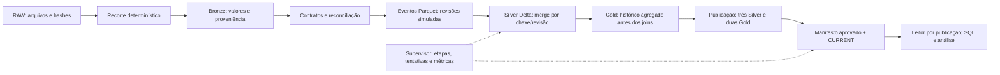

# Arquitetura da entrega local

O produto é uma ABT por caso de crédito e indicadores mensais retrospectivos.
O laboratório demonstra ingestão verificável, incremento por revisão e consumo
de conjuntos aprovados. Não oferece decisão de crédito, previsão ou serviço de produção.

RAW e Bronze permanecem em filesystem. F03–F07 têm referências Delta no filesystem;
F08 espelha entradas aprovadas na API S3 e executa Delta por S3A no SeaweedFS.
Os registries F08 e operacional F09 são distintos. O relatório analítico histórico
F07 continua ligado aos seus manifestos filesystem; não se torna consumidor S3
pela existência do espelho.

| Componente | Papel e implementação |
|---|---|
| Aquisição/recorte | Arquivos permitidos e hashes; `src/pipelines/download_home_credit.py`, `build_sample.py` |
| Bronze | Preservar valores e metadados; gate e reconciliação antes do consumo |
| Silver | Cast de datas sem perda; grãos caso/estática e caso+grupo histórico |
| Eventos | Identidade, revisão e hash do payload; conflitos bloqueiam o pacote |
| Delta | ACID por tabela; histórico de commits; MERGE idempotente |
| Publicação | Protocolo da aplicação reúne versões de cinco tabelas; não é transação Delta multitabular |
| Gold | Uma linha por caso; agregado 1:N antes do join; mensal por mês de negócio |
| Supervisor | Retry limitado a falhas transitórias reconhecidas; erros de contrato não recebem retry |
| Consumidor | Valida manifesto/inventário, lê versões explícitas e preserva a publicação anterior |

O S3 é local, com endpoint loopback, credenciais geradas e um host/driver cooperante.
O controle local de escritor não é um lock distribuído. Não há alegação de
compatibilidade para múltiplos hosts, alta disponibilidade ou SLA.

A Gold soma valores não nulos na ordem determinística do grupo. Sem montantes,
a soma e a média continuam nulas; sem histórico, as contagens são zero. O
indicador target=1 usa rótulos válidos no denominador. Não foi comprovada a
disponibilidade temporal dos atributos no momento da decisão: a análise é
retrospectiva e não define atributos elegíveis para treino.

A demonstração F11 começa com Silver tipada inventada para concentrar a apresentação
na publicação. O e2e F10 cobre RAW inventada → amostra → Bronze → eventos → S3/Gold.
São provas complementares, com escopo declarado, sem acesso obrigatório ao Kaggle.
