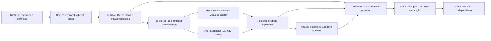
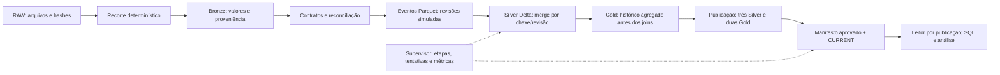

# Arquitetura da entrega local

O produto é uma ABT por caso de crédito e indicadores mensais retrospectivos.
O laboratório demonstra ingestão verificável, incremento por revisão e consumo
de conjuntos aprovados. Não oferece decisão de crédito, previsão ou serviço de produção.

## Expansão vigente — E00–E08

A expansão usa todas as 17 tabelas de treino, seleciona todos os casos de
janeiro–setembro/2020 e preserva os históricos relacionados. As publicações têm
escopo próprio e não substituem silenciosamente os manifests do MVP.

| Responsabilidade | Implementação da expansão |
|---|---|
| Catálogo e recorte | `configs/home_credit_expansion_catalog.yaml`, `temporal_policy_v1.yaml`, `src/bronze/expansion.py` |
| Contratos e qualidade | `configs/contracts/expansion_silver_v1.yaml`, `src/expansion/quality.py`, `silver.py` |
| Revisões | `src/expansion/revisions.py`: pai imutável, MERGE privado, casos/períodos afetados |
| Atributos | `src/expansion/features.py`: índice zero, agregação hierárquica ponderada, SQL independente |
| Tempo e Gold | `temporal.py`, `gold.py`: auditoria de disponibilidade, ABTs disjuntas e labels separadas |
| Análise | `analysis.py`: nove meses, denominadores, cobertura, ausências e comparações descritivas |
| Publicação | `publication.py`: bytes Delta idênticos, UUID/versão/schema/contagem e closure |
| Recuperação | `delivery.py`: falhas privadas e após ativação, retry, leitura histórica e rollback |

As tabelas físicas publicadas são 17 Silver, 16 blocos Gold, quatro tabelas de
features/labels e cinco analíticas. O prefixo é `lakehouse-expansion-v1`;
CURRENT está nos dados originais. A correção simulada fica no histórico e os
dois ponteiros do MVP tiveram os mesmos hashes antes e depois da entrega.

A aprovação é da aplicação, não uma transação Delta entre tabelas. A cópia S3
mantém os arquivos/logs originais e verifica SHA-256; não executa casts novos ou
recalcula silenciosamente features durante a publicação. Retenção: snapshots
pinados, sem VACUUM real. Leitura e escrita foram validadas em um host e driver
cooperante, sem garantia de disponibilidade ou concorrência distribuída.

A Gold é retrospectiva. O contrato mantém `ml_ready=false` e lista vazia de
preditores aprovados point in time. Data do evento e data de aquisição não
comprovam disponibilidade histórica. Maturação do target e identidade global
de cliente entre períodos continuam não demonstradas. O leitor padrão não
retorna labels individuais da avaliação; isso é uma guarda de API, não uma ACL.

Ver [contratos](../contratos/EXPANSAO_SILVER_E_ABT.md),
[análise](../analise/PUBLICO_EXPANSAO.md) e
[publicação executada](../evidencias/E07_PUBLICACAO_EXPANSAO.md).

## MVP preservado — F00–F11

O desenho e as garantias abaixo registram o escopo inicial de três fontes.

RAW e Bronze permanecem em filesystem. F03–F07 têm referências Delta no filesystem;
F08 espelha entradas aprovadas na API S3 e executa Delta por S3A no SeaweedFS.
Os registries F08 e operacional F09 são distintos. O relatório analítico histórico
F07 continua ligado aos seus manifestos filesystem; não se torna consumidor S3
pela existência do espelho.

| Componente | Papel e implementação |
|---|---|
| Aquisição/recorte | Arquivos permitidos e hashes; `src/pipelines/download_home_credit.py`, `build_sample.py` |
| Bronze | Preservar valores e metadados; gate e reconciliação antes do consumo |
| Silver | Cast de datas sem perda; grãos caso/estática e caso+grupo histórico |
| Eventos | Identidade, revisão e hash do payload; conflitos bloqueiam o pacote |
| Delta | ACID por tabela; histórico de commits; MERGE idempotente |
| Publicação | Protocolo da aplicação reúne versões de cinco tabelas; não é transação Delta multitabular |
| Gold | Uma linha por caso; agregado 1:N antes do join; mensal por mês de negócio |
| Supervisor | Retry limitado a falhas transitórias reconhecidas; erros de contrato não recebem retry |
| Consumidor | Valida manifesto/inventário, lê versões explícitas e preserva a publicação anterior |

O S3 é local, com endpoint loopback, credenciais geradas e um host/driver cooperante.
O controle local de escritor não é um lock distribuído. Não há alegação de
compatibilidade para múltiplos hosts, alta disponibilidade ou SLA.

A Gold soma valores não nulos na ordem determinística do grupo. Sem montantes,
a soma e a média continuam nulas; sem histórico, as contagens são zero. O
indicador target=1 usa rótulos válidos no denominador. Não foi comprovada a
disponibilidade temporal dos atributos no momento da decisão: a análise é
retrospectiva e não define atributos elegíveis para treino.

A demonstração F11 começa com Silver tipada inventada para concentrar a apresentação
na publicação. O e2e F10 cobre RAW inventada → amostra → Bronze → eventos → S3/Gold.
São provas complementares, com escopo declarado, sem acesso obrigatório ao Kaggle.
