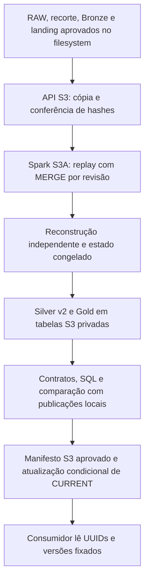

# F08 — decisão de armazenamento de objetos local

Pesquisa e decisão em 13/11/2026. O destino escolhido é **SeaweedFS 4.53**,
binário Linux amd64 fixado por SHA-256. O serviço executa no próprio laboratório,
sem Docker, conta AWS ou upload dos dados para um serviço externo.

## Alternativas examinadas

| Opção | Condições e operação | Adequação ao projeto | Decisão |
|---|---|---|---|
| SeaweedFS comunitário | Apache 2.0; release 4.53 de 08/11/2026; binário nativo e modo mini com S3 | Permite ensaiar S3A/Delta no host atual; componentes e portas podem ser fixados | Escolhido e submetido aos testes reais deste projeto |
| Garage | AGPLv3; binário autocontido; foco em armazenamento replicado entre locais | Alternativa leve, mas sua combinação com o runtime Delta deste projeto não foi ensaiada; distribuição geográfica não é requisito local | Mantido como alternativa, sem alegar incompatibilidade |
| MinIO comunitário | AGPLv3; repositório oficial arquivado em 25/04/2026 e declarado sem manutenção; AIStor segue outra oferta | Não iniciar dependência nova no repositório comunitário sem manutenção | Não escolhido |

Fontes primárias: [release SeaweedFS 4.53](https://github.com/seaweedfs/seaweedfs/releases/tag/4.53),
[licença SeaweedFS](https://github.com/seaweedfs/seaweedfs/blob/4.53/LICENSE),
[modo mini](https://github.com/seaweedfs/seaweedfs/wiki/Quick-Start-with-weed-mini),
[Garage — objetivos](https://garagehq.deuxfleurs.fr/documentation/design/goals/),
[Garage — licença no mirror oficial](https://github.com/deuxfleurs-org/garage),
[estado do MinIO comunitário](https://github.com/minio/minio).

Essa é uma decisão para o laboratório e runtime atuais. Não há benchmark entre
esses produtos nem afirmação de superioridade geral. O projeto mantém sua
licença MIT; binários e bibliotecas preservam as próprias licenças e ficam no
runtime local, fora do Git.

## Runtime e limite de escrita

Spark permanece 3.5.7, Delta 3.3.2, Java 17 e Python 3.11.14. O Hadoop que
acompanha esse Spark é 3.3.4; usamos `hadoop-aws:3.3.4` e o AWS SDK Java
`1.12.262` correspondente. O cliente Python S3 tem lock separado em
[requirements.objects.lock](../../requirements.objects.lock).

O [Hadoop exige versões correspondentes do conector e runtime](https://hadoop.apache.org/docs/r3.3.6/hadoop-aws/tools/hadoop-aws/index.html);
a [release 3.3.4 registra seu SDK](https://hadoop.apache.org/docs/r3.4.1/hadoop-project-dist/hadoop-common/release/3.3.4/RELEASENOTES.3.3.4.html).
Os principais JARs de integração são identificados por SHA no relatório F08.

O LogStore é `io.delta.storage.S3SingleDriverLogStore`, selecionado apenas para
o esquema `s3a`. O contrato admite **um host cooperante e um driver Spark de
escrita**. O [limite de single-driver documentado pelo Delta](https://docs.delta.io/delta-storage/)
é parte da configuração; não implementamos coordenação distribuída ou DynamoDB.

O controle de execução conserva um lock local em `.runtime/object-store/control`.
Esse arquivo coordena processos do mesmo host. Não é um lock no bucket e não
torna seguros escritores que o ignorem ou venham de outros hosts. As tabelas,
manifestos e ponteiros usam a API S3 e URIs; não recebem `Path`, rename ou flock.

## Posição das camadas

| Camada/artefato | Filesystem preservado | Destino em objetos |
|---|---|---|
| RAW original | Origem adquirida, imutável e identificada por seis hashes | Cópia íntegra no namespace de entradas; não ampliar a leitura para toda a competição |
| Recorte e Bronze | Aceites, valores e proveniência anteriores conservados | Parquets/manifestos espelhados por API S3, lidos por Spark e reconciliados |
| Landing F04 | Lotes simulados aprovados e código de origem preservados | Cópia tipada de eventos usada como entrada do replay S3A |
| Estado incremental | Estado F04 anterior permanece intacto | Novas tabelas Delta S3A começam vazias, recebem MERGEs e são congeladas após reconciliação |
| Silver publicada | F03 e publicações F05 continuam disponíveis | Cópias gerenciadas v2 produzidas no S3, com migração e validação |
| Gold | Publicações F06 permanecem como comparador | ABT e indicadores produzidos em Delta S3A, com casos afetados e SQL mensal |
| Publicação | Ponteiros e aceites locais antigos não mudam | Registro S3 próprio com três Silver e duas Gold, manifestos e CURRENT |
| Relatório F07 | Relatórios existentes e seus gráficos preservados | O consumo analítico pode usar DataFrames de uma publicação S3; F09 consolidará o encadeamento operacional |

Os caminhos físicos originais registrados na proveniência continuam descrevendo
a origem. Espelhar uma entrada não reescreve esses campos como se a aquisição
original tivesse ocorrido no S3. O manifesto do mirror registra o novo endereço
físico e o hash de cada arquivo.

## Publicação e histórico

O namespace de cada publicação é próprio. Intentos e metadados de commit
permitem reconhecer gravações concluídas depois de uma interrupção. Mudanças
incompatíveis, qualidade reprovada ou indisponibilidade impedem o avanço de
CURRENT. Um prefixo desconhecido é preservado; resíduos privados sem commit
só podem ser limpos quando vinculados ao próprio intento.

O manifesto imutável é enviado antes do ponteiro. `If-None-Match` protege
objetos novos; a atualização do ponteiro usa o ETag anterior em `If-Match`.
ETag é precondição de escrita, enquanto SHA-256 é a prova de integridade.
As precondições foram exercitadas com o servidor selecionado; isso não é uma
prova de concorrência distribuída ou equivalência completa com AWS S3.

As publicações e entradas ficam fixadas sem prazo de descarte; as tabelas
recebem retenção Delta de 30 dias. Não executar VACUUM nos dados reais.
Recuperar uma publicação troca o ponteiro depois de verificar seus arquivos,
sem regravar as tabelas. Time travel usa `versionAsOf`; não inferir a ordem
dos commits apenas pela resolução dos timestamps do serviço.

Operação, testes e resultados são registrados com o aceite de F08. A camada
local anterior é o comparador preservado, não um destino de overwrite.
