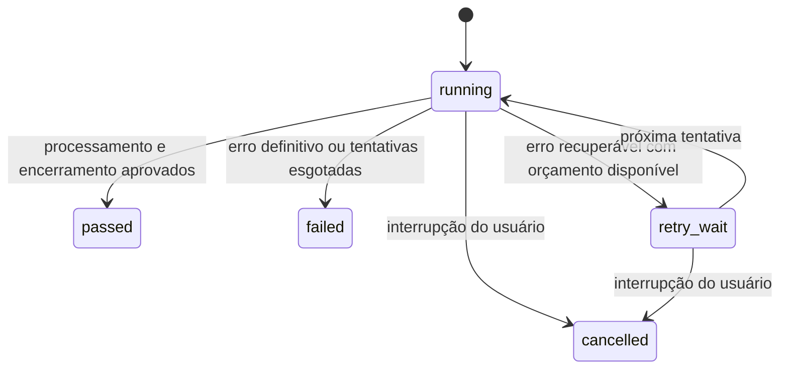

# F09.2 — estados, erros e retomada

Use o supervisor para executar a interface operacional:

```bash
bash scripts/objects.sh -m src.pipelines.operate_lakehouse \
  --sample 7d58bbdaa00cbabfbce54d26 \
  --source-report artifacts/f04/runs/20261113T020347Z_1609747b.json \
  --mode update --batch b00_w000_051 \
  --max-attempts 2 --retry-delay 2
```

Os [modos e limites](COMANDO_UNICO.md) permanecem. O CLI direto
`run_lakehouse` continua disponível; o supervisor é a entrada recomendada para
classificação de falhas e retry. Não há agendador ou serviço de monitoramento.

## Operação e tentativas

`operation_id` identifica a solicitação lógica; cada tentativa tem outro run_id.
Relatório principal: `artifacts/f09/operations/<operation_id>.json`. Relatórios
do processamento: `artifacts/f09/runs/<run_id>.json`. Se a configuração do
contexto falhar antes de criar um run_id, a tentativa tem run_id nulo e é
identificada pelo operation_id e número da tentativa. As tentativas e suas etapas
contêm horários UTC. A identidade de rebuild usa operation_id, por isso um
retry não começa outra reconstrução. Uma nova invocação rebuild é outra operação.



As etapas registradas incluem configuração do contexto, configuração/status/start
do serviço, inicialização Spark, entradas, espelho, incremento, reconciliação e
publicação. O relatório é atualizado atomicamente a cada transição. Falhas de
encerramento ficam em cleanup_errors. As gravações dependem de o diretório de
artefatos permanecer gravável; encerramento forçado do processo pode deixar um
relatório running, que não constitui aceite.

## Códigos de saída

| Código | Significado |
|---:|---|
| 0 | Sucesso, incluindo encerramento necessário |
| 1 | Falha inesperada ou encerramento reprovado sem erro anterior |
| 2 | Uso inválido do CLI; argparse encerra antes de criar a operação |
| 3 | Entrada/configuração inválida, qualidade reprovada reconhecida ou acesso S3 rejeitado |
| 4 | Conflito de escritor local |
| 5 | Falha temporária sem retomada concluída |
| 130 | Interrupção do usuário |

Não inferir rollback pelo código de saída. Uma falha após ativação, inclusive
no encerramento, pode deixar uma publicação nova já aprovada. Consultar CURRENT
e os manifestos; retry usa os mecanismos idempotentes dos componentes.

## Política de retry

Padrão: até duas tentativas, com espera de dois segundos. Limites: uma a três
tentativas e espera de zero a 30 segundos. A espera é fixa e limitada. Cada
tentativa encerra seu Spark antes da próxima; serviço que já estava ativo é
preservado. Serviço iniciado pela operação é parado. Falha no cleanup bloqueia
novo retry, para evitar iniciar outro escritor com encerramento incerto.

São recuperáveis: erros de conexão/timeout reconhecidos pelo botocore, respostas
HTTP 408/429/500/502/503/504 do cliente S3, timeout de inicialização do serviço e
causas Java de conexão/rede explicitamente reconhecidas. A classificação Java
usa classes reais das causas, sem procurar palavras na mensagem. Outros erros
Java são tratados como definitivos até diagnóstico.

Schema/contrato ou entrada inválidos, arquivo ausente, acesso negado, conflito
de escritor e erros desconhecidos não são repetidos automaticamente. Reprovações SilverContractError/GoldQualityError recebem quality_rejected, sem
retry, e o run preserva o relatório detalhado em quality_failure. As tentativas
referenciam run_report por path e SHA-256 quando o executor produziu esse arquivo.
A falha
original é preservada mesmo quando o encerramento também falha. Cancelamento
encerra sem retry. Não há loop infinito, descarte de dados ou reset de CURRENT.

O supervisor não garante recuperação de qualquer falha física: o componente
pode rejeitar estado inconsistente para preservar arquivos. O escopo continua
sendo um host/driver cooperante. Consolidação de métricas, lineage e resumo
operacional segue em F09.3–F09.5; matriz completa de falhas, em F09.6.
