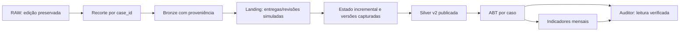

# F09.4 — lineage, inventário e identificadores

O inventário responde: quais entradas, lotes, versões e regras produziram uma
publicação? Ele audita uma operação aprovada explicitamente, sem escolher a
versão mais recente ou alterar CURRENT.

```bash
bash scripts/objects.sh -m src.pipelines.inspect_lineage \
  --operation-report artifacts/f09/operations/20261113T173937Z_821632d2.json
```

É necessário preparar o runtime de objetos e preservar os relatórios locais e
o backend S3. O CLI inicia o serviço se necessário, cria uma sessão Spark de
leitura e conserva um serviço que já estava ativo. As tabelas e publicações
anteriores são preservadas. O JSON final aponta o inventário em
`artifacts/f09/inventory/<inventory_id>/<audit_run_id>.json`.

## O que é conferido

A auditoria confere os vínculos entre operação, tentativa aprovada, run,
publicação, coorte, modo, limite de lote, versões e implementação. O leitor
Delta verifica hashes dos arquivos, UUIDs, schemas, versões e contagens das
cinco tabelas. Blobs de código/configuração e referências S3 são conferidos por
SHA-256. O contexto de leitura confere os arquivos novamente ao sair.

O espelho imutável é verificado byte a byte por hash, incluindo as entradas e
os relatórios que aprovaram seu uso. Seus registros ligam RAW, seleção,
Bronze e landing. Cada lote auditado precisa constar no relatório F04 e nos
recibos referenciados pelo manifesto da publicação, com o mesmo packet_sha256.
Lotes omitidos/duplicados são recusados. A auditoria não reconstrói a transformação
nem repete todos os contratos na RAW; essa aprovação vem dos relatórios fixados.

O relatório contém cinco tabelas publicadas e 15 nós de origem/trabalho:
três RAW, três recortes, três Bronze, três entradas de landing e três estados
incrementais. Os arquivos originais e seus endereços espelhados ficam juntos.
O catálogo de arquivos também inclui metadados auxiliares, como definições de campos.



RAW e Bronze podem representar o recorte completo; uma operação limitada ao
primeiro lote publica somente a população já entregue. A F04 aprovada tem seus
próprios estados finais; eles não são as versões do novo estado operacional.

## Dicionário de identificadores

| Campo | Significado e limite |
|---|---|
| operation_id | Solicitação lógica do supervisor; reúne tentativas de uma invocação |
| run_id | Execução de um produtor/etapa; qualificar seu papel ao cruzar artefatos |
| identity.run_id | Run operacional aprovado que está sendo auditado; pode reutilizar publicação anterior |
| status_run_id | Execução pontual do resumo F09.5; não é uma carga nem muda a última operação |
| audit_run_id | Execução desta auditoria; não é run de carga ou operação |
| publication_creation_attempts[].run_id | Tentativas aprovadas de criação observadas nos logs locais; podem estar ausentes se os logs não forem preservados |
| first_run_id | Primeira criação da seleção, registrada em seu manifesto |
| verified_by_run_id | Execução que verificou o gate Bronze; não substitui o primeiro run de ingestão de cada fragmento |
| selection_id | Identidade de 24 hexadecimais da coorte e de sua configuração/origem |
| mirror_id | Identidade do conjunto de entradas espelhadas; copia endereços físicos sem reescrever proveniência original |
| stream_id | Sequência de entregas/revisões simuladas F04, vinculada à seleção e ao contrato |
| batch_id | Pacote dessa sequência; não é a data de decisão nem um número de versão Delta |
| packet_sha256 | Integridade do pacote; vincula manifesto de entrega, relatório e recibo |
| _event_id | Identidade do evento de uma chave/revisão de origem |
| _delivery_id | Identidade da entrega; permite representar reenvio do mesmo evento |
| _source_revision | Precedência da revisão por chave; não é versão Delta |
| state_prefix | Namespace do estado operacional mutável; mudanças posteriores não invalidam a cópia publicada |
| source_versions | Versões do estado de trabalho capturadas na publicação auditada |
| original_versions_after | Versões registradas quando o lote foi aplicado originalmente |
| observed_versions_after | Versões vistas ao reaplicar esse lote na execução auditada; podem já incluir outros lotes |
| publication_id | Identidade do conjunto aprovado Silver + Gold e de suas referências |
| delta_table_id | UUID de uma tabela física Delta; reconstruções têm outros UUIDs |
| version | Número de commit daquela tabela, fixado no manifesto; não precisa coincidir entre tabelas |
| inventory_id | Identidade dos relatórios/fonte e da implementação do auditor; auditorias repetidas preservam o ID, variando audit_run_id |

O manifesto S3 não possui o mesmo campo de criação do manifesto filesystem.
`publication_creation_attempts` é uma observação dos logs locais, com caminho
e hash de conteúdo; não é um campo assinado dentro do manifesto S3. A ausência
desses logs deixa essa lista vazia, sem inventar um produtor. O run de replay
continua sendo outro run, mesmo quando lê a mesma publicação e os mesmos UUIDs.

## Lineage de colunas

`column_lineage` cobre as 19 colunas da ABT e as 11 dos indicadores. Cada saída
lista as fontes e uma transformação: projeção, presença de join, contagem,
soma ordenada, média, agregação mensal ou constante. case_id é a chave de join;
a observação histórica tem grão case_id + num_group1. História é agregada antes
do join, preservando uma linha ABT por caso.

O mapa é explícito e revisado, vinculado ao SHA-256 da implementação Gold
suportada. Não é um parser automático de SQL. Um modelo não reconhecido bloqueia
a auditoria até revisar o mapa. A constante de versão não recebe fonte fictícia.
Datas/atributos continuam retrospectivos, sem prova point-in-time.

## Consumidores e limites

O relatório registra as dependências Gold/ABT e ABT/indicadores e esta auditoria
como leitor verificado das cinco tabelas. Não é um log global de acessos ou
descoberta de todos os consumidores. O relatório F07 existente continua vinculado
às publicações F06 do filesystem; não é apresentado como consumidor do S3.

A auditoria histórica não exige que o estado de trabalho continue no mesmo
commit: confere as cópias imutáveis da publicação e os recibos preservados.
Não atualiza manifestos, dados ou ponteiros. Falha de vínculo ou de integridade
impede gerar inventário aprovado. Os consumidores reais devem continuar usando
o protocolo de leitura por manifesto. F09.5 consolidará o resumo operacional.
